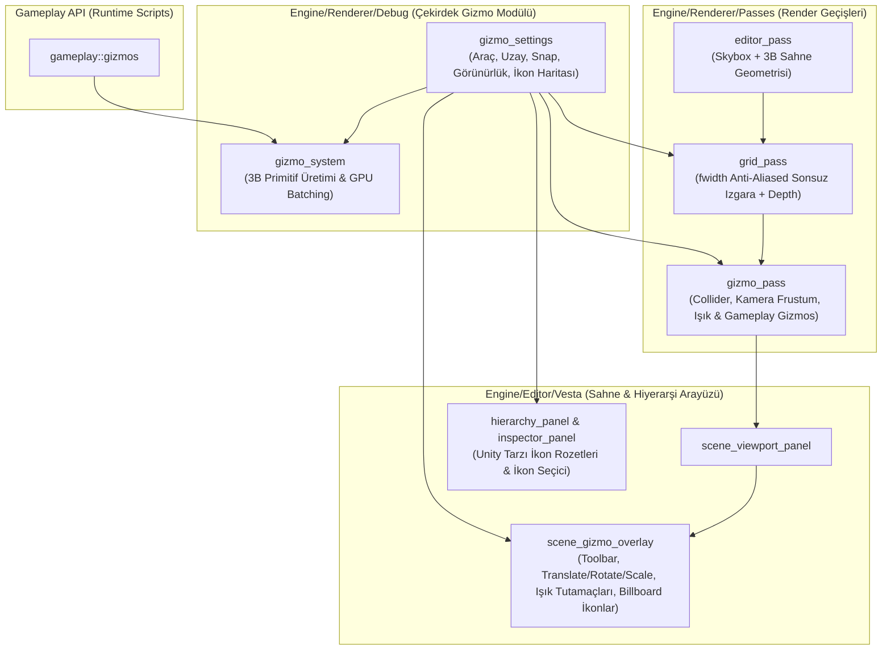

# Modüler Gizmo Sistemi, Anti-Aliased Sonsuz Izgara ve Sahne Manipülasyon Araçları Raporu

## 1. Genel Bakış ve Mimari Hedefler
Bu güncelleme kapsamında motorda daha önce dağınık halde bulunan (`editor_pass.cpp` içindeki sabit collider çizimleri ve eski `grid.frag` shader'ı) görsel yardımcı yapılar tamamen yeniden tasarlanarak **modern yazılım mühendisliği prensiplerine (Single Responsibility, Open/Closed, Modülerlik ve MVVM uyumu)** uygun, kapsamlı bir **Gizmo ve Sahne Araçları Modülü** haline getirilmiştir.

### Temel Kazanımlar
1. **Merkezi ve Modüler Gizmo Mimarisi (`gizmo_settings`, `gizmo_system`, `gizmo_pass`):**
   - Tüm gizmo durumları ve kullanıcı tercihleri `gizmo_settings` yapısında merkezileştirilmiştir.
   - `editor_pass.cpp` içerisindeki gömülü Collider çizim kodları temizlenerek bağımsız `gizmo_pass` render geçişine taşınmıştır.
   - `gizmo_system` zengin 3B geometrik primitiflerle (`DrawLine`, `DrawRay`, `DrawArrow`, `DrawWireCube`, `DrawWireSphere`, `DrawWireCircle`, `DrawWireArc`, `DrawWireCone`, `DrawCameraFrustum`, `DrawDirectionalLightGizmo`) genişletilmiştir.
2. **Unity / Unreal Kalitesinde Anti-Aliased Sonsuz Izgara (`grid.frag` & `grid_pass.cpp`):**
   - Ekran uzayı kısmi türevleri (`fwidth`) kullanılarak her mesafede ve bakış açısında **1-piksel keskinliğinde pürüzsüz (anti-aliased)** ızgara çizgileri elde edilmiştir.
   - Kamera yüksekliğine duyarlı **3 kademeli dinamik LOD (Level of Detail)** geçişi ve ufuk çizgisi sönümlemesi (Horizon & Grazing Angle Fade) eklenmiştir.
   - Dünya **X Ekseni (Kırmızı)** ve **Z Ekseni (Mavi)** referans çizgileri eklenmiştir.
   - `viewProj` matrisi shader'a aktarılarak `gl_FragDepth` değeri `[0, 1]` aralığında doğru hesaplanmış ve `GL_DEPTH_TEST` (`GL_LEQUAL`) açılarak 3B nesnelerin ızgarayı derinlik tamponunda kusursuz kesmesi sağlanmıştır.
3. **Sahne Görünümü (Scene Viewport) Etkileşimli Dönüşüm Araçları (Translate / Rotate / Scale):**
   - **Konum Taşıma (`W` - Translate):** X, Y, Z eksen okları, XY / XZ / YZ çift eksenli düzlem kutucukları ve merkez serbest taşıma tutamacı.
   - **Döndürme (`E` - Rotate):** Ön/arka yarımküre derinlik ayrımlı 3B X, Y, Z dönüş halkaları ve teğetsel açısal delta hesaplaması (`Rx * Ry * Rz` Euler ayrıştırması ile tam uyumlu).
   - **Ölçeklendirme (`R` - Scale):** X, Y, Z eksen kolları ve merkezde **Uniform Scale** (tüm eksenleri orantılı büyütme/küçültme) küpü.
   - **Local / World Uzay Geçişi (`X`)** ve **Adımlı Kenetlenme (`Snap` / `Ctrl`)** desteği.
4. **Kamera Sınır Çizgileri (Frustum) ve Etkileşimli Işık Menzil/Koni Gizmoları:**
   - **Kamera Frustum:** Seçili (veya tüm) kameralar için `fov`, `nearPlane`, `farPlane` ve oyun ekranı en/boy oranına (`aspect`) göre 3B görüş piramidi ve üst yön (Up) şapkası çizimi.
   - **Işık Gizmoları & Unity Tarzı Sürüklenebilir Tutamaçlar:**
     - **Point Light:** 3 eksenli küresel menzil çemberleri + sahne üzerinden fareyle sürüklenerek `range` değerini canlı değiştiren 6 adet sarı tutamaç noktası.
     - **Spot Light:** İç (`inner_cone`) ve dış (`outer_cone`) koni çizgileri + sahne üzerinden sürüklenerek hem `range` hem de `outer_cone` / `inner_cone` açılarını canlı değiştiren 9 adet etkileşimli tutamaç noktası.
     - **Directional Light:** Güneş diski ve yönlü paralel ışık okları.
5. **Görünmez Nesneler İçin Billboard İkonlar ve Hiyerarşi İkon Sistemi:**
   - Kameralar ve ışıklar için sahne içinde otomatik 2B/3B vektörel **Billboard İkonlar** (Kamera, Güneş, Ampul, Projektör) çizilir; sahne içindeki ikona tıklanarak nesne doğrudan seçilebilir.
   - Hiyerarşi ve Inspector panellerinden her varlığa Unity tarzı özel ikon veya renkli etiket (`Spawn Point`, `Trigger Zone`, `Audio Source`, `Waypoint`, `Label: Blue/Green/Yellow/Orange/Red/Purple`) atanabilir.
6. **Gameplay API Gizmo Desteği (`gameplay::gizmos`):**
   - Oyun betiklerinin (Scripts) çalışma zamanında `gameplay::gizmos::draw_line`, `draw_ray`, `draw_arrow`, `draw_wire_cube`, `draw_wire_sphere`, `draw_wire_circle`, `draw_wire_cone` çağrılarıyla hem Scene hem de Game ekranında hata ayıklama şekilleri çizebilmesi sağlanmıştır.

---

## 2. Mimari Diyagram



---

## 3. Değiştirilen ve Eklenen Dosyalar

| Dosya Yolu | Açıklama |
| :--- | :--- |
| `Engine/Renderer/Debug/gizmo_settings.h` | **(Yeni)** Tüm dönüşüm araçları, ızgara, ikon boyutu, bileşen görünürlük modları ve varlık ikon atamalarını tutan merkezi yapı. |
| `Engine/Renderer/Debug/gizmo_system.h` & `.cpp` | **(Güncellendi)** Koni, çember, yay, ok, kamera frustum, yönlü ışık ve ayrık Gameplay gizmo tamponu eklendi. |
| `Engine/Renderer/Passes/gizmo_pass.h` & `.cpp` | **(Yeni)** Collider, Kamera Frustum, Işık (Point/Spot/Directional) ve Gameplay gizmolarını modüler olarak çizen render geçişi. |
| `Engine/Renderer/Passes/editor_pass.cpp` | **(Güncellendi)** İçerisindeki sabit collider çizim kodları temizlenerek `gizmo_pass`'e devredildi. |
| `Engine/Renderer/Passes/grid_pass.cpp` | **(Güncellendi)** `viewProj`, `u_GridOpacity`, `u_ShowAxes` uniform'ları ve `GL_DEPTH_TEST` (`GL_LEQUAL`) desteği eklendi. |
| `Application/Shaders/Debug/grid.frag` | **(Güncellendi)** `fwidth` türev tabanlı anti-aliasing, 3 kademeli LOD, X/Z eksen renkleri ve `[0, 1]` derinlik yazımı eklendi. |
| `Engine/Editor/Vesta/Panels/scene_gizmo_overlay.h` & `.cpp` | **(Yeni)** Etkileşimli Translate/Rotate/Scale araçları, sürüklenebilir Point/Spot ışık tutamaçları, Billboard ikonlar ve üst Gizmos araç çubuğu. |
| `Engine/Editor/Vesta/Panels/scene_viewport_panel.h` & `.cpp` | **(Güncellendi)** `scene_gizmo_overlay` entegrasyonu ve dinamik FBO doku senkronizasyonu. |
| `Engine/Editor/Vesta/Panels/hierarchy_panel.h` & `.cpp` | **(Güncellendi)** Hiyerarşi ağaç düğümlerinde ikon rozetleri, sağ tık `"Set Icon (Gizmo)"` menüsü ve hızlı Kamera/Işık (`+ Preset`) oluşturucu. |
| `Engine/Editor/Vesta/Panels/inspector_panel.h` & `.cpp` | **(Güncellendi)** Seçili varlık için Inspector üst çubuğuna `"Icon (Gizmo)"` seçici eklendi. |
| `Engine/Gameplay/gameplay_gizmos.h` & `.cpp` | **(Yeni)** Kullanıcı scriptleri için çalışma zamanı `gameplay::gizmos` hata ayıklama çizim API'si. |

---

## 4. Kullanım Kılavuzu

### 4.1. Sahne Görünümü (Scene Viewport) Kısayolları ve Araç Çubuğu
- **`Q` (Select):** Sadece seçim modu (dönüşüm oklarını gizler).
- **`W` (Move / Translate):** Seçili nesneyi X, Y, Z eksenlerinde veya XY, XZ, YZ düzlemlerinde taşır.
- **`E` (Rotate):** Seçili nesneyi X, Y, Z eksen halkaları etrafında döndürür.
- **`R` (Scale):** Seçili nesneyi eksenel veya merkez küpten orantılı (uniform) ölçeklendirir.
- **`X` (Space Toggle):** Dönüşüm eksenlerini **Local** ve **World** uzayı arasında değiştirir.
- **`G` (Grid Toggle):** Sonsuz referans ızgarasını açar/kapatır.
- **`Ctrl` Basılı Tutma (veya `Snap` Butonu):** Taşıma, döndürme ve ölçeklendirme işlemlerini belirlenen adımlara (`Move Snap`, `Rotate Snap`, `Scale Snap`) kenetler.

### 4.2. Işık Menzil ve Koni Sınırlarını Sahne Üzerinden Değiştirme
1. Sahnedeki bir **Point Light** veya **Spot Light** nesnesini seçin (veya Hierarchy'den `+ Preset -> Point Light / Spot Light` ile oluşturun).
2. Işığın çevresinde beliren **sarı kare tutamaçları** (Spot ışıkta iç koni için **mavi tutamaçları**) farenin sol tuşuyla tutup sürükleyin:
   - **Point Light:** 6 yöndeki tutamaçtan herhangi birini sürükleyerek `range` yarıçapını büyütüp küçültebilirsiniz.
   - **Spot Light:** Koni ucundaki merkez tutamacı sürükleyerek `range` mesafesini, dış çemberdeki 4 sarı tutamacı sürükleyerek `outer_cone` açısını, iç çemberdeki 4 mavi tutamacı sürükleyerek `inner_cone` açısını canlı olarak ayarlayabilirsiniz.

### 4.3. Gameplay API Üzerinden Çizim Örneği
```cpp
#include "Gameplay/gameplay.h"

class MyDebugScript : public gameplay::script
{
public:
    void on_update(float dt) override
    {
        glm::vec3 pos = transform().get_position();
        glm::vec3 fwd = transform().get_forward();

        // İleri yönde 5 metrelik ok çiz
        gameplay::gizmos::draw_arrow(pos, pos + fwd * 5.0f, 0.3f, glm::vec4(0.2f, 0.9f, 1.0f, 1.0f));

        // Karakterin etrafında 3 metre yarıçaplı algılama çemberi çiz
        gameplay::gizmos::draw_wire_circle(pos, glm::vec3(0.0f, 1.0f, 0.0f), 3.0f, glm::vec4(1.0f, 0.8f, 0.2f, 1.0f));
    }
};
```

---

## 5. Çoklu Seçim, Gelişmiş Editör Araçları ve Sis (Fog) Güncellemesi

### 5.1 Çoklu Seçim ve Ortak Özellik Düzenleme (Multi-Selection Inspector)
- **Toplu İkon ve Bileşen Yönetimi:** Birden fazla nesne seçildiğinde Inspector üzerinde `Icon (Set for All)` ile tüm nesnelere tek seferde Unity tarzı sahne/hiyerarşi ikonu atanabilir; `Add Component to All` ile seçili tüm nesnelere toplu bileşen eklenebilir.
- **Transform Çoklu Düzenleme:** Seçili nesnelerin dünya ve yerel pozisyon, rotasyon ve ölçek ortalamaları hesaplanır. Kullanıcı delta bazlı olarak konum, açı veya ölçek değiştirdiğinde tüm nesneler göreceli mesafelerini koruyarak birlikte manipüle edilir. Tek tıkla `Set All Scales to 1.0` ve `Align Positions to First` hizalama araçları sunulmuştur.
- **Bileşen Bazlı Toplu Düzenleme:**
  - **Light:** Seçili tüm ışıkların rengi (`ColorEdit3`), yoğunluğu (`Intensity`), menzili (`Range`), türü (`Point`, `Spot`, `Directional`), koni açıları ve gölge dökme durumu senkronize düzenlenir.
  - **Collider:** Kutu/küre boyutları (`Extents`) ve türü seçili tüm varlıklar için eşzamanlı ayarlanır.
  - **Rigidbody:** Hareket modu (`Static`, `Kinematic`, `Dynamic`), kütle, sürtünme ve esneklik katsayıları toplu olarak güncellenir.
- **Seçili Nesneler Özeti:** Açılır/kapanır `Selected Entities List` başlığı altında seçilen nesnelerin adları ve ID'leri listelenir.

### 5.2 Çoklu Seçim Ortalanmış Gizmo ve Eşzamanlı Manipülasyon (Scene Viewport)
- **Ağırlık Merkezi (Center of Selection):** Sahne görünümünde birden fazla nesne seçildiğinde, Transform Gizmosu (W: Move, E: Rotate, R: Scale) seçili tüm nesnelerin dünya koordinatlarındaki ağırlık merkezine (`centerWorld = sum(pos) / N`) yerleştirilir.
- **Eşzamanlı Taşıma (Translate):** Merkez eksen veya düzlem sürüklenirken, hesaplanan dünya delta vektörü tüm varlıkların ebeveyn hiyerarşi matrisleri tersiyle çarpılarak her nesnenin yerel pozisyonuna uygulanır. Nesneler aralarındaki mesafeyi korur.
- **Ağırlık Merkezi Etrafında Döndürme (Orbit Rotation):** Nesneler yalnızca kendi eksenleri etrafında dönmekle kalmaz; seçim merkezine göre oluşturdukları yarıçap vektörleri de seçilen eksen etrafında döndürülerek gerçek bir grup rotasyonu gerçekleştirilir.
- **Ağırlık Merkezine Göre Ölçekleme (Group Scale):** Merkez Uniform Scale veya eksen bazlı ölçekleme yapıldığında nesnelerin hem boyutları hem de merkezden olan radyal uzaklıkları oranlanır.

### 5.3 İngilizce Araç İpuçları (English Tooltips & Hints)
- Araç çubuğundaki tüm butonlar, kısayol açıklamaları ve durum ipuçları temiz İngilizceye dönüştürülmüştür:
  - `Select Tool (Shortcut: Q)`
  - `Move Tool (Shortcut: W)`
  - `Rotate Tool (Shortcut: E)`
  - `Scale Tool (Shortcut: R)`
  - `Toggle Coordinate Space: Local / World (Shortcut: X)`
  - `Toggle Snapping. Hold Ctrl while dragging for temporary snap.`
  - `Toggle Infinite Reference Grid (Shortcut: G)`
  - `Toggle 3D Billboard Icons`
  - `Toggle Scene View Fog (Currently: Enabled/Disabled)`

### 5.4 Varsayılan Docking: Hierarchy Altına Kilitli Asset Browser
- `ui_manager::setupDockLayout` güncellenerek sağ docking alanı dikey olarak ikiye bölünmüştür:
  - **Üst Kısım (%55):** `Hierarchy` paneli.
  - **Alt Kısım (%45):** `Asset Browser` paneli.
- Editör ilk açıldığında veya yerleşim sıfırlandığında Asset Browser penceresi doğrudan Hiyerarşinin altına kilitli (docked) olarak başlar.

### 5.5 Üst Bar "Window" Menüsü ve Açık Pencere Koruması
- Ana menü çubuğuna `Window` sekmesi eklenmiştir:
  - `Window -> General`: `Scene`, `Game`, `Hierarchy`, `Inspector`, `Asset Browser`.
  - `Window -> Rendering`: `Lighting`.
- **Yeniden Açılma Koruması:** Kullanıcının kuralına uygun olarak (`"Zaten açık iseler açamamak gerek ama onu unutma"`), bir pencere zaten açıksa menü öğesi işaretli (checked) ve devre dışı (disabled) bırakılır; kullanıcı üzerine tıklayarak gereksiz tekrarlı pencere açamaz. Kapalı olan pencereler ise tıklanarak hemen açılabilir.

### 5.6 Lighting & Fog Paneli ve Sahne Sis Açma/Kapama
- **Lighting Penceresi (`lighting_panel`):**
  - Üstel sis ayarları (`Fog Enabled`, `Show in Scene View`, `ColorEdit3`, `Density` kaydırıcısı).
  - Hızlı önayarlar (`Clear / No Fog`, `Subtle Mist`, `Moody Blue Fog`, `Dense Swamp`).
  - Sahnedeki ışık kaynaklarının anlık istatistik ve özet paneli.
- **Sahne İçi Sis Anahtarı:**
  - Viewport araç çubuğuna ve `Gizmos v` menüsüne `[Fog]` hızlı anahtar butonu eklenmiştir.
  - Editör kamerasının sahne çiziminde sis istenirse devre dışı bırakılabilir; oyun görünümünde (Game View) ise `ctx.fog.enabled` ana kuralı geçerli kalır. Shaders (`default_shader.frag` ve `skinned_default.frag`) ile tam entegre çalışır.


