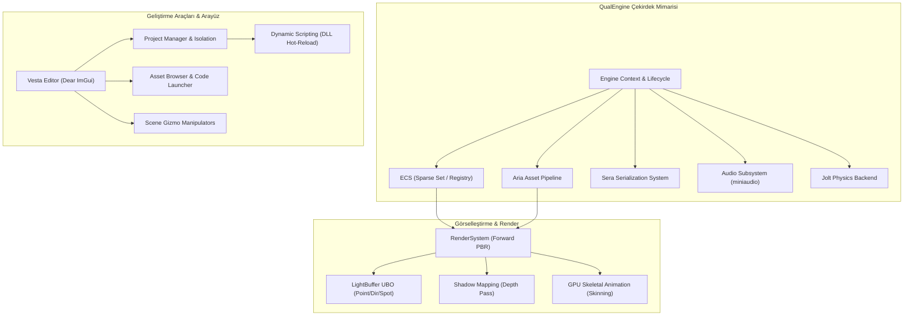
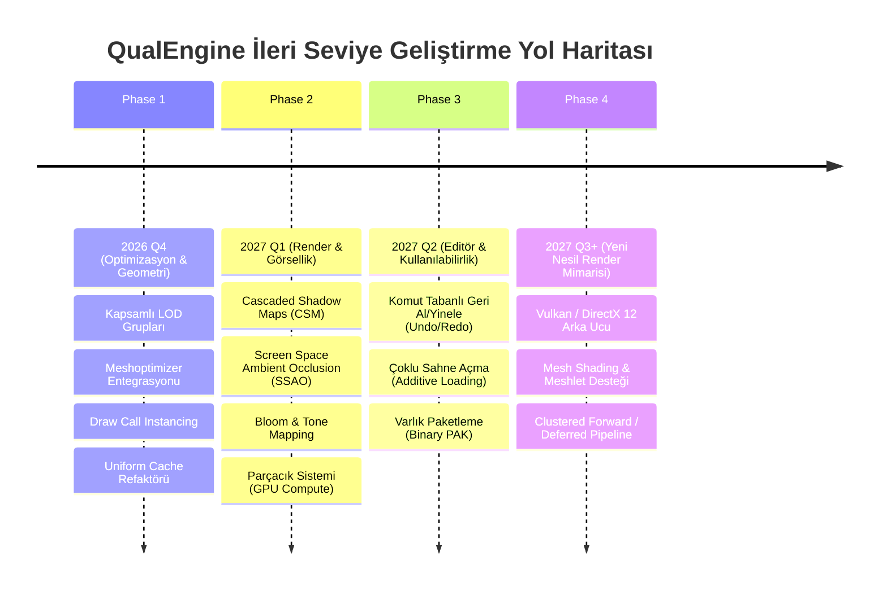

# QualEngine (v0.8.5) — Kapsamlı Motor Durum Raporu ve Özellik Envanteri

**Rapor Tarihi:** 22 Ekim 2026  
**Doküman Kodu:** `QE-REP-2026-01`  
**Durum:** Resmi İlerleme Dokümantasyonu  
**Hedef Kitle:** Motor Mimarları, Baş Sistem Mühendisleri, Teknik Liderler  

---

## 1. Yönetici Özeti ve Vizyon

**QualEngine**, C++17/20 standartları ve modern OpenGL mimarisi üzerine inşa edilmiş, veri odaklı (Data-Oriented), modüler ve yüksek performanslı bir 3D oyun motoru ve editör ekosistemidir. 

Başlangıçta bir grafik programlama laboratuvarı (`OpenGL-Learn-1`) olarak hayata geçen proje; geçirdiği mimari refaktör süreçleri, katmanlı alt sistem tasarımı, dinamik C++ hot-reload desteği ve entegre içerik geliştirme arayüzü sayesinde **"öğrenme amaçlı hobi motoru" sınıfını aşarak bağımsız (Indie) ve orta ölçekli (AA) oyun geliştirme potansiyeline sahip bir üretim motoru platformuna dönüşmüştür**.

Bu rapor; motorun bugüne kadar ulaştığı olgunluk düzeyini, barındırdığı 10 temel alt sistemin teknik kabiliyetlerini, mimari veri akışını ve geleceğe yönelik geliştirme yol haritasını eksiksiz olarak sunmaktadır.

---

## 2. Mimari Seviye ve Olgunluk Değerlendirmesi

Oyun motoru geliştirme spektrumunda QualEngine'in mevcut konumu aşağıdaki matriste tanımlanmıştır:

```
[Seviye 1: Grafik Laboratuvarı]  -->  [Seviye 2: Hobi / Toy Engine]  -->  [Seviye 3: Modüler Çekirdek Motor]  -->  [Seviye 4: Üretim Seviyesi Motor (MEVCUT)]  -->  [Seviye 5: Ticari Ekosistem]
- Tek main.cpp                       - Basit küp çizimi                   - ECS entegrasyonu                  - İzole Proje/Editör Ayrımı                - Unreal / Unity ölçeği
- Hardcoded shader                   - Sıkı bağımlılıklar                 - Varlık yöneticisi (ilkel)         - Dinamik C++ Hot-Reload                   - Çoklu API (Vulkan/DX12)
- Sıfır mimari                       - Sabit kamera & ışık                - Temel serileştirme                - Fiziksel PBR & Işık UBO                  - Global Illumination
                                                                                                               - Miniaudio Entegre 3D Ses
                                                                                                               - Standalone Export Boru Hattı
```

### Motorun Öne Çıkan Karakteristiği:
1. **Zero-Copy Single Live World:** Editör ve oyun dünyası gereksiz kopyalamalar yapmaz. Editör durdurulduğunda sahne SERA anlık görüntüsünden (Snapshot) geri yüklenir; bellek ayak izi minimumda tutulur.
2. **Generational Handle Tabanlı Güvenlik:** İşaretçiler (raw pointers) yerine 32-bit indeks ve nesil sayacından oluşan `aria::handle<T>` yapısı kullanılarak "Dangling Pointer" ve "Use-After-Free" hataları sıfırlanmıştır.
3. **Modüler Alt Sistem İzolasyonu:** Editör (`Vesta`), Varlık Boru Hattı (`Aria`), Serileştirme (`Sera`), Ses (`Audio`), Fizik (`Jolt`) ve Render sistemleri birbirine zayıf referanslarla (Weakly Coupled) bağlıdır.
4. **Kod Değişikliklerinde Sıfır Yeniden Başlatma:** C++ oyun mantığı `GameModule.dll` içerisine dinamik olarak derlenip motor çalışırken hot-reload ile saniyeler içinde belleğe takılıp çıkarılabilir.

---

## 3. Alt Sistemler ve Geliştirilmiş Özellikler Envanteri



### 3.1. Varlık ve Kaynak Boru Hattı — ARIA (Asset Runtime & Import Architecture)
* **Kapsam:** Motorun tüm doku, model, iskelet, animasyon, ses ve malzeme kaynaklarını yükleyen, GPU'ya aktaran ve GUID üzerinden yöneten çekirdek varlık yöneticisi.
* **Mevcut Özellikler:**
  - **Nesil Sayaçlı Güvenli Handle:** `handle<model_asset>`, `handle<texture_asset>`, `handle<audio_clip>` gibi tür güvenli tutamaçlar.
  - **Manifest Tabanlı İndeksleme:** `asset_manifest.json` üzerinden GUID -> Sanal Yol -> Disk Yolu eşleştirmesi.
  - **Model Yükleme:** Assimp arka ucu ile statik ve iskeletli mesh'lerin içe aktarımı, teğet/binormal hesaplama.
  - **Doku Yükleme:** stb_image entegrasyonu, 2D dokular, Cubemap/Skybox desteği, sRGB/Linear renk uzayı yönetimi.
  - **Dahili Kaynak Yönetimi:** Motorun kendi shader ve temel geometrilerini (`Cube`, `Sphere`, `Plane`) proje bağımsız olarak barındırması.

### 3.2. Sahne Serileştirme ve Arşivleme — SERA (Serialization & Engine Resource Archiver)
* **Kapsam:** Sahne hiyerarşisinin, ECS bileşenlerinin ve malzeme konfigürasyonlarının JSON formatında disk üzerinde kalıcı hale getirilmesi.
* **Mevcut Özellikler:**
  - **Tekil Varlık Kimlik Doğrulaması:** Her sahne nesnesi için benzersiz 64-bit Entity UUID ve Parent-Child ilişkisi.
  - **Bileşen Yansıma Sistemi (Reflection):** Transform, Mesh, Skinned Mesh, Material, Camera, Light, Rigidbody, Audio Source, Audio Listener bileşenlerinin otomatik serileştirilmesi.
  - **Sahne Snapshot Mekanizması:** Play Moduna geçildiğinde anlık bellek durumunu yedekleme; Stop dendiğinde dünyayı milisaniyeler içinde sıfır kayıpla eski haline getirme.

### 3.3. Editör Ekosistemi — VESTA
* **Kapsam:** Geliştiricinin sahneyi görselleştirdiği, varlıkları yönettiği, oyun nesnelerini manipüle ettiği entegre masaüstü geliştirme ortamı.
* **Mevcut Özellikler:**
  - **Görünüm Pencereleri (Viewports):** Bağımsız Scene Viewport (Editör kamerası, serbest uçuş, odaklanma) ve Game Viewport (Oyun kamerası bakış açısı).
  - **Gelişmiş Eksen Manipülatörü (Scene Gizmo):** Translate, Rotate ve Scale modları; Dünya/Yerel uzay geçişi; Grid Snapping (adım bazlı yapışma); görsel eksen vurgulama.
  - **Hiyerarşi Paneli:** Sürükle-bırak (Drag & Drop) ebeveynlik atama, varlık arama/filtreleme, oluşturma/silme/kopyalama.
  - **Denetçi (Inspector):** Seçili nesnenin bileşenlerini düzenleme, materyal parametrelerini renk paletleri ve kaydırıcılarla canlı değiştirme, ses önizleme (Audio Preview) butonları.
  - **Gelişmiş Varlık Tarayıcısı (Asset Browser):** Klasör hiyerarşisi, dosya filtreleme, sağ tık menüsü (Create Folder, Create Material, Create Script), ses ve model dosyası simgeleri.
  - **Harici Kod Editörü Entegrasyonu (IDE Launcher):** C++ script dosyalarına çift tıklandığında otomatik VS Code tespiti veya Engine Settings üzerinden belirlenen özel editörün (Visual Studio, Rider, Sublime) ilgili dosya satırında açılması.

### 3.4. Ses Alt Sistemi — Audio Engine (miniaudio)
* **Kapsam:** Motorun 2D arayüz ve 3D uzamsal ses işleme omurgası.
* **Mevcut Özellikler:**
  - **Genişletilebilir Soyutlama Katmanı:** `IAudioBackend` arayüzü sayesinde miniaudio dışında FMOD, Wwise veya OpenAL'a kolayca geçiş imkanı.
  - **Donanım Çalma Motoru:** `miniaudio` kütüphanesi ile düşük gecikmeli (low latency) ses çalma, ses seviyesi (volume), perde (pitch) ve döngü (looping) yönetimi.
  - **3D Uzamsal Ses (Spatial Audio):** Ses kaynağı ile dinleyici arasındaki 3B mesafe ve yönelim hesaplaması, `attenuation_min_distance` ve `attenuation_max_distance` ile gerçekçi ses düşümü.
  - **ECS Entegrasyonu:** `audio_source_component` ve `audio_listener_component` bileşenleri.
  - **Editör İçi Ses Testi:** Oyunu başlatmadan (Play modu dışında) Inspector üzerinden sesleri dinleyebilme.
  - **Görsel Editör Gizmoları:** Ses kaynağı için sahne üzerinde billboard simgesi ve küresel etki alanı (Audio Range Sphere) çizimi.
  - **C++ Gameplay API Desteği:** `gameplay::audio::play_sound_2d`, `play_sound_at_position`, `set_master_volume` gibi script çağrıları.

### 3.5. Görselleştirme ve Render Sistemi
* **Kapsam:** OpenGL 3.3 Core Profile üzerinde çalışan forward render boru hattı.
* **Mevcut Özellikler:**
  - **Fiziksel Tabanlı Aydınlatma (PBR - Cook-Torrance BRDF):** Albedo, Normal Haritası, Metallic, Roughness, Ambient Occlusion (AO) ve Emissive harita desteği.
  - **Birleşik Işık UBO'su (LightBuffer):** 5136 baytlık blok bellek ile 16 adet Noktasal Işık (Point Light), 4 adet Yönlü Işık (Directional Light) ve 8 adet Spot Işığın tek GPU çağrısıyla shader'lara beslenmesi.
  - **Gölge Haritalama (Shadow Mapping):** Yönlü ışık için 2048x2048 çözünürlüklü derinlik FBO'su ve gölge sivilcelerini (shadow acne) önleyen bias algoritmaları.
  - **Hacimsel Görsel Efektler:** Sahne ve Oyun görünümünde bağımsız açılıp kapatılabilen atmosferik sis (Fog System).
  - **Shader Gruplaması (Batching):** Nesnelerin GPU shader ID'sine göre gruplanarak çizilmesiyle OpenGL durum geçişlerinin (State Changes) azaltılması.
  - **Görüş Alanı Kırpması (Frustum Culling):** Küresel sınır (Bounding Sphere) tabanlı kaba culling ile kamera açısı dışındaki alt meşlerin çizimden elenmesi.

### 3.6. GPU İskelet Animasyon Sistemi (Skeletal Animation)
* **Kapsam:** Karakterlerin eklemlerine (kemiklerine) bağlı olarak vertex deformasyonunun GPU üzerinde gerçek zamanlı gerçekleştirilmesi.
* **Mevcut Özellikler:**
  - **Kemik Hiyerarşisi Çözümleyicisi:** Assimp kemik ağacının motor içi düz dizi formatına dönüştürülmesi.
  - **Animasyon Harmanlama (Crossfade & Blending):** Bir animasyondan diğerine geçerken yumuşak ara geçiş (Slerp/Lerp interpolasyonu).
  - **GPU Matris Paleti:** 100 kemiğe kadar destek veren GPU skinning vertex shader'ı (`skinned_default.vert`).
  - **ECS İskelet Bileşenleri:** `skinned_mesh_component`, `skeleton_component`, `animation_component`.

### 3.7. Fizik Sistemi (Jolt Physics)
* **Kapsam:** Gerçek zamanlı rijit cisim dinamikleri, çarpışma testleri ve yerçekimi simülasyonu.
* **Mevcut Özellikler:**
  - **Modern Fizik Arka Ucu:** Endüstri standardı Jolt Physics entegrasyonu.
  - **Çarpıştırıcı Tipleri:** Kutu (Box), Küre (Sphere), Kapsül (Capsule) collider desteği.
  - **Rijit Cisim Tipleri:** Statik (çevre nesneleri), Dinamik (kuvvet uygulanan cisimler), Kinematik (kod ile hareket ettirilen cisimler).
  - **Fizik-ECS Çift Yönlü Senkronizasyonu:** Oyun döngüsünde Transform bileşeni ile Jolt Body Transform'unun otomatik eşitlenmesi.

### 3.8. Dinamik C++ Scripting ve Proje İzolasyonu
* **Kapsam:** Oyun mantığının motordan tamamen izole edilmesi ve derleme sürelerini düşüren dinamik DLL mimarisi.
* **Mevcut Özellikler:**
  - **Ayrık `GameModule.dll`:** Proje mantığı motorun ana `.exe` dosyasından ayrı bir DLL olarak derlenir.
  - **Çalışma Zamanı Hot-Reload:** Editör çalışırken C++ kodu Visual Studio veya VS Code'da düzenlenip derlendiğinde, motor mevcut DLL'i bellekten düşürür (FreeLibrary) ve yeni DLL'i dinamik olarak yükler (`LoadLibraryW`).
  - **Nesne Yaşam Döngüsü:** `OnCreate`, `OnUpdate(float dt)`, `OnDestroy` fonksiyon kancaları.
  - **Kapsamlı Gameplay API:** `Transform`, `Rigidbody`, `Input`, `Audio`, `Scene` yönetim fonksiyonlarına script içerisinden güvenli erişim.

### 3.9. Bağımsız Dışa Aktarma ve Dağıtım (Export & Standalone Build)
* **Kapsam:** Geliştirilen projenin editörden arındırılarak bağımsız çalışabilir bir oyun paketine dönüştürülmesi.
* **Mevcut Özellikler:**
  - **GameRuntime Uygulaması:** Vesta editörünü barındırmayan, yalnızca oyun döngüsünü, ARIA, SERA, Render ve Audio sistemlerini çalıştıran saf C++ oyun yürütücüsü.
  - **Varlık Paketleme:** Sahne dosyaları, asset manifest ve binary modellerin `Builds/` klasörüne otomatik kopyalanması.

---

## 4. Alt Sistem Olgunluk Matrisi

| Alt Sistem | Olgunluk Düzeyi (1-10) | Endüstri Standardı Karşılığı | Güçlü Yönler | Eksik / Geliştirilecek Yönler |
| :--- | :---: | :--- | :--- | :--- |
| **ECS & Bellek Modeli** | **8.5 / 10** | EnTT benzeri Sparse Set | Nesil sayaçlı handle, sıfır kopyalama | SIMD paralel iterasyon eksikliği |
| **Aria Varlık Sistemi** | **8.0 / 10** | Godot Resource / Unreal Package | GUID manifest, tür güvenli handle | Asenkron stream & sıkıştırılmış format yok |
| **Sera Serileştirme** | **8.5 / 10** | JSON tabanlı Unity YAML | Snapshot desteği, geriye dönük uyumluluk | Binary serileştirme desteği yok |
| **Vesta Editör** | **8.0 / 10** | Özel Dear ImGui Studio | Çift Viewport, Gizmo, IDE açıcı | Panel docking kalıcılığı, Undo/Redo eksik |
| **Audio Sistemi** | **8.0 / 10** | Unity Audio / Godot AudioServer | 3D mesafe sönümlemesi, backend soyutlama | Ses filtreleri (Reverb/Lowpass), Akış (Streaming) |
| **Render Boru Hattı** | **6.5 / 10** | Forward OpenGL Renderer | PBR Cook-Torrance, Light UBO, Gölgeler | **Sıfır LOD**, Instancing yok, glGetUniformLocation yükü |
| **GPU İskelet Animasyon** | **7.5 / 10** | Unity Legacy/Mecanim temel | Crossfade, GPU skinning shader | Animasyon durum makinesi (State Machine) eksik |
| **Jolt Fizik** | **8.0 / 10** | AAA Modern Physics | Yüksek kararlılık, modern CPU optimizasyonu | Karakter kontrolcüsü (Character Controller) ilkel |
| **C++ Scripting** | **8.5 / 10** | CryEngine / Unreal Hot-Reload | Dinamik DLL takas, sıfır motor restart | Hot-reload esnasında üye değişken state transferi |
| **Export Boru Hattı** | **7.5 / 10** | Standalone Launcher | Tamamen bağımsız GameRuntime | Tek dosyaya paketleme (PAK formatı) yok |

---

## 5. Gelecek Yol Haritası (Future Roadmap)



---

> [!NOTE]
> Bu doküman QualEngine v0.8.5 temel alınarak hazırlanmıştır. Alt sistemlerde yapılan her köklü mimari değişiklikte sürüm numarası ve olgunluk matrisi güncellenecektir.

