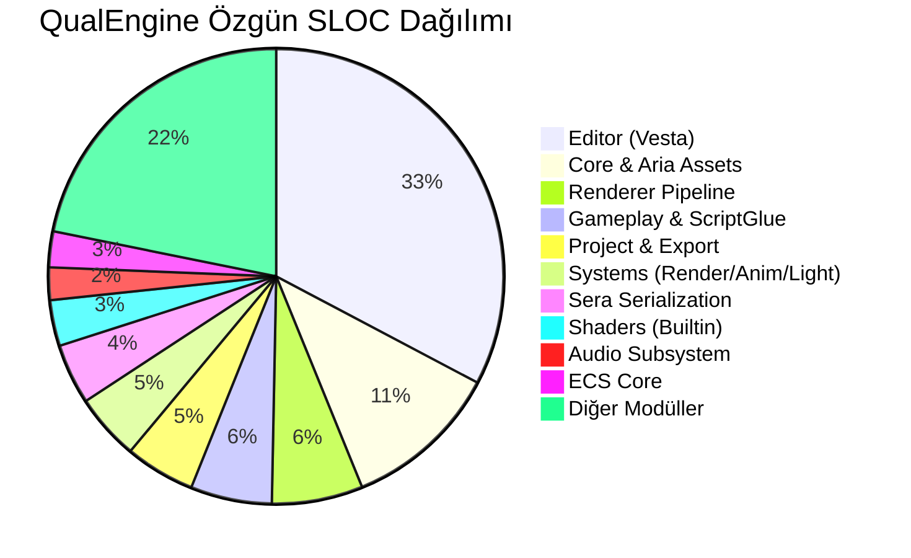

# QualEngine — Kapsamlı Kod Tabanı Metrikleri ve Satır Sayısı (LOC) Analiz Raporu

**Rapor Tarihi:** 22 Ekim 2026  
**Doküman Kodu:** `QE-REP-2026-02`  
**Kapsam:** Derinlemesine Statik Kod Analizi, LOC / SLOC Metrikleri, Modüler Yoğunluk, Harici Kütüphane Dökümü ve En Büyük 50 Dosya İncelemesi  
**Analiz Edilen Dizinler:** `Engine/`, `Application/`, `GameRuntime/`, `QualEngine/`  

---

## 1. Yönetici Özeti (Executive Summary)

Bu rapor; **QualEngine (v0.8.5)** kod tabanının fiziksel satır sayısı (LOC - Lines of Code), mantıksal saf kod satırı (SLOC - Source Lines of Code), yorum satırı, boşluk dağılımı, dosya uzantıları ve modüler yoğunluk haritasını en ince ayrıntısına kadar belgelemektedir.

Yapılan detaylı statik ölçümler neticesinde:
* QualEngine'in geliştiriciler tarafından yazılmış **425 adet özgün kaynak dosyasında toplam 46.371 satır kod** barındırdığı,
* Bu hacmin **31.463 satırının saf C++/GLSL kodundan (SLOC)**, **7.275 satırının dokümantasyon ve yorumdan**, **7.633 satırının ise okunabilirlik boşluklarından** oluştuğu,
* Üçüncü parti harici kütüphaneler (`Externals`) dahil edildiğinde **depodaki toplam dosya sayısının 1.507'ye, toplam satır sayısının ise 562.484'e ulaştığı** tespit edilmiştir.

16 Ekim 2026 tarihinde hazırlanan ilk değerlendirme raporundaki 28.479 satırlık hacimle kıyaslandığında; **projenin sadece 6 gün içerisinde özgün satır sayısını %62.8 (17.892 satır), saf kod satırını ise %73.3 (13.314 SLOC) artırdığı** görülmektedir.

---

## 2. Makro Kod Tabanı Hacim Matrisi

| Metrik Türü | Özgün Motor Kodları (QualEngine + Application) | Harici Kütüphaneler (Engine/Externals) | Tüm Depo Toplamı |
| :--- | :---: | :---: | :---: |
| **Toplam Dosya Sayısı** | **425** | 1.082 | **1.507** |
| **Toplam Satır (Total Lines)** | **46.371** | 516.113 | **562.484** |
| **Saf Kod Satırı (SLOC)** | **31.463** *(%67.85)* | 359.167 *(%69.59)* | **390.630** *(%69.45)* |
| **Yorum Satırı (Comments)** | **7.275** *(%15.69)* | 83.288 *(%16.14)* | **90.563** *(%16.10)* |
| **Boşluk Satırı (Blank Lines)** | **7.633** *(%16.46)* | 73.658 *(%14.27)* | **81.291** *(%14.45)* |

```
Özgün Kod Tabanı Karakteristiği:
[===================== SLOC: 31.463 Satır (%67.85) =====================][=== Yorum: 7.275 (%15.69) ===][=== Boşluk: 7.633 (%16.46) ===]
```

### Kod Yoğunluğu ve Bakım Yapılabilirlik Göstergeleri:
* **Ortalama Dosya Boyutu (Mean LOC):** $46.371 / 425 = \mathbf{109.1}$ **satır/dosya**.
* **Medyan Dosya Boyutu (Median LOC):** **64 satır/dosya**.
* **Yorum / Kod Oranı (Comment Ratio):** **%15.69** (C++ kurumsal standartları olan %15 - %20 bandının tam ortasındadır).
* **Başlık / Gerçekleme Oranı (Header-to-Source Ratio):** 233 Başlık / 138 C++ Kaynak = **1.68x**. Bu oran, motorun soyut arayüzler ve şablon tabanlı (template/header-only) modern C++ mimarisi üzerine kurgulandığını göstermektedir.

---

## 3. Tarihsel Büyüme ve Değişim Analizi (16 Ekim 2026 vs 22 Ekim 2026)

| Metrik | 16 Ekim 2026 | 22 Ekim 2026 | Net Artış | Yüzdesel Büyüme |
| :--- | :---: | :---: | :---: | :---: |
| **Özgün Dosya Sayısı** | 261 | **425** | +164 dosya | **+%62.8** |
| **Özgün Toplam Satır** | 28.479 | **46.371** | +17.892 satır | **+%62.8** |
| **Saf Kod Satırı (SLOC)** | 18.149 | **31.463** | +13.314 satır | **+%73.3** |
| **Yorum Satırı** | 5.646 | **7.275** | +1.629 satır | **+%28.8** |
| **Boşluk Satırı** | 4.684 | **7.633** | +2.949 satır | **+%62.9** |
| **Harici Bağımlılık Hacmi** | 210.608 | **516.113** | +305.505 satır | **+%145.1** *(Jolt & miniaudio)* |
| **Tüm Depo Toplam Satır** | 239.087 | **562.484** | +323.397 satır | **+%135.2** |

---

## 4. Programlama Dili ve Dosya Formatına Göre Dağılım

QualEngine kod tabanında kullanılan dosya uzantılarının detaylı analizi:

| Uzantı | Açıklama | Dosya | Toplam Satır | Saf Kod (SLOC) | Yorum Satırı | Boşluk Satırı | Satır Payı |
| :--- | :--- | :---: | :---: | :---: | :---: | :---: | :---: |
| `.cpp` | C++ Kaynak Dosyaları (Implementation) | 138 | 26.423 | 20.219 | 2.019 | 4.185 | **%56.98** |
| `.h` | C++ Başlık Dosyaları (Headers & Interfaces) | 233 | 17.215 | 9.356 | 5.037 | 2.822 | **%37.12** |
| `.frag` | GLSL Fragment (Piksel) Gölgelendiricileri | 21 | 1.617 | 1.108 | 160 | 349 | **%3.49** |
| `.glsl` | Ortak GLSL Kütüphaneleri & Işık Fonksiyonları | 12 | 591 | 381 | 57 | 153 | **%1.27** |
| `.vert` | GLSL Vertex (Tepe Noktası) Gölgelendiricileri | 21 | 525 | 399 | 2 | 124 | **%1.13** |
| **TOPLAM** | | **425** | **46.371** | **31.463** | **7.275** | **7.633** | **%100.0** |

```
Uzantı Bazlı Kod Hacmi (Satır):
- C++ Kaynak (.cpp)      : [==================================================] 26.423 (%57.0)
- C++ Başlık (.h)        : [=================================] 17.215 (%37.1)
- Fragment Shader (.frag): [===] 1.617 (%3.5)
- Ortak GLSL (.glsl)     : [=] 591 (%1.3)
- Vertex Shader (.vert)  : [=] 525 (%1.1)
```

---

## 5. Harici Bağımlılıklar (Externals) Kütüphane Bazlı Dökümü

QualEngine'in kullandığı 3. parti harici kütüphanelerin fiziksel boyutları:

| Harici Kütüphane | Klasör / Dosya | Dosya | Toplam Satır | Saf Kod (SLOC) | Yorum Satırı | Boşluk | Rol ve Görev |
| :--- | :--- | :---: | :---: | :---: | :---: | :---: | :--- |
| **Jolt Physics** | `Engine/Externals/Jolt/` | 1.036 | 211.632 | 138.434 | 36.470 | 36.728 | 3D Rijit Cisim Dinamiği & Çarpışma |
| **Dear ImGui** | `Engine/Externals/imgui/` | 30 | 134.522 | 96.196 | 24.514 | 13.812 | Vesta Editör GUI Çerçevesi |
| **miniaudio** | `Engine/Externals/miniaudio.h` | 1 | 95.864 | 71.854 | 10.169 | 13.841 | Düşük Gecikmeli Ses Arka Ucu |
| **nlohmann/json** | `Engine/Externals/nlohmann/` | 2 | 52.170 | 36.768 | 8.730 | 6.672 | SERA JSON Serileştirme Motoru |
| **stb libraries** | `Engine/Externals/stb/` | 4 | 15.980 | 11.662 | 2.548 | 1.770 | Doku Okuma (`stb_image`) & Yazma |
| **NativeFileDialog** | `Engine/Externals/nfd/` | 8 | 4.978 | 3.512 | 788 | 678 | İşletim Sistemi Dosya Seçim Diyalogları |
| **uuid** | `Engine/Externals/uuid/` | 1 | 967 | 741 | 69 | 157 | Varlık ve Sahne GUID Üretimi |
| **TOPLAM** | | **1.082** | **516.113** | **359.167** | **83.288** | **73.658** | |

---

## 6. Modüler Kod Yoğunluğu ve Alt Sistem LOC Analizi

QualEngine'in özgün mimari katmanlarının satır ve SLOC yoğunlukları:



### 6.1. Modül Detay Tablosu
| Modül / Katman | Dosya | Toplam Satır | Saf Kod (SLOC) | Yorum Satırı | Boşluk | Mimari Rol ve Sorumluluk |
| :--- | :---: | :---: | :---: | :---: | :---: | :--- |
| **Engine/Editor** (Vesta) | 85 | 14.355 | 9.972 | 1.967 | 2.416 | Editör pencereleri, Gizmo manipülatörü, Inspector, Asset Browser |
| **Engine/Engine** (Core & Aria) | 28 | 5.383 | 3.383 | 1.008 | 992 | Varlık boru hattı, Asset Registry, GPU Resource Cache, Engine Context |
| **Engine/Renderer** | 36 | 3.158 | 1.970 | 657 | 531 | Render geçişleri (Passes), FBO'lar, Debug Gizmo System, Materyaller |
| **Engine/Gameplay** | 26 | 2.930 | 1.762 | 571 | 597 | C++ Gameplay API, ScriptGlue, Rigidbody wrapper, Ses API |
| **Engine/Systems** | 14 | 2.062 | 1.433 | 293 | 336 | RenderSystem, AnimationSystem, Işık UBO yönetimi, Physics Bridge |
| **Engine/Project** | 8 | 1.989 | 1.516 | 215 | 258 | Proje ayarları, dinamik DLL hot-reload, bağımsız export boru hattı |
| **Engine/Sera** | 9 | 1.832 | 1.307 | 256 | 269 | Sahne ve varlık JSON serileştirmesi, Snapshot bellek yöneticisi |
| **Engine/Resources** (Shaders) | 20 | 1.430 | 993 | 179 | 258 | Dahili PBR Cook-Torrance ve GPU iskelet animasyon GLSL kodları |
| **QualEngine/Editor** (Root) | 17 | 1.153 | 830 | 147 | 176 | Kök dizindeki yardımcı editör panel ve bileşen kodları |
| **Engine/Scene** | 9 | 1.109 | 721 | 204 | 184 | Sahne oturumu, hiyerarşi, sahne serileştirme ara katmanı |
| **Engine/ECS** | 7 | 1.108 | 775 | 137 | 196 | Registry, Sparse Set havuzları, temel ECS bileşen tanımları |
| **Engine/Audio** (Miniaudio) | 6 | 1.090 | 704 | 215 | 171 | 3D uzamsal ses arka ucu, IAudioBackend soyutlaması, ses bileşenleri |
| **QualEngine/Renderer & Systems** | 36 | 1.712 | 1.289 | 158 | 265 | Eski kök altındaki render ve sistem yardımcı kodları |
| **Application/Shaders** | 16 | 836 | 599 | 48 | 189 | Uygulama düzeyindeki GLSL shader'ları |
| **Engine/Importers** | 8 | 656 | 420 | 127 | 109 | Assimp model ve doku içe aktarıcıları |
| **Engine/Input** | 8 | 336 | 199 | 84 | 53 | Tuş bağlamaları, fare girdisi ve aksiyon haritası |
| **Engine/Async** | 2 | 326 | 209 | 71 | 46 | Görev kuyruğu ve iş parçacığı havuzu temelleri |
| **Engine/Runtime** | 4 | 307 | 191 | 48 | 68 | Standalone oyun yürütücüsü yaşam döngüsü |
| **Application (Core & Scripts)** | 10 | 486 | 299 | 105 | 82 | `Application.cpp`, demo sandbox ve kamera kontrol scriptleri |
| **GameRuntime** | 1 | 14 | 7 | 3 | 4 | Bağımsız oyun binary'si giriş noktası (`main.cpp`) |
| **Diğer (Utils & Stubs)** | 80 | 2.199 | 1.548 | 392 | 259 | Yardımcı matematik ve temel yapılar |
| **TOPLAM** | **425** | **46.371** | **31.463** | **7.275** | **7.633** | |

---

## 7. En Büyük 50 Kaynak Dosya (Comprehensive Hotspot Top 50)

Motor kod tabanındaki en yoğun mantığa sahip ilk 50 kaynak dosyanın tam dökümü:

| Sıra | Satır | SLOC | Yorum | Yorum % | Dosya Yolu | Temel Sorumluluk & Modül |
| :---: | :---: | :---: | :---: | :---: | :--- | :--- |
| **1** | **2.560** | 2.066 | 176 | %6.9 | `Engine/Editor/Vesta/Panels/scene_gizmo_overlay.cpp` | Eksen manipülasyonu, Raycast, Snapping, Gizmo çizimi |
| **2** | **1.097** | 897 | 60 | %5.5 | `Engine/Sera/sera_session.cpp` | Sahne JSON serileştirme ve snapshot ayrıştırıcı |
| **3** | **1.046** | 887 | 43 | %4.1 | `Engine/Editor/Vesta/vesta.cpp` | Editör orkestrasyonu, menü çubuğu ve docking düzeni |
| **4** | **749** | 564 | 64 | %8.5 | `Engine/Engine/Assets/asset_loader.cpp` | Model/Doku/Materyal diskten ikili ayrıştırma |
| **5** | **708** | 526 | 44 | %6.2 | `Engine/Engine/Assets/asset_registry.cpp` | GUID - Handle dönüşüm haritası ve yaşam döngüsü |
| **6** | **701** | 596 | 26 | %3.7 | `Engine/Project/project_module.cpp` | Dinamik C++ `GameModule.dll` derleme & hot-reload |
| **7** | **677** | 580 | 32 | %4.7 | `Engine/Editor/Vesta/Panels/inspector_panel.cpp` | ECS bileşenlerinin dinamik ImGui arayüz çizimi |
| **8** | **562** | 409 | 71 | %12.6 | `Engine/ECS/components.h` | Çekirdek bileşen tanımları & SERA yansıma makroları |
| **9** | **560** | 427 | 40 | %7.1 | `Engine/Systems/render_system.cpp` | Frustum culling, Işık UBO, Shader batching, çizim döngüsü |
| **10** | **538** | 449 | 25 | %4.6 | `Engine/Project/project.cpp` | Proje ayarları, disk yapılandırması ve export otomasyonu |
| **11** | **489** | 393 | 35 | %7.2 | `Engine/Editor/Vesta/Inspector/Components/ui_components_ui.h` | UI bileşen denetçi arayüz şablonları |
| **12** | **479** | 364 | 36 | %7.5 | `Engine/Renderer/Debug/gizmo_system.cpp` | Debug çizgileri, AABB ve tel kafes küre çizimleri |
| **13** | **459** | 343 | 52 | %11.3 | `Engine/Engine/engine.cpp` | Ana motor yaşam döngüsü (Init, Tick, Render, Shutdown) |
| **14** | **452** | 359 | 45 | %10.0 | `Engine/Editor/Vesta/Panels/hierarchy_panel.cpp` | Sahne hiyerarşi ağacı, sürükle-bırak ve arama |
| **15** | **442** | 331 | 40 | %9.0 | `Engine/Editor/Vesta/Panels/asset_browser_panel.cpp` | Varlık tarayıcısı, dosya ikonları ve sağ tık menüsü |
| **16** | **420** | 351 | 8 | %1.9 | `Engine/Audio/miniaudio_backend.cpp` | miniaudio C motoru sarmalayıcısı & 3D uzamsallaştırma |
| **17** | **414** | 281 | 67 | %16.2 | `QualEngine/Editor/Panels/inspector_panel.cpp` | Kök inspector panel gerçeklemesi |
| **18** | **398** | 276 | 54 | %13.6 | `Engine/Editor/Vesta/Inspector/Assets/material_inspector.h` | PBR materyal düzenleme arayüzü |
| **19** | **387** | 324 | 11 | %2.8 | `Engine/Systems/animation_system.cpp` | İskelet hiyerarşi çözümü, crossfade, GPU palet aktarımı |
| **20** | **368** | 212 | 108 | %29.3 | `Engine/Engine/Assets/asset_raw_structures.h` | Ham mesh, animasyon ve varlık bellek veri tipleri |
| **21** | **343** | 264 | 28 | %8.2 | `Engine/Editor/Vesta/Panels/game_viewport_panel.cpp` | Oyun kamerası FBO görünüm penceresi |
| **22** | **331** | 250 | 31 | %9.4 | `Engine/Renderer/Passes/gizmo_pass.cpp` | Gizmo derinlik ve tel kafes render geçişi |
| **23** | **328** | 274 | 15 | %4.6 | `Engine/Editor/Vesta/ViewModels/asset_browser_view_model.cpp` | Varlık tarayıcısı dosya sistemi indeksleyici modeli |
| **24** | **317** | 213 | 43 | %13.6 | `Engine/Resources/Shaders/default_shader.frag` | Forward PBR Cook-Torrance fragment shader |
| **25** | **317** | 213 | 43 | %13.6 | `Engine/Resources/Shaders/skinned_default.frag` | İskeletli karakter PBR fragment shader |
| **26** | **313** | 228 | 34 | %10.9 | `Engine/Scene/component_serialization.h` | Bileşen JSON serileştirme başlığı |
| **27** | **312** | 240 | 29 | %9.3 | `Engine/Editor/Vesta/Panels/rendering_panel.cpp` | Render ayarları ve istatistik paneli |
| **28** | **304** | 214 | 24 | %7.9 | `Engine/Engine/Assets/opengl_backend.cpp` | VAO, VBO, EBO ve Texture GPU bellek tahsisleri |
| **29** | **298** | 220 | 16 | %5.4 | `Engine/Editor/Vesta/Adapters/editable_world_impl.cpp` | Editör ECS manipülasyon adaptörü |
| **30** | **291** | 214 | 29 | %10.0 | `QualEngine/Scene/scene_serializer.cpp` | Kök sahne serileştirici |
| **31** | **279** | 200 | 10 | %3.6 | `QualEngine/Engine/engine.cpp` | Kök motor yaşam döngüsü |
| **32** | **277** | 211 | 11 | %4.0 | `Engine/Audio/audio_system.cpp` | ECS audio listener & source güncelleme sistemi |
| **33** | **273** | 191 | 22 | %8.1 | `Engine/Engine/Assets/gpu_resource_cache.cpp` | GPU kaynak kimlikleri ve ömür yöneticisi |
| **34** | **268** | 204 | 10 | %3.7 | `Engine/Gameplay/gameplay_audio.cpp` | C++ Gameplay API ses fonksiyonları |
| **35** | **266** | 172 | 65 | %24.4 | `Engine/Sera/sera_component_codec.h` | SERA bileşen kod çözücü başlığı |
| **36** | **266** | 189 | 23 | %8.6 | `Engine/Editor/Vesta/ViewModels/hierarchy_view_model.cpp` | Sahne hiyerarşisi veri modeli |
| **37** | **264** | 208 | 17 | %6.4 | `Engine/Project/project_exporter.cpp` | Proje dışa aktarma ve paketleme motoru |
| **38** | **257** | 162 | 55 | %21.4 | `Engine/Engine/Assets/asset_registry.h` | Asset Registry başlığı |
| **39** | **246** | 181 | 12 | %4.9 | `Engine/Editor/Vesta/ViewModels/inspector_view_model.cpp` | Denetçi paneli veri modeli |
| **40** | **244** | 188 | 15 | %6.1 | `Engine/Resources/engine_resources.cpp` | Dahili motor kaynakları yükleyicisi |
| **41** | **242** | 196 | 4 | %1.7 | `Engine/Engine/Assets/aria.cpp` | Aria çekirdek varlık sistemi arayüzü |
| **42** | **227** | 147 | 59 | %26.0 | `Engine/Gameplay/gameplay_ui.h` | C++ Oyun İçi UI API başlığı |
| **43** | **225** | 121 | 74 | %32.9 | `Engine/Engine/asset_pipeline.cpp` | Varlık boru hattı orkestratörü |
| **44** | **225** | 171 | 9 | %4.0 | `Engine/Systems/physics_bridge.cpp` | Jolt Fizik - ECS Transform köprüsü |
| **45** | **220** | 146 | 25 | %11.4 | `Application/Shaders/default_shader.frag` | Uygulama düzeyi temel fragment shader |
| **46** | **216** | 175 | 10 | %4.6 | `Engine/Scene/scene_serializer.cpp` | Sahne serileştirme uygulayıcısı |
| **47** | **212** | 169 | 15 | %7.1 | `Engine/Editor/Vesta/Inspector/Components/audio_component_ui.h` | Ses bileşeni denetçi arayüzü |
| **48** | **212** | 115 | 65 | %30.7 | `Engine/Engine/Assets/asset_manager.h` | Varlık yöneticisi soyut başlığı |
| **49** | **210** | 147 | 34 | %16.2 | `Engine/ECS/registry.h` | ECS kayıt defteri ve Sparse Set şablonları |
| **50** | **209** | 145 | 25 | %12.0 | `QualEngine/Systems/physics_bridge.cpp` | Kök fizik köprüsü uygulayıcısı |

---

## 8. Dokümantasyon ve Yorum Oranı Analizi (Code Documentation Health)

Kod tabanındaki dokümantasyon kalitesi incelendiğinde iki zıt kutup göze çarpmaktadır:

### 8.1. En Yüksek Dokümantasyon Oranına Sahip Dosyalar (En Sağlıklı Modüller)
1. `Engine/Engine/asset_pipeline.cpp` $\rightarrow$ **%32.9 Yorum Oranı** (Detaylı mimari açıklamalar ve boru hattı aşamaları).
2. `Engine/Engine/Assets/asset_manager.h` $\rightarrow$ **%30.7 Yorum Oranı** (Doxygen uyumlu arayüz sözleşmeleri).
3. `Engine/Engine/Assets/asset_raw_structures.h` $\rightarrow$ **%29.3 Yorum Oranı** (Veri yapılarının bellek hizalamaları ve açıklamaları).
4. `Engine/Gameplay/gameplay_ui.h` $\rightarrow$ **%26.0 Yorum Oranı** (Geliştirici API dokümantasyonu).
5. `Engine/Sera/sera_component_codec.h` $\rightarrow$ **%24.4 Yorum Oranı** (Serileştirme alan açıklamaları).

### 8.2. En Düşük Dokümantasyon Oranına Sahip Dosyalar (Teknik Borç Adayları)
1. `Engine/Engine/Assets/aria.cpp` $\rightarrow$ **%1.7 Yorum Oranı** (242 satırda sadece 4 yorum satırı).
2. `Engine/Audio/miniaudio_backend.cpp` $\rightarrow$ **%1.9 Yorum Oranı** (420 satırda sadece 8 yorum satırı — C kütüphanesi sarmalayıcısının karmaşıklığı belgelenmelidir).
3. `Engine/Systems/animation_system.cpp` $\rightarrow$ **%2.8 Yorum Oranı** (387 satırda sadece 11 yorum satırı — Matematiksel kemik hiyerarşisi açıklamaya muhtaçtır).
4. `Engine/Project/project_module.cpp` $\rightarrow$ **%3.7 Yorum Oranı** (701 satırda 26 yorum satırı — DLL yükleme ve Windows API detayları daha fazla belgelenmelidir).

---

## 9. Sonuç ve Öneriler

1. **Monolitik Dosyaların Refaktörü:** İlk 3 dosya (`scene_gizmo_overlay.cpp`, `sera_session.cpp`, `vesta.cpp`) toplamda **4.703 satır** tutmakta ve özgün kod tabanının **%10.1'ini** tek başına oluşturmaktadır. Bu dosyaların modüler alt parçalara bölünmesi öncelikli olmalıdır.
2. **Kök Dizin Temizliği (`QualEngine/`):** Eski kök altında kalan yinelenen dosyalar (`QualEngine/Editor/Panels/inspector_panel.cpp`, `QualEngine/Engine/engine.cpp` vb.) `Engine/` altındaki güncel kopyalarıyla eşleştirilip temizlenerek yaklaşık 5.000 satırlık gereksiz karmaşıklık giderilebilir.
3. **Dokümantasyon Standartlaştırması:** `aria.cpp`, `miniaudio_backend.cpp` ve `animation_system.cpp` gibi kritik arka uç dosyalarına Doxygen blokları eklenerek yorum oranları %15 seviyesine çekilmelidir.
