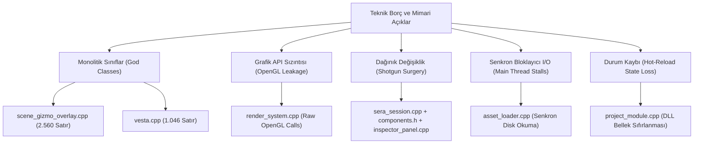

# QualEngine — Teknik Seviye, Mimari Borç ve Yetersiz Kod Modülleri Raporu

**Rapor Tarihi:** 22 Ekim 2026  
**Doküman Kodu:** `QE-REP-2026-04`  
**Kapsam:** Statik Kod İncelemesi, Mimari Anti-Pattern'ler, Güvenlik ve Kararlılık Riskleri, Refaktör Reçeteleri  
**İncelenen Modüller:** `Engine/Editor`, `Engine/Systems`, `Engine/Sera`, `Engine/Engine/Assets`, `Engine/Project`, `Engine/Audio`  

---

## 1. Yönetici Özeti

QualEngine, mimari temel olarak modern C++ ve veri odaklı (DOD) tasarım ilkelerini benimsemiş olsa da; projenin hızlı prototipleme evresinde yazılan bazı kod dosyaları zamanla **monolitik yapılara ("God Objects")**, **sıkı bağımlılıklara (Tight Coupling)** ve **yetersiz hata kontrol mekanizmalarına** bürünmüştür.

Bu rapor; motorun şu an aktif olarak çalışan kod tabanında tespit edilen teknik yetersizlikleri, mimari darboğazları ve bakım zorluğu yaratan bileşenleri dosya dosya, somut kod örnekleriyle belgelemekte ve her biri için profesyonel yeniden yapılandırma (refactoring) reçeteleri sunmaktadır.

---

## 2. Tespit Edilen Kritik Mimari Anti-Pattern'ler



---

## 3. Dosya ve Modül Bazlı Derinlemesine İnceleme

### 3.1. `Engine/Editor/Vesta/Panels/scene_gizmo_overlay.cpp` (2.560 Satır)
* **Kritiklik Düzeyi:** 🔴 **YÜKSEK (Kritik Monolit)**
* **Mevcut Sorunlar:**
  1. **Aşırı Boyut ve Sorumluluk:** Dosya tek başına 2.560 satırdır. Translation (taşıma), Rotation (döndürme), Scale (ölçekleme), Ray-Casting (fare-sahne ışın çarpışması), Grid Snapping (kılavuz yapışma), ImGui overlay çizimi ve çizgi matris hesaplamalarını tek bir gövdede yürütmektedir.
  2. **Yüksek Bakım Maliyeti:** Yeni bir manipülasyon aracı (örneğin Audio Source Range Manipulator veya Box Collider Extents Gizmo) eklemek istendiğinde dosya daha da şişmekte ve regresyon hatalarına davetiye çıkarmaktadır.
  3. **Kod Tekrarı (DRY İhlali):** X, Y ve Z eksenleri için yapılan ray-disk ve ray-silindir çarpışma matematik kodları neredeyse kopyala-yapıştır bloklar barındırmaktadır.
* **Yeniden Yapılandırma (Refactoring) Reçetesi:**
  - `IGizmoTool` soyut arayüzü oluşturulmalıdır (`on_hover`, `on_drag_start`, `on_drag`, `on_render`).
  - Dosya 4 bağımsız sınıfa bölünmelidir:
    - `gizmo_translation_tool.cpp` (~400 satır)
    - `gizmo_rotation_tool.cpp` (~400 satır)
    - `gizmo_scale_tool.cpp` (~350 satır)
    - `gizmo_math_utils.h` (Kesişim formülleri)
  - `scene_gizmo_overlay.cpp` yalnızca araçları yöneten bir orkestratör (~200 satır) haline getirilmelidir.

---

### 3.2. `Engine/Systems/render_system.cpp` (OpenGL API Sızıntısı ve Tight Coupling)
* **Kritiklik Düzeyi:** 🔴 **YÜKSEK (Mimari İzolasyon Eksikliği)**
* **Mevcut Sorunlar:**
  1. **Doğrudan OpenGL Bağımlılığı:** Bir ECS sistem sınıfı olan `render_system`, doğrudan ham OpenGL fonksiyonları çağırmaktadır:
     ```cpp
     glUseProgram(gpuShaderID);
     glUniformMatrix4fv(glGetUniformLocation(gpuShaderID, "view"), ...);
     glBindFramebuffer(GL_FRAMEBUFFER, previousFBO);
     ```
  2. **RHI (Render Hardware Interface) Yokluğu:** Sistem mantığı ile grafik API'si iç içe geçmiştir. QualEngine gelecekte Vulkan, DirectX 12 veya WebGPU'ya taşınmak istendiğinde `render_system.cpp` tamamen çöpe atılmak zorunda kalacaktır.
  3. **Her Kare Senkron String Sorgusu (`glGetUniformLocation`):** Her çizim nesnesinde onlarca kez çağrılan `glGetUniformLocation` fonksiyonu GPU sürücüsünde string hashing yapmakta ve CPU tarafında ciddi gecikmelere (CPU Stall) yol açmaktadır.
* **Yeniden Yapılandırma Reçetesi:**
  - Render mantığı ikiye ayrılmalıdır:
    1. **Render Frontend (System):** ECS'ten nesneleri toplar, culling yapar ve `RenderCommandBuffer` üretir.
    2. **Render Backend (Hardware):** OpenGL (veya gelecekte Vulkan) komut kuyruğunu GPU'ya iletir.
  - Uniform konumları bir kez `shader_program` oluşturulurken önbelleğe (Hash Map veya Sabit Dizi) alınmalı; çizim anında string araması yapılmamalıdır.

---

### 3.3. `Engine/Sera/sera_session.cpp` (Serileştirmede Dağınık Değişiklik / Shotgun Surgery)
* **Kritiklik Düzeyi:** 🟡 **ORTA-YÜKSEK (Geliştirici Ergonomisi Engeli)**
* **Mevcut Sorunlar:**
  1. **Büyük El Yapımı Bloklar (1.097 Satır):** Tüm bileşenlerin JSON serileştirmesi ve deserileştirmesi elle yazılmış if-else zincirleriyle yürütülmektedir:
     ```cpp
     if (type == "audio_source") { ... }
     else if (type == "audio_listener") { ... }
     else if (type == "mesh") { ... }
     ```
  2. **Hata Eğilimi:** Sisteme yeni bir bileşen eklendiğinde geliştirici:
     - `Engine/ECS/components.h`
     - `Engine/Sera/sera_session.cpp` (kaydetme fonksiyonu)
     - `Engine/Sera/sera_session.cpp` (yükleme fonksiyonu)
     - `Engine/Editor/Vesta/Panels/inspector_panel.cpp`
     - `Engine/Gameplay/ScriptGlue.cpp`
     olmak üzere 5 ayrı dosyada elle değişiklik yapmak zorundadır. Bu durum insan hatasını ve unutulan alan riskini artırmaktadır.
* **Yeniden Yapılandırma Reçetesi:**
  - Modern C++ şablon yansıma (Type-traits / compile-time reflection) veya bileşen bazlı serileştirici delegasyonu uygulanmalıdır:
    ```cpp
    template<typename T>
    void register_component_serializer(
        const std::string& name,
        std::function<void(const T&, nlohmann::json&)> saveFn,
        std::function<void(T&, const nlohmann::json&)> loadFn);
    ```

---

### 3.4. `Engine/Engine/Assets/asset_loader.cpp` (Senkron Disk I/O & Donma Riski)
* **Kritiklik Düzeyi:** 🟡 **ORTA-YÜKSEK (Performans & Kullanıcı Deneyimi)**
* **Mevcut Sorunlar:**
  1. **Ana İş Parçacığında Disk Okuma:** Dokular (`stbi_load`), modeller (Assimp `ReadFile`) ve ses dosyaları doğrudan ana render/update thread'i üzerinde senkron olarak okunmaktadır.
  2. **Frame Stutter (Kare Takılması):** Editörde veya oyunda 50 MB'lık yeni bir 3D model sahneye çekildiğinde motor 1.5 - 2 saniye tamamen donmakta, FPS 0'a düşmektedir.
  3. **Thread Safety Eksikliği:** `asset_registry` içindeki GUID -> Handle haritası `std::mutex` ile korunmamaktadır; çoklu iş parçacıklı bir yapıya geçirildiğinde Race Condition riski taşır.
* **Yeniden Yapılandırma Reçetesi:**
  - `Engine/Async` altındaki iş parçacığı havuzu (Thread Pool) aktif hale getirilmelidir.
  - Disk okuma ve mesh parsing arka plan thread'lerinde yapılmalı; sadece OpenGL'e VAO/VBO/Texture yükleme aşaması (GPU Context gerektiren kısım) ana thread'e senkronize edilmelidir.

---

### 3.5. `Engine/Project/project_module.cpp` (Hot-Reload State Loss & Bellek Güvenliği)
* **Kritiklik Düzeyi:** 🟡 **ORTA (Çalışma Zamanı Güvenilirliği)**
* **Mevcut Sorunlar:**
  1. **Üye Değişken Durum Kaybı (State Reset):** C++ betik kodu düzenlenip derlendiğinde (`FreeLibrary` -> `LoadLibraryW`), script nesnelerinin bellek adresleri sıfırlanmakta, script içindeki değişken değerleri (puan, can, sayaç vb.) varsayılan hallerine dönmektedir.
  2. **DLL Kilitleme ve Dosya İzin Hataları:** Bazı Windows sürümlerinde `GameModule.dll` Visual Studio tarafından yeniden derlenirken motor dosyayı henüz tamamen serbest bırakmamışsa `MSB3073` veya `LNK1104` dosya kilitlenme hataları meydana gelebilmektedir.
* **Yeniden Yapılandırma Reçetesi:**
  - Hot-reload öncesinde script örneğindeki serileştirilebilir alanlar SERA JSON tamponuna kaydedilmeli; yeni DLL yüklendikten sonra bu tampondan nesneye geri basılmalıdır (Serialization-based state preservation).
  - DLL takasında orijinal dosya kopyalanarak çalıştırılmalı (`GameModule_temp_xyz.dll`), böylece derleyicinin orijinal DLL'i yazması asla engellenmemelidir.

---

### 3.6. `Engine/Audio/miniaudio_backend.cpp` (Ses Bellek Tüketimi ve Akış Eksikliği)
* **Kritiklik Düzeyi:** 🟢 **ORTA-DÜŞÜK (Ölçeklenebilirlik Sınırı)**
* **Mevcut Sorunlar:**
  1. **Tampon Akışı (Streaming) Yokluğu:** Tüm ses dosyaları (kısa efektler ve uzun dakikalık fon müzikleri dahil) diskten belleğe toptan çözülmektedir. 10 dakikalık sıkıştırılmamış ses dosyaları RAM'i yüzlerce megabayt şişirebilir.
  2. **DSP Efekt Eksikliği:** Reverb, Low-Pass Filter (duvar arkasından gelen boğuk ses) veya Doppler efekti bulunmamaktadır.
* **Yeniden Yapılandırma Reçetesi:**
  - Kısa efektler için `MA_SOUND_FLAG_DECODE` (Memory), uzun ortam sesleri ve müzikler için `MA_SOUND_FLAG_STREAM` (Disk Streaming) bayrakları ayrılmalıdır.

---

## 4. Teknik Seviye ve Kod Kalitesi Puan Kartı

| Alan | Puan (100 Üzerinden) | Durum | Öncelikli Eylem |
| :--- | :---: | :---: | :--- |
| **Bellek Güvenliği (Handles)** | **90 / 100** | Mükemmel | Raw pointer yerine handle disiplini tam uygulanmış. |
| **Veri Odaklı Mimari (ECS)** | **85 / 100** | Çok İyi | Sparse Set veri yapısı verimli. |
| **Kapsülleme ve Modülerlik** | **70 / 100** | Orta | Monolitik dosyaların bölünmesi gerekiyor. |
| **Grafik API İzolasyonu (RHI)** | **45 / 100** | Yetersiz | RenderSystem içindeki ham OpenGL temizlenmeli. |
| **Eşzamanlılık (Multi-Threading)** | **50 / 100** | Yetersiz | Varlık yüklemeleri arka plana taşınmalı. |
| **Hata Yönetimi (Robustness)** | **65 / 100** | Geliştirilmeli | Sessiz dönüşler yerine yapılandırılmış hata takibi. |

---

## 5. Öncelikli Refaktör Eylem Planı (Hemen Uygulanması Gerekenler)

1. **Sprint 1 (Acil):** `render_system.cpp` içindeki `glGetUniformLocation` çağrılarının kaldırılması ve shader program başlatma anında önbelleklenmesi.
2. **Sprint 2 (Acil):** `scene_gizmo_overlay.cpp` dosyasının bağımsız araç sınıflarına (`Translation`, `Rotation`, `Scale`) parçalanması.
3. **Sprint 3 (Önemli):** ARIA varlık boru hattına asenkron yükleme (Background Thread Job) desteğinin eklenmesi.
4. **Sprint 4 (Önemli):** SERA bileşen serileştirmesinin dinamik makro/şablon kayıt mimarisine dönüştürülmesi.

