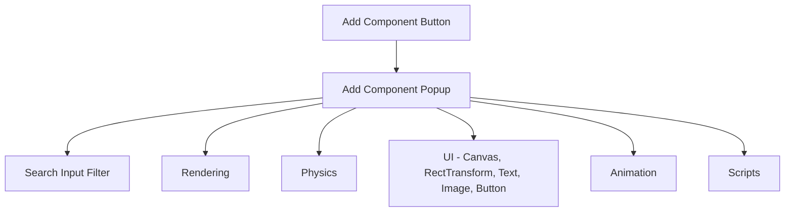

# In-Game UI Sistemi ve Editör Geliştirme Yol Haritası (Mimari Tasarım ve Planlama)

**Tarih:** 17 Ekim 2026  
**Durum:** Taslak / Planlama  
**Kapsam:** 
1. In-Game 2D UI Mimarisi (Canvas, RectTransform, Text, Button, Image)
2. UI Hiyerarşisi, Anchor, Pivot ve Çözünürlük Duyarlılığı (Responsive Scaling)
3. UI Render Hattı (Dedicated Shader, Orthographic Camera, Alpha Blending, Font Atlas)
4. Sahne Viewport UI Düzenleme Aleti (Rect Tool / 2D Transform & Resize Manipulator)
5. Inspector Arayüz İyileştirmeleri (Kategorili ve Filtreli "Add Component", Temizlenen Sağ Tık Menüleri, Sadeleştirilmiş Silme Butonları)

---

## 1. Sistemin Vizyonu ve Temel İlkeleri

Oyun içi kullanıcı arayüzü (In-Game UI), editör arayüzü olan ImGui'den tamamen bağımsız, oyun dünyasının veya ekranının üzerinde çalışan, donanım hızlandırmalı (OpenGL) ve ECS tabanlı bir alt sistem olacaktır.

### Temel Prensipler:
1. **ECS Uyumlu Olma:** Her UI elemanı (`Canvas`, `RectTransform`, `UIText`, `UIImage`, `UIButton`) sahnede birer `entity` olacak, mevcut hiyerarşi (`parent_component`) ile iç içe hiyerarşik UI ağaçları oluşturabilecektir.
2. **Kusursuz Responsive Davranış:** Ekran boyutu değiştiğinde (örn: 1280x720 -> 1920x1080 -> 4K veya pencere yeniden boyutlandırıldığında) arayüz elemanları bozulmadan sabit noktalara (Sol-Üst, Orta, Sağ-Alt) demirlenebilmeli (Anchor) ve oransal ölçeklenebilmelidir.
3. **Dedicated UI Render Pipeline:** 3D sahne çizimi tamamlandıktan sonra, derinlik testi kapatılarak veya UI derinlik katmanına geçilerek, ortografik projeksiyon ve özel bir UI shader'ı ile sıfır artefaktlı çizim yapılacaktır.
4. **Unity/Unreal Tarzı Sahne İçi Rect Tool:** Sahne penceresinde (Scene Viewport) bir UI elemanı seçildiğinde, 3B gizmo yerine köşelerinde ve kenarlarında tutamaçları (handles) olan 2B bir dikdörtgen kutu belirecek; tıklayıp sürükleyerek boyutlandırma ve taşıma yapılabilecektir.
5. **Ergonomik Editör Deneyimi:** Hızla artan bileşen listesinde kaybolmamak için kategorize edilmiş, canlı aramalı (Search Bar) "Add Component" penceresi ve sadeleştirilmiş sağ tık operasyonları sağlanacaktır.

---

## 2. Mimari Bileşenler (ECS UI Components)

### 2.1. `canvas_component`
Tüm UI elemanlarının köküdür (Root). Bir varlıkta bu bileşen varsa, altındaki UI hiyerarşisi bir ekran uzayı düzlemi olarak işlenir.

```cpp
enum class canvas_render_mode {
    screen_space_overlay, // Doğrudan ekran üstüne çizilir (HUD, Menüler)
    screen_space_camera,  // Belirli bir kameranın önüne çizilir
    world_space           // 3B dünya içinde (örn: bilgisayar ekranı, oyuncu üstünde can barı)
};

enum class canvas_scaler_mode {
    constant_pixel_size,       // Piksel boyutu sabit kalır
    scale_with_screen_size     // Referans çözünürlüğe göre oranlanır (Örn: 1920x1080 referans)
};

struct canvas_component {
    canvas_render_mode render_mode = canvas_render_mode::screen_space_overlay;
    canvas_scaler_mode scaler_mode = canvas_scaler_mode::scale_with_screen_size;
    glm::vec2 reference_resolution{ 1920.0f, 1080.0f };
    float match_width_or_height = 0.5f; // 0: Genişliğe göre, 1: Yüksekliğe göre ölçekle
    int sorting_order = 0;              // Çizim öncelik sırası
};
```

---

### 2.2. `rect_transform_component`
Klasik 3B `transform_component` yerine UI elemanlarında kullanılan veya onu 2B uzayda genişleten özel bileşen.

* **Anchor (Min / Max):** Ebeveynin (Parent) boyutlarına göre elemanın nereye sabitleneceğini belirler (`(0,0)` sol-alt, `(1,1)` sağ-üst, `(0.5, 0.5)` merkez).
* **Pivot:** Elemanın kendi merkez noktası (`(0.5, 0.5)` tam ortası).
* **Anchored Position & Size Delta:** Ebeveyn anchor noktasına göre piksel cinsinden konum ve genişlik/yükseklik.

```cpp
struct rect_transform_component {
    glm::vec2 anchored_position{ 0.0f, 0.0f };
    glm::vec2 size{ 100.0f, 100.0f };
    glm::vec2 anchor_min{ 0.5f, 0.5f }; // [0..1]
    glm::vec2 anchor_max{ 0.5f, 0.5f }; // [0..1]
    glm::vec2 pivot{ 0.5f, 0.5f };      // [0..1]
    float rotation = 0.0f;              // 2B Z ekseni rotasyonu (derece)
    glm::vec2 scale{ 1.0f, 1.0f };

    // Çalışma zamanında hesaplanan mutlak ekran koordinatları (Cache):
    // x: left, y: top, z: width, w: height
    glm::vec4 computed_screen_rect{ 0.0f };
};
```

#### Responsive Matematik Modeli:
Bir UI elemanının ekran koordinatı hesaplanırken:
$$\text{ParentRect} = [P_{left}, P_{top}, P_{width}, P_{height}]$$
$$\text{AnchorOrigin} = P_{pos} + \text{mix}(\text{anchor\_min}, \text{anchor\_max}, 0.5) \times P_{size}$$
$$\text{FinalPos} = \text{AnchorOrigin} + \text{anchored\_position} - (\text{pivot} \times \text{size})$$

---

### 2.3. Görsel Elemanlar (Visual Components)

#### A. `ui_text_component`
Font atlası üzerinden ekrana yazı çizmek için kullanılır.
```cpp
enum class text_alignment {
    top_left, top_center, top_right,
    middle_left, center, middle_right,
    bottom_left, bottom_center, bottom_right
};

struct ui_text_component {
    std::string text = "New Text";
    std::string font_path = "EngineResources/Fonts/Roboto-Regular.ttf";
    float font_size = 24.0f;
    glm::vec4 color{ 1.0f, 1.0f, 1.0f, 1.0f };
    text_alignment alignment = text_alignment::center;
    bool wrap_text = false;
    float line_spacing = 1.2f;
};
```

#### B. `ui_image_component`
Düz renk kutular, pencereler, ikonlar ve dokulu görseller için:
```cpp
enum class image_type {
    simple,   // Düz doku veya renk
    sliced_9  // 9-slice (köşeleri bozulmadan esneyen buton/pencere çerçevesi)
};

struct ui_image_component {
    glm::vec4 color{ 1.0f, 1.0f, 1.0f, 1.0f };
    aria::uuid texture_uuid = aria::uuid::null();
    image_type type = image_type::simple;
    bool raycast_target = true; // Tıklama algılasın mı?
};
```

#### C. `ui_button_component`
Kullanıcı etkileşimi, tıklama ve renk değişimleri (Hover, Pressed, Disabled):
```cpp
enum class button_state {
    normal,
    hovered,
    pressed,
    disabled
};

struct ui_button_component {
    bool interactable = true;
    glm::vec4 normal_color{ 0.8f, 0.8f, 0.8f, 1.0f };
    glm::vec4 hover_color{ 1.0f, 1.0f, 1.0f, 1.0f };
    glm::vec4 pressed_color{ 0.6f, 0.6f, 0.6f, 1.0f };
    glm::vec4 disabled_color{ 0.4f, 0.4f, 0.4f, 0.5f };

    button_state current_state = button_state::normal;
    std::function<void()> on_click; // C++ scriptinden veya motor API'sinden bağlanabilir
};
```

---

## 3. UI Render ve Shader Hattı (Render Pipeline)

UI elemanları standart 3B sahne nesnelerinden farklı kurallarla render edilmelidir:

1. **Özel UI Shader'ı (`ui.vert` & `ui.frag`):**
   * Giriş: 2B Pozisyon `(X, Y)`, Doku Koordinatı `(U, V)`, Renk `(R, G, B, A)`.
   * Matris: Standart 3D Camera View/Projection yerine `glm::ortho(0.0f, screenWidth, screenHeight, 0.0f, -1.0f, 1.0f)` (Sol-üst köşe orijin `(0,0)`).
   * Fragman Shader:
     ```glsl
     #version 330 core
     in vec2 v_TexCoord;
     in vec4 v_Color;
     out vec4 FragColor;

     uniform sampler2D u_Texture;
     uniform bool u_HasTexture;
     uniform bool u_IsFontSDF; // Font atlası çizilirken Signed Distance Field veya Alpha maskesi

     void main() {
         vec4 texColor = vec4(1.0);
         if (u_HasTexture) {
             if (u_IsFontSDF) {
                 float alpha = texture(u_Texture, v_TexCoord).r;
                 texColor = vec4(1.0, 1.0, 1.0, alpha);
             } else {
                 texColor = texture(u_Texture, v_TexCoord);
             }
         }
         FragColor = texColor * v_Color;
     }
     ```
2. **OpenGL State Yapılandırması:**
   * `glDisable(GL_DEPTH_TEST);` (UI elemanları 3B dünyadaki nesnelerin arkasında kaybolmamalı).
   * `glEnable(GL_BLEND);`
   * `glBlendFunc(GL_SRC_ALPHA, GL_ONE_MINUS_SRC_ALPHA);`
   * `glDisable(GL_CULL_FACE);` (UI quad'ları çift yönlü güvenle çizilsin).
3. **Batching / Dynamic Quad Buffer:**
   * Tüm UI metin harfleri ve kutuları dinamik bir VBO'da toplanarak (Batch rendering) tek bir `glDrawElements` çağrısıyla ekrana basılacaktır.

---

## 4. Sahne Viewport UI Düzenleme Aleti (Rect Tool Manipulator)

3B sahnede kullanılan `Translate / Rotate / Scale` gizmosu, 2B arayüz düzenlemek için ergonomik değildir. Kullanıcı bir UI elemanını (veya Canvas altındaki bir nesneyi) seçtiğinde veya araç çubuğundan **Rect Tool** modunu seçtiğinde devreye girecek alet:

```
+---[Top-Left]----------[Top-Edge]----------[Top-Right]---+
|                                                         |
|                                                         |
[Left-Edge]                 (Center)                [Right-Edge]
|                      (Tıkla & Sürükle)                  |
|                                                         |
+---[Bottom-Left]-----[Bottom-Edge]-------[Bottom-Right]--+
```

### Yetenekleri:
1. **8 Noktalı Boyutlandırma (Resize Handles):**
   * 4 Köşe Tutamacı (Köşelerden en-boy serbest veya Shift ile orantılı ölçekleme).
   * 4 Kenar Tutamacı (Sadece genişlik veya sadece yükseklik değiştirme).
2. **Kutu İçi Sürükleme (Drag & Move):**
   * Dikdörtgenin içine tıklanıp sürüklendiğinde elemanın `anchored_position` değeri akıcı biçimde güncellenir.
3. **ImDrawList Entegrasyonu:**
   * [`scene_gizmo_overlay.cpp`](../Engine/Editor/Vesta/Panels/scene_gizmo_overlay.cpp) içine `render_rect_tool(...)` adımı eklenecek.
   * Viewport'un aktif projeksiyonuna göre ekran koordinatına yansıtılacak (Screen Space Overlay için doğrudan ImGui koordinatlarında çizim).

---

## 5. Editör & Inspector İyileştirme Planı

### 5.1. "Add Component" Menüsünün Yenilenmesi (Arama ve Kategorizasyon)
Mevcut durumda tüm bileşenler düz bir liste halinde açılıyor. Bileşen sayısı 15'i geçtiği için:

1. **Arama Kutusu (Search Filter):**
   * Pop-up açıldığı anda otomatik odaklanan (`ImGui::SetKeyboardFocusHere()`) bir `char search_filter[128]` arama çubuğu.
   * Yazılan metne göre anlık süzme (Örn: "rig" yazınca sadece Rigidbody listelenir).
2. **Kategori Ağacı (Hierarchical / Categorized Menu):**
   * **Rendering:** `MeshRenderer`, `SkinnedMesh`, `Material`, `Camera`, `Light`
   * **Physics:** `Rigidbody`, `BoxCollider`, `SphereCollider`
   * **Animation:** `Animator`, `Skeleton`, `BoneAttachment`
   * **Scripts:** `NativeScript`
   * **UI (Yeni):** `Canvas`, `RectTransform`, `UIText`, `UIImage`, `UIButton`



### 5.2. Inspector Silme Butonlarının Sadeleştirilmesi (Ergonomik Temizlik)
Mevcut kodda her bileşenin en altında büyük bir `Remove Component` butonu ve başlığın sağında da küçük bir `Remove` butonu yer alıyor.

* **Yapılacak Düzenleme:**
  1. Bileşenin en altındaki büyük buton tamamen kaldırılacak.
  2. Başlığın sağındaki zarif, kırmızı renk tonundaki küçük buton tek başına kalacak.
  3. Bileşen başlığına sağ tıklandığında açılan `ComponentHeaderContextMenu` menüsünde **"Remove Component"** seçeneği korunacak/güçlendirilecek (Unity standartı).

---

## 6. Aşamalı Uygulama Yol Haritası (Implementation Phases)

| Aşama | Kapsam | Çıktı / Hedef |
|---|---|---|
| **Faz 1: Editör UI Temizliği** | Inspector ve Add Component | • Alt kısımdaki devasa Remove butonu kaldırılır.<br>• Sağ tık "Remove Component" standartlaştırılır.<br>• Kategorili ve aramalı "Add Component" pop-up'ı kodlanır. |
| **Faz 2: Çekirdek ECS UI Bileşenleri** | `components.h` | • `canvas_component`, `rect_transform_component`, `ui_text_component`, `ui_image_component`, `ui_button_component` tanımlanır.<br>• SERA serileştirme kayıtları yapılır. |
| **Faz 3: UI Render Sistemi & Shader** | `ui_system.cpp` & Shaders | • `ui.vert`, `ui.frag` GLSL shader'ları oluşturulur.<br>• FreeType veya STB ile dinamik Font Atlas yükleyici entegre edilir.<br>• Responsive anchor/pivot ekran koordinat hesaplama algoritması tamamlanır. |
| **Faz 4: Rect Tool (2B Sahne Düzenleme Aleti)** | `scene_gizmo_overlay.cpp` | • Viewport üzerinde 8 tutamaçlı, tıklayıp sürüklenebilen 2B Rect Tool kontrolörü geliştirilir.<br>• Üst araç çubuğuna Rect Tool ikonu/düğmesi (Kısayol: `T`) eklenir. |
| **Faz 5: Buton & Event Etkileşimi** | Standalone & In-Game Input | • Farenin UI elemanları üzerindeki hover/click durumları `input_system` ile bağlanır.<br>• C++ script API'sine (`gameplay::ui`) erişim fonksiyonları sunulur. |

---

## 7. Sonuç
Bu plan, motoru sadece 3B dünyayı çizen bir yapıdan çıkarıp, profesyonel oyunlarda ihtiyaç duyulan HUD, menü, yazı ve etkileşim sistemlerine sahip eksiksiz bir oyun geliştirme ortamına dönüştürecektir.

