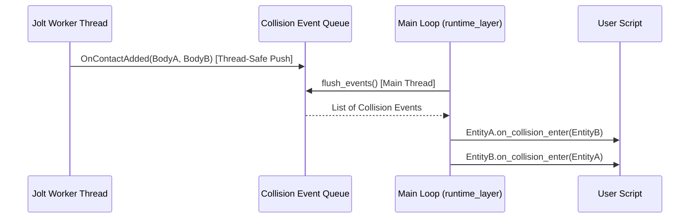

# Rapor 2: Önerilen Gameplay API Mimari Tasarımı

## 1. Mimari Vizyon ve Temel İlkeler

Oyun geliştiren bir programcının render pass'leri, FBO'ları, Jolt bellek yöneticilerini veya ham ECS pointer'larını bilmesine gerek olmamalıdır.

Gameplay API katmanının temel hedefleri şunlardır:
1. **İç Yapıları Soyutlamak (Encapsulation):** Çekirdek motor yapılarını gizleyip, betiklere yalnızca ihtiyaç duydukları güvenli servisleri sağlamak.
2. **Olay Tabanlı Çarpışma Yönetimi (Event-Driven Physics):** `on_collision_enter`, `on_collision_exit`, `on_trigger_enter`, `on_trigger_exit` gibi olayları otomatik olarak betiklere dağıtmak.
3. **Ergonomik ve Sezgisel Kullanım (Developer Ergonomics):** Unity/Unreal tarzı, öğrenmesi ve yazması kolay, temiz bir C++ nesne modeli kurmak.
4. **İş Parçacığı Güvenliği (Thread Safety):** Jolt fizik motorunun çoklu iş parçacıklı temas olaylarını ana iş parçacığına güvenle taşımak.

```
+-------------------------------------------------------------------+
|               KULLANICI BETİKLERİ (User Scripts)                  |
|    (player_controller, enemy_ai, interactive_door, coin_pickup)   |
+-------------------------------------------------------------------+
                                 |
                                 v
+-------------------------------------------------------------------+
|                     GAMEPLAY API KATMANI                          |
|  +--------------------+  +-------------------+  +---------------+ |
|  |    Scriptable      |  |    Input API      |  |  Physics API  | |
|  |      Entity        |  |  (is_down, axis)  |  | (raycast,vel) | |
|  +--------------------+  +-------------------+  +---------------+ |
|  +--------------------+  +-------------------+  +---------------+ |
|  |   Collision Queue  |  |    Entity API     |  |   Time API    | |
|  |  (Enter/Exit/Trig) |  | (find, instantiate|  |  (dt, fixed) | |
|  +--------------------+  +-------------------+  +---------------+ |
+-------------------------------------------------------------------+
                                 |
                                 v
+-------------------------------------------------------------------+
|                     ÇEKİRDEK MOTOR (Engine Core)                  |
|        (EngineContext, Jolt Physics, ECS Registry, GLFW)         |
+-------------------------------------------------------------------+
```

---

## 2. Temel Bileşenler ve API Detayları

### 2.1. Genişletilmiş Betik Yaşam Döngüsü (`scriptable_entity`)

Yeni yaşam döngüsü şunları içerecektir:
```cpp
class scriptable_entity {
public:
    virtual ~scriptable_entity() = default;

    // --- Temel Yaşam Döngüsü ---
    virtual void on_create() {}
    virtual void on_destroy() {}
    virtual void on_update(float delta_time) {}
    
    // --- Fizik Sabit Adım Döngüsü ---
    // Fizik hesaplamaları ve hıza doğrudan müdahaleler burada yapılır (60 Hz vb.)
    virtual void on_fixed_update(float fixed_delta_time) {}

    // --- Katı Çarpışma Olayları (Fiziksel temas eden nesneler) ---
    virtual void on_collision_enter(const collision_hit& hit) {}
    virtual void on_collision_exit(const collision_hit& hit) {}

    // --- Tetikleyici Olayları (İçinden geçilebilen sensör alanlar) ---
    virtual void on_trigger_enter(entity other) {}
    virtual void on_trigger_exit(entity other) {}

    // --- Yardımcı Ergonomik Erişimciler ---
    transform_wrapper transform();
    rigidbody_wrapper rigidbody();
    
    template<typename T>
    T* try_get_component();

    template<typename T>
    T& get_component();

    template<typename T>
    bool has_component();
};
```

---

### 2.2. Çarpışma Veri Yapısı (`collision_hit`)
Bir çarpışma gerçekleştiğinde betiğe ham sayılar yerine anlamlı veriler sunulmalıdır:

```cpp
struct collision_hit {
    entity other_entity;       ///< Çarpışılan diğer varlığın kimliği.
    glm::vec3 contact_point;   ///< Çarpışmanın gerçekleştiği dünya koordinatı.
    glm::vec3 contact_normal;  ///< Temas yüzeyinin normal vektörü.
    float impulse = 0.0f;      ///< Çarpışma şiddeti / impuls değeri.
};
```

---

### 2.3. Jolt Çarpışma Dinleyicisi ve Olay Kuyruğu (Collision Event Queue)

#### Neden Kuyruk Gerekli?
Jolt, fizik simülasyonunu arka plandaki iş parçacığı havuzunda (`JobSystemThreadPool`) yürütür. Çarpışma tespit edildiği anda doğrudan `scriptComp.instance->on_collision_enter(...)` çağrılırsa:
1. ECS registry üzerinde thread-safety bozulabilir.
2. Betik bir bileşeni silmeye veya oluşturmaya çalışırsa sistem kilitlenebilir.

#### Çözüm: Çift Aşamalı İletim (Queue & Dispatch)
1. **Fizik Adımı Esnasında (Worker Threads):**
   - Jolt'a bir `JPH::ContactListener` atanır (`engine_contact_listener`).
   - `OnContactAdded` ve `OnContactRemoved` tetiklendiğinde, temas eden `Body1` ve `Body2` nesnelerinden `UserData` (yani `entity` ID) okunur.
   - Bu olaylar thread-safe bir kuyruğa (`std::vector<pending_collision_event>` + hafif mutex) kaydedilir.
2. **Kare Güncellemesi Esnasında (Main Game Thread):**
   - `runtime_layer::update` fizik simülasyonunu tamamladıktan hemen sonra olay kuyruğu ana iş parçacığı tarafından tüketilir.
   - Her olayın tarafları olan varlıklar bulunur. Eğer üzerlerinde `native_script_component` varsa ilgili `on_collision_enter` veya `on_trigger_enter` çağrısı güvenle tetiklenir.



---

### 2.4. Ergonomik Girdi API'si (`input`)

Mevcut `input.actions[(int)InputAction::MoveForward]` kullanımı yerine temiz ve statik/bağlamsal bir arayüz:

```cpp
namespace gameplay {
    class input {
    public:
        // Eylem tabanlı kontroller
        static bool is_action_pressed(InputAction action);      // Basılı tutuluyor mu?
        static bool is_action_just_pressed(InputAction action); // Bu karede yeni mi basıldı?
        static bool is_action_just_released(InputAction action);// Bu karede mi bırakıldı?

        // Fiziksel tuş kontrolleri (ör. Escape, Enter, Tab)
        static bool is_key_pressed(int glfw_key);
        static bool is_key_just_pressed(int glfw_key);

        // Fare ve Eksen kontrolleri
        static glm::vec2 get_mouse_delta();
        static glm::vec2 get_mouse_position();
        static float get_axis(InputAction positive, InputAction negative); // -1.0f ile +1.0f arası
    };
}
```

*Örnek Kullanım (Yeni `player_controller`):*
```cpp
void player_controller::on_update(float dt) {
    float moveX = input::get_axis(InputAction::MoveRight, InputAction::MoveLeft);
    float moveZ = input::get_axis(InputAction::MoveForward, InputAction::MoveBackward);
    
    if (input::is_action_just_pressed(InputAction::Jump)) {
        rigidbody().add_impulse(glm::vec3(0.0f, jump_force, 0.0f));
    }
}
```

---

### 2.5. Dönüşüm ve Fizik Sarmalayıcıları (`transform_wrapper`, `rigidbody_wrapper`)

Kullanıcının her seferinde `getContext().physicsSystem.api().set_velocity(...)` yazması yerine:

```cpp
// Rigidbody Kolaylaştırıcı Metotlar:
this->rigidbody().set_velocity(glm::vec3(x, y, z));
this->rigidbody().get_velocity();
this->rigidbody().add_force(glm::vec3(0, 100, 0));
this->rigidbody().add_impulse(glm::vec3(0, 5, 0));

// Transform Kolaylaştırıcı Metotlar:
this->transform().get_position();
this->transform().set_position(pos);
this->transform().forward(); // İleri vektör otomatik hesaplanır
this->transform().right();   // Sağ vektör otomatik hesaplanır
this->transform().look_at(target_pos);
```

---

### 2.6. Sahne ve Varlık Yönetimi (`scene_api`)

```cpp
namespace gameplay {
    class scene_api {
    public:
        static entity find(const std::string& name);
        static void destroy(entity e);
        static entity instantiate_prefab(const std::string& asset_path, const glm::vec3& position);
    };
}
```

