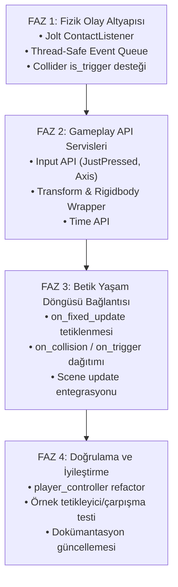

# Rapor 3: Aşamalı Uygulama ve Geçiş Stratejisi (Roadmap)

## 1. Geçiş Stratejisi ve Geriye Dönük Uyumluluk (Zero Breaking Changes)

Yeni bir katman eklerken en kritik ilke, çalışan mevcut projeyi (`player_controller`, `camera_controller`, `Engine`, `Vesta Editor`) **kesinlikle kırmamaktır**.

Bu nedenle geçiş şu prensiple yürütülmelidir:
* Mevcut `scriptable_entity` içindeki `getContext()` ve `get_registry()` kaldırılmayacak, geriye dönük uyumluluk için korunacaktır.
* Yeni fonksiyonlar (`on_collision_enter`, `on_fixed_update`, `input::...`) varsayılan boş gövdelere (`{}`) sahip olacaktır. Kullanıcı scriptleri istediği zaman bu metotları ezebilecektir (override).
* Mevcut scriptler çalışmaya devam ederken, yeni API kademeli olarak devreye alınacaktır.

---

## 2. Aşamalı Yol Haritası (Phased Roadmap)

---

### FAZ 1: Fizik Çarpışma ve Olay Altyapısı
*Hedef: Jolt temaslarını yakalayıp ana döngüye taşımak.*

1. **`collider_component` Güncellemesi:**
   - `bool is_trigger = false;` alanı eklenecektir.
   - Tetikleyici olan nesnelerin Jolt tarafında `Sensor` veya temas filtresi olarak ayarlanması sağlanacaktır.
2. **`engine_contact_listener` Sınıfı:**
   - Jolt `JPH::ContactListener` arayüzü uygulanacaktır.
   - `OnContactAdded` ve `OnContactRemoved` fonksiyonları dinlenecektir.
   - Temas anında `Body1.GetUserData()` ve `Body2.GetUserData()` üzerinden `entity` ID'leri alınacaktır.
3. **`collision_event_queue` (Kuyruk Yapısı):**
   - Çarpışma verilerini (EntityA, EntityB, Normal, Point, is_trigger, is_enter/exit) toplayan hafif, thread-safe bir kuyruk oluşturulacaktır.
   - `physics_system::init` aşamasında bu dinleyici Jolt'a tanıtılacaktır.

---

### FAZ 2: Temel Gameplay API Servisleri
*Hedef: Betik yazan kişinin motora doğrudan dokunmasını engelleyen sarmalayıcıları kurmak.*

1. **`gameplay::input` Sınıfı:**
   - `InputState` üzerindeki `keys`, `prevKeys`, `actions`, `prevActions` dizilerini karşılaştırarak tek satırda sorgulama sağlayan statik API:
     - `is_action_just_pressed(InputAction)`
     - `is_action_just_released(InputAction)`
     - `get_axis(positive, negative)`
     - `get_mouse_delta()`
2. **`transform_wrapper` ve `rigidbody_wrapper`:**
   - `scriptable_entity` içine `this->transform()` ve `this->rigidbody()` metotları eklenecektir.
   - Bu sayede `physics.set_velocity(get_entity(), v)` yerine `rigidbody().set_velocity(v)` yazılabilecektir.
3. **`gameplay::time`:**
   - `time::delta_time()` ve `time::fixed_delta_time()` erişimi.

---

### FAZ 3: Betik Yaşam Döngüsü ve Olay Dağıtımı (Dispatching)
*Hedef: Olayların `scriptable_entity` türevlerine güvenle ulaştırılması.*

1. **`scriptable_entity` Sanal Fonksiyonları:**
   - `virtual void on_fixed_update(float fixed_dt) {}`
   - `virtual void on_collision_enter(const collision_hit& hit) {}`
   - `virtual void on_collision_exit(const collision_hit& hit) {}`
   - `virtual void on_trigger_enter(entity other) {}`
   - `virtual void on_trigger_exit(entity other) {}`
2. **`runtime_layer::update` Entegrasyonu:**
   - Fizik simülasyonu çalıştırılmadan hemen önce: `on_fixed_update` döngüsü çağrılacaktır.
   - Fizik simülasyonu tamamlandıktan hemen sonra: Çarpışma kuyruğu boşaltılacak (`flush`) ve ilgili varlıkların scriptlerine `on_collision_enter / exit` dağıtılacaktır.

---

### FAZ 4: Örnek Senaryo ve Doğrulama
*Hedef: Yeni API'nin kullanım kolaylığını ve sağlamlığını test etmek.*

1. **`player_controller` Refaktörü:**
   - Ham `getContext().inputState` ve `getContext().physicsSystem` kodları temizlenip yeni API'ye geçirilecektir.
2. **Test Çarpışması:**
   - Oyuncunun bir nesneye çarptığında (örneğin yere indiğinde veya duvara çarptığında) `on_collision_enter` fonksiyonunun çalıştığı doğrulanacaktır.
   - Örneğin bir "Coin / Checkpoint" nesnesi yapıldığında `on_trigger_enter` ile algılanması test edilecektir.

---

## 3. Kod Öncesi Karar Özeti

* Kod yazımına geçmeden önce bu raporlar doğrultusunda mimarinin projenin gelecekteki hedeflerine (örneğin Lua/C# desteği gelmesi veya saf C++ native script kalması) uygunluğu teyit edilmelidir.
* Bu soyutlama katmanı kurulduğunda, ileride C++ yerine **C# (Mono/Dotnet) veya Lua** betik desteği eklenmek istendiğinde de aynı Gameplay API arayüzü doğrudan kullanılabilir olacaktır.

