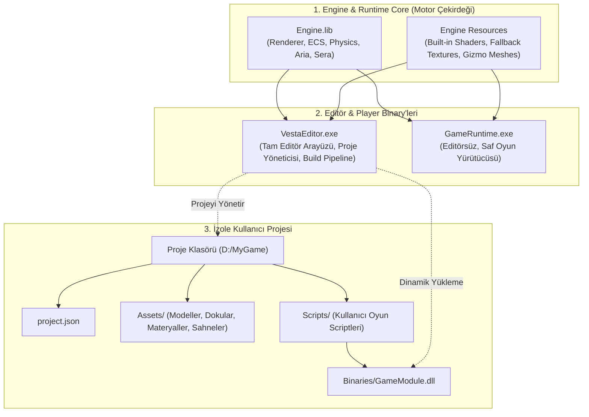
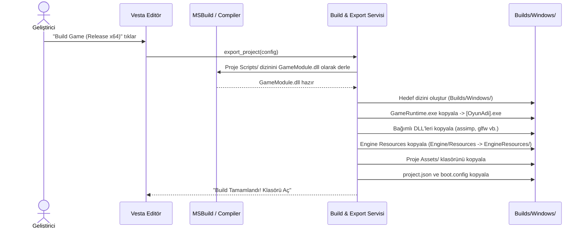

# Proje İzolasyonu, Dinamik Scripting ve Standalone Build (Export) Sistemi Mimari Tasarım Raporu

> **Tarih:** 16 Ekim 2026  
> **Kapsam:** Motor Mimarisi, Proje Yaşam Döngüsü, Script İzolasyonu ve Dağıtım Boru Hattı  
> **Hedef:** Motordan tamamen soyutlanmış izole projeler, bağımsız betik modülleri ve tek tıkla çalışan bağımsız oyun çıktısı (Standalone Game Build) üretimi.

---

## 1. Yönetici Özeti ve Mevcut Durum Analizi

Mevcut mimaride oyun motorumuz, editör yetenekleri (Vesta), sahne yönetimi (Sera), fizik (Jolt) ve grafik boru hattı (Aria) açısından güçlü bir altyapıya kavuşmuştur. Ancak motorun **uygulama (Application)** katmanı ile **proje (Project)** katmanı arasındaki sınırlar henüz tam olarak ayrıştırılmamış, monolitik bir yapıda kalmıştır.

### Mevcut Mimari Tıkanıklıklar

```
┌────────────────────────────────────────────────────────────────────────┐
│                   MEVCUT MONOLİTİK YAPI (PROBLEMLİ)                    │
│                                                                        │
│  Application.exe (Tek Gövde)                                           │
│  ├── Engine Çekirdeği (ECS, Renderer, Fizik, Aria)                     │
│  ├── Vesta Editör (ImGui Panelleri, Viewportlar)                       │
│  ├── Built-in Motor Shader'ları (Application/Shaders/)                 │
│  ├── Hardcoded Oyun Scriptleri (player_controller, camera_controller) │
│  └── Demo Sahnesi (sandbox.cpp)                                        │
│                                                                        │
│  Kullanıcı Projesi (project.json, Dış Assets klasörü)                  │
│  └── Editörden bağımsız yaşayamıyor, motor varlıklarıyla iç içe         │
└────────────────────────────────────────────────────────────────────────┘
```

1. **Application Projesinin Çift Kimliği:** `Application` projesi hem Editörü çalıştırmakta hem de `sandbox.cpp`, `player_controller.cpp` gibi demo oyun kodlarını doğrudan derlemektedir. Kullanıcı yeni bir proje açtığında, motor hala `Application` içindeki scriptleri görmeye devam etmektedir.
2. **Built-in Varlıkların (Engine Assets) Projeyle Karışması:** Motorun temel çalışması için zorunlu olan shader'lar (`default_shader`, `gizmo`, `grid`, `skybox`, `shadow`) ve varsayılan dokular/modeller kullanıcının `Assets` klasöründe durmaktadır. Kullanıcı başka bir disk konumundaki projeyi açtığında veya boş bir proje oluşturduğunda bu dahili kaynaklar kaybolmakta veya proje köküne gereksiz yere kopyalanmaktadır.
3. **Statik Script Kaydı:** `REGISTER_SCRIPT` makrosu derleme zamanında statik olarak çalışmakta; kullanıcının projesine özel yazdığı C++ scriptleri editör tarafından dinamik olarak algılanamamaktadır.
4. **Dağıtım (Standalone Build / Export) Sisteminin Yokluğu:** Editörden bağımsız, son kullanıcıya verilebilecek çalıştırılabilir bir oyun çıktısı (`GameName.exe + GameData`) üreten bir export mekanizması bulunmamaktadır.

---

## 2. Profesyonel Oyun Motorlarının Çözüm Modelleri

Endüstri standardı motorlar (Unreal Engine, Unity, Godot ve Hazel Engine) bu ayrımı benzer temel prensiplerle çözmektedir:

| Özellik | Unreal Engine 5 | Unity | Godot 4 | Hazel Engine (TheCherno) |
| :--- | :--- | :--- | :--- | :--- |
| **Editör Binary** | `UnrealEditor.exe` | `Unity.exe` | `Godot_editor.exe` | `Hazelnut.exe` (Editor) |
| **Runtime Binary** | `Engine/Binaries/...` şablonu | `UnityPlayer.dll` + Wrapper | Standalone Export Template | `Hazel-Runtime.exe` (Player) |
| **Kullanıcı Kodu** | C++ Game Module (`.dll`) | C# `Assembly-CSharp.dll` | GDExtension (`.dll` / C#) | C# Assembly / C++ DLL |
| **Motor Varlıkları** | `Engine/Content/` | `Editor/Data/Resources/` | Gömülü (Embedded ZIP/Binary) | `Resources/` (Editor-side) |
| **Proje Varlıkları** | `<Project>/Content/` | `<Project>/Assets/` | `<Project>/res://` | `<Project>/Assets/` |
| **Build Çıktısı** | UBT paketleme (Cooked Data) | Player Build Pipeline | PCK Paketi + Template Exe | Runtime + Asset Pack |

---

## 3. Hedeflenen Mimari: Üç Katmanlı Ayrım

Motorumuzu profesyonel standartlara taşımak için üç kesin katman tanımlanacaktır:



---

## 4. Detaylı Sistem Tasarımı

### 4.1. Motor Dahili Kaynakları (Engine Built-in Resources) Ayrımı

Motorun shader ve hata ayıklama varlıkları kullanıcının projesinden tamamen yalıtılacaktır.

* **Dizin Yapısı:**
  ```
  OpenGL-Learn-1/
  ├── Engine/
  │   └── Resources/
  │       ├── Shaders/
  │       │   ├── default_shader.vert/frag
  │       │   ├── skinned_default.vert/frag
  │       │   ├── Debug/ (gizmo, grid)
  │       │   ├── Skybox/ (skybox)
  │       │   └── shadow.vert/frag
  │       └── Textures/
  │           ├── default_white.png
  │           ├── default_normal.png
  │           └── skybox/skybox1.png
  ```
* **Sanal Yol Şeması (Virtual Path Schema):**
  Varlık boru hattı (`asset_pipeline`) ve `aria_system`, `@engine/` önekini tanıyacaktır:
  - `@engine/shaders/default_shader` -> Doğrudan motorun `Resources/Shaders` dizinini işaret eder.
  - `@engine/skybox/default` -> Motorun dahili skybox dokusunu işaret eder.
  - Proje varlıkları ise göreli yol olarak projenin `Assets/` klasöründen okunur (`Assets/Textures/Rock.png`).
* **Kazanım:** Kullanıcı projeyi tamamen silse veya yeni boş bir proje açsa dahi motorun çizim, ışıklandırma ve gölge sistemi asla çökmez ve projenin `Assets` klasörüne motor dosyaları sızmaz.

---

### 4.2. Projeye Özgü Scripting ve Yansıma (Reflection) Mimarisi

Kullanıcının yazdığı scriptler motorun veya editörün kaynak koduna dokunmamalıdır.

#### Çözüm Modeli: Dinamik Oyun Modülü (`GameModule.dll`)

1. **Proje Klasör Yapısı:**
   ```
   D:/MyGame/
   ├── project.json
   ├── Assets/
   │   └── Scenes/
   │       └── Main.json
   ├── Scripts/
   │   ├── PlayerController.h
   │   ├── PlayerController.cpp
   │   └── GameModule.cpp   (Modül giriş noktası)
   └── Binaries/
       └── GameModule.dll   (Derlenen proje kodu)
   ```

2. **Dinamik Modül Arayüzü (Game Module API):**
   Proje kodunun motora bağlanmasını sağlayan hafif bir C-linkage dışa aktarma (export) köprüsü kurulur:
   ```cpp
   // Scripts/GameModule.cpp (Kullanıcı projesinde derlenir)
   #include <Engine/Scripting/script_factory.h>
   #include "PlayerController.h"

   extern "C" __declspec(dllexport) void InitializeGameModule(script_factory& factory) {
       factory.register_script("PlayerController", [](entity e, registry& reg) {
           auto& nsc = reg.add_component<native_script_component>(e);
           nsc.bind<PlayerController>("PlayerController");
       });
   }

   extern "C" __declspec(dllexport) void ShutdownGameModule(script_factory& factory) {
       // Kayıtları temizle
   }
   ```

3. **Editör Tarafındaki Yaşam Döngüsü (Hot-Reload / Load):**
   - Editör bir proje açtığında:
     1. Projenin `Binaries/GameModule.dll` dosyasını arar.
     2. Windows API `LoadLibraryA("D:/MyGame/Binaries/GameModule.dll")` ile DLL'i belleğe yükler.
     3. `InitializeGameModule` fonksiyon işaretçisini alır ve `script_factory`'ye sadece o projenin scriptlerini kaydeder.
   - **Sonuç:** Vesta Inspector panelinde `Native Script -> Script Class` açılır kutusu tıklandığında **yalnızca o projede yazılmış scriptler** listelenir! Başka projelerin veya demo sandbox scriptlerinin görünmesi imkansız hale gelir.

---

### 4.3. Standalone Oyun Çıktısı Üretim Sistemi (Build & Export Pipeline)

Kullanıcı Editör üst menüsünden `Project -> Build / Export Game...` seçeneğine bastığında çalışan otomatikleştirilmiş üretim boru hattı.



#### Export Klasörünün Nihai İçeriği:
```
Builds/Windows/
├── MyAwesomeGame.exe       (Editörsüz GameRuntime.exe'nin yeniden adlandırılmış hali)
├── GameModule.dll          (Projenin derlenmiş scriptleri)
├── assimp-vc145-mt.dll     (Gerekli üçüncü parti kütüphaneler)
├── glfw3.dll
├── boot.config             (Başlangıç sahnesi, pencere adı, çözünürlük ayarları)
├── EngineResources/        (Dahili motor shader'ları ve varsayılan kaynaklar)
│   └── Shaders/
└── Assets/                 (Projenin modelleri, materyalleri, sahneleri)
    ├── Scenes/
    │   └── Main.json
    └── Textures/
```

#### GameRuntime (Standalone Player) Çalışma Mantığı:
Editör kodlarını (ImGui editör panelleri, Vesta sistemi, gizmo manipülatörleri) **kesinlikle içermez**.
```cpp
// Runtime/main.cpp
int main(int argc, char** argv) {
    EngineContext ctx;
    ctx.isEditorBuild = false; // Saf oyun modu

    // 1. boot.config oku
    BootConfig config = load_boot_config("boot.config");

    // 2. Motoru başlat (Pencere, ses, grafik)
    Engine::init(ctx, config);

    // 3. Proje script modülünü yükle
    load_game_module("GameModule.dll", ctx.scriptFactory);

    // 4. Başlangıç sahnesini yükle ve Play moduna gir
    ctx.sera->load_scene(config.start_scene, ctx.session.game_scene());
    ctx.session.play(ctx);

    // 5. Oyun döngüsü (Sadece oyun kamerası ve oyun viewport'u tam ekran)
    while (!glfwWindowShouldClose(ctx.window)) {
        Engine::update_gameplay(ctx);
        Engine::render_gameplay(ctx);
    }

    Engine::shutdown(ctx);
    return 0;
}
```

---

## 5. Uygulama ve Geçiş Stratejisi (Aşamalı Yol Haritası)

Bu mimariye geçiş sistemi bozmadan 4 aşamada gerçekleştirilecektir:

### Aşama 1: Built-in Shader ve Kaynak Ayrımı (Hemen Uygulanabilir)
- `Engine/Resources/Shaders/` klasörü oluşturularak motorun zorunlu shader'ları (`default_shader`, `skinned_default`, `gizmo`, `grid`, `skybox`, `shadow`) buraya taşınır.
- `asset_pipeline` motor kaynaklarını projenin `Assets` klasöründen değil, bu çekirdek dizinden yükleyecek şekilde güncellenir.
- **Kazanım:** Kullanıcı hangi projeyi açarsa açsın, motor grafik boru hattı sıfır hata ile ayağa kalkar.

### Aşama 2: Application Katmanının Temizlenmesi (Editor vs Sandbox Ayrımı)
- `Application` projesi yalnızca **Vesta Editör** odaklı bir giriş noktasına (`EditorLauncher`) dönüştürülür.
- `sandbox.cpp`, `player_controller`, `camera_controller` gibi demo oyun scriptleri `Application` çekirdeğinden çıkarılıp bağımsız bir örnek proje klasörüne (`Projects/DemoGame/`) aktarılır.

### Aşama 3: Proje Script Modülü (`GameModule.dll`) Entegrasyonu
- Her proje için `Scripts/` klasörünü derleyen hafif bir MSBuild/CMake şablonu sunulur.
- Editörde `native_script_component_ui.h`, sadece o anda yüklü olan `GameModule.dll` içindeki sınıfları listeleyecek şekilde dinamikleştirilir.

### Aşama 4: Editör İçi Build / Export Sistemi
- Vesta Top Bar'a `Project -> Export Standalone Game...` butonu ve modal arayüzü eklenir.
- Otomatik dosya kopyalama, DLL bağlama ve `boot.config` üretim mekanizması kodlanır.

---

## 6. Sonuç

Bu mimari tamamlandığında motorumuz:
1. Başka bir klasördeki projeyi açtığında o projenin dosyalarına asla motor dosyası bulaştırmayacaktır.
2. Sahnede bir nesneye script eklerken yalnızca o projeye ait kodları listeleyecektir.
3. "Build Game" dendiğinde herhangi bir harici araca ihtiyaç duymadan doğrudan oynanabilir `.exe` ve bağımlılık paketini hazır teslim edecektir.

