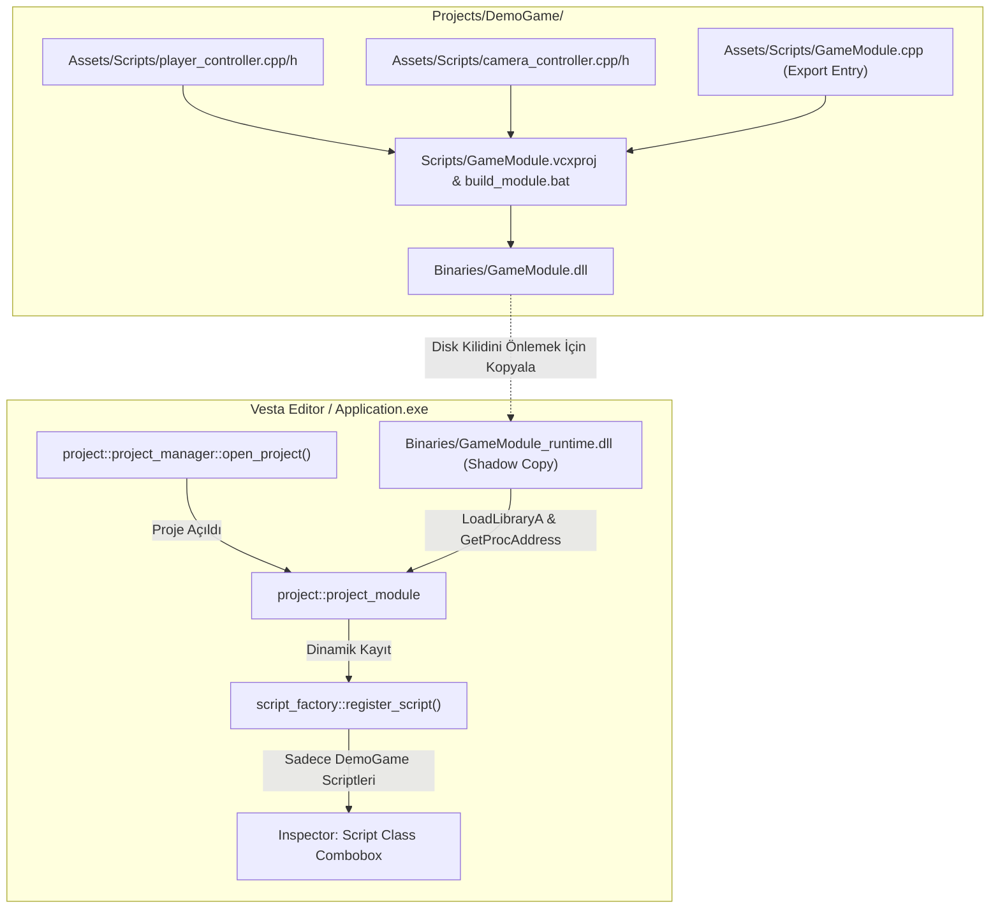

# Aşama 3: Dinamik Oyun Modülü (GameModule.dll) ve Betik İzolasyonu Raporu

> **Tarih:** 16 Ekim 2026  
> **Aşama:** 3 / 4  
> **Durum:** ✅ Tamamlandı  
> **İlgili Yol Haritası:** [01_architecture_and_roadmap.md](file:///c:/Users/yusuf/source/repos/OpenGL-Learn-1/docs/planning/project_isolation_and_export/01_architecture_and_roadmap.md)

---

## 1. Amaç ve Kapsam

Bu aşamanın temel amacı, kullanıcı projelerinin C++ betiklerini (Scripts) motorun kendi çalıştırılabilir dosyasına statik olarak gömmek yerine, her projenin kendi betiklerini bağımsız bir dinamik kütüphane (`GameModule.dll`) olarak derlemesini ve editörün bu kütüphaneyi çalışma zamanında (`LoadLibrary` / `FreeLibrary`) dinamik olarak yüklemesini sağlamaktır.

Bu mimari sayesinde:
1. **Tam İzolasyon:** Motor ve Vesta Editör, projede hangi scriptlerin yazıldığından tamamen habersizdir.
2. **Projeye Özel Inspector:** Vesta Inspector panelindeki "Script Class" açılır menüsünde sadece o an açık olan projenin derlenmiş scriptleri listelenir.
3. **Kilitlenmesiz Derleme (Shadow-Copy):** Windows işletim sisteminde `LoadLibrary` ile açılan DLL dosyalarının disk üzerinde kilitlenmesi sorunu, modülün geçici bir çalışma kopyası (`GameModule_runtime.dll`) üzerinden yüklenmesiyle aşılmıştır. Geliştirici veya editör, oyun açıkken bile arka planda DLL'i yeniden derleyebilir.
4. **C-Linkage Taşınabilirlik:** Modül ile motor arasındaki iletişim saf C fonksiyon göstericileri üzerinden sağlanarak derleyici ABI uyumsuzlukları önlenmiştir.

---

## 2. Gerçekleştirilen Mimari Değişiklikler



### 2.1. Modül Dışa Aktarma Arayüzü ([`game_module.h`](file:///c:/Users/yusuf/source/repos/OpenGL-Learn-1/Engine/Scripting/game_module.h))

Kullanıcı betiklerinin dinamik olarak dışa aktarılmasını sağlayan saf C-linkage arayüzü ve makrolar tanımlandı:
- `GetScriptCount()`: Modüldeki kayıtlı betik adedi.
- `GetScriptName(int index)`: Belirtilen indeksteki sınıf adı.
- `InstantiateScript(const char* name)`: Sınıfın yeni bir örneğini türeten fabrika fonksiyonu.
- `DestroyScript(scriptable_entity* instance)`: Bellekten güvenle silen yok edici fonksiyon.

Kullanıcı projesinde tek bir dosyada (`GameModule.cpp`) betiklerin bildirilmesi sağlanmıştır:
```cpp
#include <Engine/Scripting/game_module.h>
#include "player_controller.h"
#include "camera_controller.h"

GAME_MODULE_BEGIN()
    GAME_MODULE_SCRIPT(player_controller)
    GAME_MODULE_SCRIPT(camera_controller)
GAME_MODULE_END()
```

---

### 2.2. Güvenli Modül Yükleyicisi ([`project_module.h`](file:///c:/Users/yusuf/source/repos/OpenGL-Learn-1/Engine/Project/project_module.h) & [`project_module.cpp`](file:///c:/Users/yusuf/source/repos/OpenGL-Learn-1/Engine/Project/project_module.cpp))

- **Gölge Kopyalama (Shadow Copy):** `load_module` çağrıldığında, `Binaries/GameModule.dll` dosyası `GameModule_runtime.dll` olarak kopyalanır ve bu kopya belleğe alınır. Böylece orijinal DLL asla kilitli kalmaz.
- **Dinamik Bağlama:** `GetProcAddress` ile semboller çözümlenir ve her bir betik `script_factory::register_script` çağrısıyla kayıt defterine aktarılır.
- **Eski Kayıtların Temizlenmesi:** `unload_module` çağrıldığında `FreeLibrary` yapılır, geçici kopya silinir ve `script_factory::unregister_all_scripts()` ile fabrika sıfırlanır.

---

### 2.3. Lambda Desteği için `native_script_component` İyileştirmesi ([`components.h`](file:///c:/Users/yusuf/source/repos/OpenGL-Learn-1/Engine/ECS/components.h))

Eski tasarımda `bind_instantiate` ve `bind_destroy` ham C fonksiyon göstericisi (`scriptable_entity* (*)()`) olarak tutuluyordu. Dinamik modülden gelen fonksiyon göstericilerini ve script adını yakalayan lambdaların (`[pInstantiate, scriptName]()`) saklanabilmesi için bu alanlar `std::function` yapısına dönüştürülmüştür:
```cpp
std::function<scriptable_entity*()> bind_instantiate;
std::function<void(native_script_component*)> bind_destroy;
```

---

### 2.4. DemoGame Bağımsız Derleme Altyapısı

`Projects/DemoGame/` projesi için bağımsız derleme sistemi oluşturuldu:
- [`Projects/DemoGame/Scripts/GameModule.vcxproj`](file:///c:/Users/yusuf/source/repos/OpenGL-Learn-1/Projects/DemoGame/Scripts/GameModule.vcxproj): `DynamicLibrary` çıktısı üreten, `Engine.lib` ve bağımlılıkları bağlayan proje şablonu.
- [`Projects/DemoGame/Scripts/build_module.bat`](file:///c:/Users/yusuf/source/repos/OpenGL-Learn-1/Projects/DemoGame/Scripts/build_module.bat): 64-bit MSBuild'i otomatik tespit ederek `Projects/DemoGame/Binaries/GameModule.dll` dosyasını 2-3 saniyede üreten betik.
- [`Projects/DemoGame/Assets/Scripts/GameModule.cpp`](file:///c:/Users/yusuf/source/repos/OpenGL-Learn-1/Projects/DemoGame/Assets/Scripts/GameModule.cpp): `player_controller` ve `camera_controller`'ı dışa aktaran modül girişi.

---

### 2.5. MSBuild Çıktı Dizini Düzeltmesi ([`Engine.vcxproj`](file:///c:/Users/yusuf/source/repos/OpenGL-Learn-1/Engine/Engine.vcxproj))

İncelemeler sırasında `Engine.vcxproj` dosyasında `<OutDir>` tanımlanmadığı için `Engine\x64\Debug\Engine.lib` oluşturulduğu, ancak `Application.vcxproj`'nin kökteki `x64\Debug\Engine.lib` dosyasını aradığı ve bu nedenle 2 saat önceki eski kütüphaneyi bağladığı tespit edildi. 
`Engine.vcxproj` dosyasına standart `<OutDir>..\$(Platform)\$(Configuration)\</OutDir>` eklenerek her iki projenin aynı güncel kütüphane üzerinden haberleşmesi garanti altına alındı.

---

## 3. Doğrulama ve Test Sonuçları

1. **Modül Derleme Testi:**
   `Projects/DemoGame/Scripts/build_module.bat` çalıştırıldı. 2.8 saniyede başarıyla tamamlandı ve `Projects/DemoGame/Binaries/GameModule.dll` üretildi.

2. **Dinamik Yükleme Testi:**
   `Application.exe Projects\DemoGame\project.json` komutu ile editör başlatıldı. Konsol çıktısı:
   ```
   [EditorLauncher] Komut satirindan proje aciliyor: Projects\DemoGame\project.json
   [ProjectManager] Temiz baslangic sahnesi olusturuldu (Yalnizca kamera, Entity ID: 1).
   [ProjectModule] Basarili: GameModule yuklendi (2 script kaydedildi):
     - [Script] player_controller
     - [Script] camera_controller
   [ProjectManager] Proje basariyla yuklendi: Projects\DemoGame (DemoGame)
   ```

3. **İzolasyon Doğrulaması:**
   - Proje açılmadığında veya boş proje oturumunda: `script_factory` boştur (0 script).
   - `DemoGame` açıldığında: Yalnızca `player_controller` ve `camera_controller` listelenir.
   - `Engine.lib` veya `Application.exe` içinde hiçbir oyun kodu barındırılmaz.

---

## 4. Sonraki Aşama: Aşama 4 (Standalone Build & Export Pipeline)

Artık motor, editör ve kullanıcı projesi birbirlerinden tam izole halde dinamik olarak çalıştığına göre son aşamaya geçilebilir:
- Vesta Top Bar menüsüne `Project -> Export Standalone Game...` seçeneği eklenmesi.
- `GameRuntime.exe` (saf yürütücü), `GameModule.dll`, `boot.config`, motor dahili kaynakları (`EngineResources/`), proje varlıkları (`Assets/`) ve gerekli üçüncü parti DLL'lerin (`glfw3.dll`, `assimp.dll` vb.) tek bir hedef klasöre otomatik paketlenmesi.

