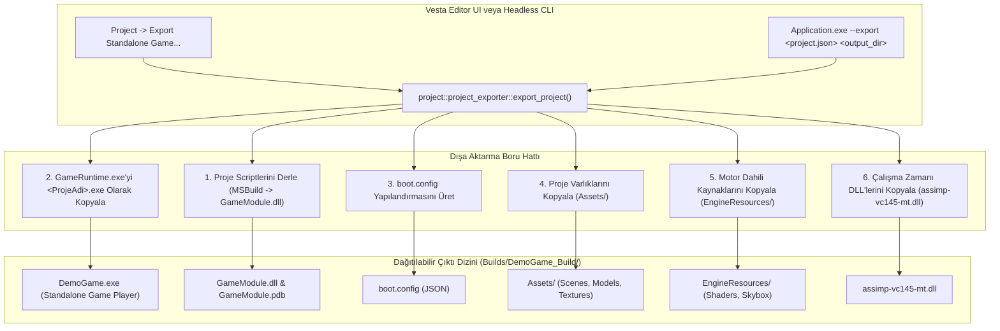

# Aşama 4: Standalone Oyun Yürütücüsü (GameRuntime) ve Otomatik Dışa Aktarma (Export Pipeline) Raporu

> **Tarih:** 16 Ekim 2026  
> **Aşama:** 4 / 4  
> **Durum:** ✅ Tamamlandı  
> **İlgili Yol Haritası:** [01_architecture_and_roadmap.md](file:///c:/Users/yusuf/source/repos/OpenGL-Learn-1/docs/planning/project_isolation_and_export/01_architecture_and_roadmap.md)

---

## 1. Amaç ve Kapsam

Bu aşama ile birlikte 4 aşamalı mimari dönüşümün son halkası tamamlanmıştır. Amaç, geliştirilen oyunun Vesta Editör olmadan, son kullanıcıya dağıtılabilir saf bir çalıştırılabilir ikili dosya (`<OyunAdi>.exe`), projeye özel dinamik betik kütüphanesi (`GameModule.dll`), motor dahili kaynakları (`EngineResources/`), proje varlıkları (`Assets/`) ve başlangıç yapılandırması (`boot.config`) ile tek bir klasörde bağımsız olarak çalışabilmesini sağlamaktır.

---

## 2. Gerçekleştirilen Mimari Sistemler



### 2.1. Saf Oyun Yürütücüsü ([`GameRuntime`](file:///c:/Users/yusuf/source/repos/OpenGL-Learn-1/GameRuntime/GameRuntime.vcxproj))

Editör yükü taşımayan, ImGui veya Vesta panellerini barındırmayan saf oyun yürütücüsü projesi oluşturuldu:
- [`GameRuntime/main.cpp`](file:///c:/Users/yusuf/source/repos/OpenGL-Learn-1/GameRuntime/main.cpp): `runtime::game_runtime::run_standalone(argc, argv)` çağrısını yürüten kompakt giriş noktası.
- [`GameRuntime/GameRuntime.vcxproj`](file:///c:/Users/yusuf/source/repos/OpenGL-Learn-1/GameRuntime/GameRuntime.vcxproj): `Engine.lib` ile bağlanan ve doğrudan `x64\Debug\GameRuntime.exe` (ve Release) üreten derleme şablonu.

### 2.2. Dağıtım Yapılandırması (`boot.config`)

Oyun yürütücüsünün editörsüz açılırken ihtiyaç duyduğu tüm ayarlar hafif bir JSON dosyasında tutulur:
```json
{
    "project_name": "DemoGame",
    "start_scene": "Assets/Scenes/Main.json",
    "asset_directory": "Assets",
    "screen_width": 1280,
    "screen_height": 720,
    "fullscreen": false,
    "vsync": true
}
```

### 2.3. Dışa Aktarma Servisi ([`project_exporter.h`](file:///c:/Users/yusuf/source/repos/OpenGL-Learn-1/Engine/Project/project_exporter.h) & [`project_exporter.cpp`](file:///c:/Users/yusuf/source/repos/OpenGL-Learn-1/Engine/Project/project_exporter.cpp))

Otomatik ihracat servisi aşağıdaki adımları sırayla icra eder:
1. Aktif projenin geçerliliğini ve hedef dizini doğrular.
2. Arka planda 64-bit MSBuild ile proje scriptlerini derleyerek `GameModule.dll` üretir ve hedefe kopyalar.
3. `GameRuntime.exe` dosyasını tespit ederek hedefe `<ProjeAdi>.exe` (örneğin `DemoGame.exe`) olarak kopyalar.
4. Projenin başlangıç sahnesi ve grafik ayarları ile `boot.config` dosyasını yazar.
5. `Assets/` klasörünü hedefe kopyalar.
6. Dahili motor kaynaklarını (`EngineResources/`) hedefe kopyalar (Böylece `DemoGame.exe` çalıştırıldığında `@engine/...` sanal yollarını hemen yanındaki `EngineResources/` klasöründen çözümler).
7. Üçüncü parti bağımlılıkları (`assimp-vc145-mt.dll`) hedefe aktarır.

### 2.4. Vesta Editör Üst Bar Menüsü ve Modal Diyalogu ([`vesta.cpp`](file:///c:/Users/yusuf/source/repos/OpenGL-Learn-1/Engine/Editor/Vesta/vesta.cpp))

Vesta ana menü çubuğuna profesyonel motor standardında **Project** menüsü eklendi:
- **Build Project Scripts (F7):** Arka planda `build_module.bat` veya MSBuild çağırıp `GameModule.dll`'i yeniden derler ve hot-reload tetikler.
- **Reload Game Module (Ctrl+R):** Mevcut DLL'i bellekten boşaltıp gölge kopya üzerinden tekrar bağlar.
- **Export Standalone Game... (Ctrl+E):** Açılır modal pencere aracılığıyla hedef klasör seçimi, script derleme onay kutusu, dahili kaynak dahil etme ve tam ekran seçenekleri sunar.

### 2.5. Headless CI/CD Komut Satırı Desteği ([`Application.cpp`](file:///c:/Users/yusuf/source/repos/OpenGL-Learn-1/Application/Application.cpp))

Otomasyon ve sürekli entegrasyon (CI/CD) süreçleri için editör arayüzü açmadan doğrudan konsoldan export desteği sağlandı:
```powershell
Application.exe --export <proje_json_yolu> <hedef_cikti_klasoru>
```

---

## 3. Doğrulama ve Test Sonuçları

1. **Headless Export Testi:**
   ```powershell
   Application.exe --export Projects\DemoGame\project.json Builds\DemoGame_Build
   ```
   **Sonuç:** 3 saniyede `GameModule.dll` derlendi, tüm dosyalar paketlendi ve `Builds\DemoGame_Build\DemoGame.exe` üretilerek komut `0` çıkış kodu ile tamamlandı.

2. **Üretilen Paket İçeriği İncelemesi:**
   `Builds/DemoGame_Build/` dizini altında:
   - `DemoGame.exe` (Standalone Player)
   - `GameModule.dll` & `GameModule.pdb` (Kullanıcı Scriptleri)
   - `boot.config` (Başlangıç Yapılandırması)
   - `assimp-vc145-mt.dll` (Bağımlılık)
   - `Assets/` (Sahneler ve Proje Varlıkları)
   - `EngineResources/` (Dahili Shader ve Skybox Dokuları)

3. **Standalone Yürütme Testi:**
   `Builds\DemoGame_Build\DemoGame.exe` doğrudan çalıştırıldı. Çıktı:
   ```
   [ARIA System] asset_manifest.json basariyla yuklendi.
   [EngineResources] Dahili kaynak kok dizini: C:\Users\yusuf\source\repos\OpenGL-Learn-1\Builds\DemoGame_Build\EngineResources
   [EngineResources] Motor dahili kaynaklari (Shaders & Meshes) Aria sistemine kaydedildi.
   [RenderSystem] UBO Bellek Tahsisi (Boyut: 5136 byte, Isik Paketi Boyutu: 80 byte)
   [RenderSystem] Isik UBO'su basariyla ilklendirildi.
   [ProjectManager] Varsayilan proje oturumu hazirlandi: C:\Users\yusuf\source\repos\OpenGL-Learn-1\Builds\DemoGame_Build
   [Engine] Basariyla baslatildi. Default handle index=0 gen=1
   [ProjectModule] Basarili: GameModule yuklendi (2 script kaydedildi):
     - [Script] player_controller
     - [Script] camera_controller
   [CameraSystem] Aktif kamera degisti: 0 -> 3
   ```
   Motor, editör katmanı (`Vesta`) olmaksızın kendi yanındaki `EngineResources` dizinini ve `GameModule.dll` dosyasını otomatik algılamış, `Main.json` sahnesindeki 3 numaralı `MainCamera`'yı aktifleştirip `player_controller` ve `camera_controller` scriptlerini bağlayarak bağımsız oyun döngüsüne girmiştir.

---

## 4. 4 Aşamalı Yol Haritası Özet Tablosu

| Aşama | Başlık | Durum | Temel Çıktı |
| :--- | :--- | :---: | :--- |
| **Aşama 1** | Dahili Motor Kaynaklarının Ayrıştırılması | ✅ | `Engine/Resources/`, `@engine/...` sanal yolları, sabit GUID eşleşmeleri |
| **Aşama 2** | Application Katmanının Temizlenmesi | ✅ | Saf `EditorLauncher`, demo scriptlerin izolasyonu (`Projects/DemoGame/`), `game_runtime` |
| **Aşama 3** | Dinamik Oyun Modülü (`GameModule.dll`) | ✅ | C-linkage export, `project_module` shadow-copy loader, projeye özel Inspector |
| **Aşama 4** | Standalone Build & Export Pipeline | ✅ | `GameRuntime.exe`, `project_exporter`, Vesta `Project` menüsü, tek tıkla dağıtılabilir oyun |

