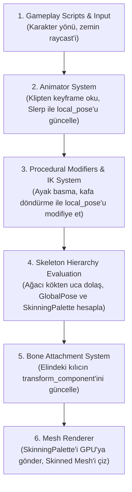

# 02 - ECS Bileşen Mimarisi & Çalışma Zamanı Veri Modeli

## 1. Mimari Tasarım ve Sorumlulukların Ayrılması (Separation of Concerns)

İskelet animasyonlarında motor mimarilerinin en sık düştüğü hata, çizim (render), iskelet durumu (skeleton state) ve animasyon oynatıcıyı (animator) tek bir devasa bileşende birleştirmektir. 

Bunun yerine **OpenGL-Learn-1** motoru için önerilen modern, modüler ve ECS dostu bileşen ayrımı şöyledir:

```
+--------------------------------------------------------------------------------+
|                             Kullanıcı Varlığı (Entity)                         |
+--------------------------------------------------------------------------------+
|  [skinned_mesh_component]  --> Geometriyi ve Materyalleri işaret eder (Görsel)  |
|  [skeleton_component]      --> Kemiklerin anlık pozunu ve matrislerini tutar    |
|  [animator_component]      --> Klipleri çalar, enterpolasyon ve blend yapar     |
|  [ik_solver_component]     --> (Opsiyonel) Ayak/kafa prosedürel pozunu çözer    |
+--------------------------------------------------------------------------------+
                                       |
                   (Kemik Takibi / Socket Mekanizması)
                                       v
+--------------------------------------------------------------------------------+
|                 Bağlı Eşya Varlığı (Örn: Elindeki Kılıç / Silah)                |
+--------------------------------------------------------------------------------+
|  [bone_attachment_component] --> "RightHand" kemiğinin dünya pozisyonunu izler  |
|  [transform_component]       --> Otomatik olarak her kare güncellenir          |
|  [mesh_component]            --> Silah modeli (Statik mesh)                    |
+--------------------------------------------------------------------------------+
```

---

## 2. Bileşen Tanımları (Component Specifications)

### 2.1. `skinned_mesh_component`
Statik `mesh_component` yapısına paralel olarak tasarlanır; ancak GPU'ya deri yüzme (skinning) niteliklerine sahip VAO/VBO ile çizim yapılması gerektiğini bildirir.

```cpp
/**
 * @struct skinned_mesh_component
 * @brief İskeletli (derili) 3D modellerin render referansını tutar.
 */
struct skinned_mesh_component {
    aria::handle<aria::model_asset> model_handle; ///< Model geometrisi (raw_skinned_vertex içeren).
    size_t sub_mesh_index{ 0 };                   ///< Çizilecek alt ağ indeksi.
    bool cast_shadows{ true };                    ///< Gölge haritasına dahil edilme durumu.
};
```

### 2.2. `skeleton_component` (Çalışma Zamanı Poz ve Matris Havuzu)
İskeletin statik verileri (`skeleton_asset` içinde) sadece okunurken; her bir karakterin dünyadaki anlık kemik dönüşümleri `skeleton_component` üzerinde yaşar.

```cpp
/**
 * @struct bone_transform
 * @brief Tek bir kemiğin yerel TRS (Translation, Rotation, Scale) pozu.
 */
struct bone_transform {
    glm::vec3 position{ 0.0f };
    glm::quat rotation{ 1.0f, 0.0f, 0.0f, 0.0f };
    glm::vec3 scale{ 1.0f };

    [[nodiscard]] glm::mat4 to_matrix() const {
        glm::mat4 m = glm::translate(glm::mat4(1.0f), position);
        m *= glm::mat4_cast(rotation);
        m = glm::scale(m, scale);
        return m;
    }
};

/**
 * @struct skeleton_component
 * @brief Bir varlığın çalışma zamanındaki canlı kemik pozlarını ve GPU matris paletini barındırır.
 */
struct skeleton_component {
    aria::handle<aria::skeleton_asset> skeleton_handle;

    /// @brief Her kemiğin ebeveynine göre anlık yerel TRS dönüşümü (Animatör veya IK tarafından yazılır).
    std::vector<bone_transform> local_pose;

    /// @brief Her kemiğin model kök uzayındaki global matrisi (Hiyerarşi çözülünce hesaplanır).
    std::vector<glm::mat4> global_pose;

    /// @brief GPU Vertex Shader'a aktarılacak nihai matris paleti: GlobalPose * OffsetMatrix.
    std::vector<glm::mat4> skinning_palette;

    bool is_dirty{ true }; ///< Poz değiştiğinde hiyerarşinin yeniden hesaplanmasını tetikler.
};
```

### 2.3. `animator_component` (Klip Oynatıcı ve Karıştırıcı)
Zaman içindeki ilerlemeyi, klip geçişlerini (crossfade / blend) ve oynatma durumunu yönetir.

```cpp
/**
 * @struct animation_blend_state
 * @brief İki animasyon arasındaki yumuşak geçiş (Crossfade) durum bilgisi.
 */
struct animation_blend_state {
    aria::handle<aria::animation_clip_asset> target_clip;
    float current_weight{ 0.0f };  ///< 0.0 (eski klip) ile 1.0 (yeni klip) arası.
    float target_weight{ 1.0f };
    float fade_duration{ 0.25f };  ///< Geçiş süresi (saniye cinsinden).
    float fade_timer{ 0.0f };
    bool is_blending{ false };
};

/**
 * @struct animator_component
 * @brief İskelete animasyon klibi uygulayan oynatıcı bileşen.
 */
struct animator_component {
    aria::handle<aria::animation_clip_asset> current_clip;
    float playback_time{ 0.0f };    ///< Klip içindeki mevcut zaman (saniye veya tick).
    float playback_speed{ 1.0f };   ///< Oynatma hızı çarpanı (1.0 normal, 0.5 yavaş, -1.0 ters).
    bool is_playing{ true };
    bool is_looping{ true };

    animation_blend_state blend_state;

    /// @brief Kök Hareketi (Root Motion): Hips kemiğindeki yer değiştirmeyi karaktere aktarma bayrağı.
    bool apply_root_motion{ false };
};
```

### 2.4. `bone_attachment_component` (Socket Sistemi)
Silah, kalkan, şapka, kamera veya fener gibi nesnelerin belirli bir kemiğe (örn. `"mixamorig:RightHand"`) fiziksel olarak bağlanmasını sağlar.

```cpp
/**
 * @struct bone_attachment_component
 * @brief Bir varlığın başka bir varlığın belirli bir kemiğine yapışmasını sağlar.
 */
struct bone_attachment_component {
    entity target_skeleton_entity{ 0 }; ///< İskelet bileşenine sahip ebeveyn varlık.
    std::string bone_name;              ///< Takip edilecek kemik adı (Örn: "mixamorig:RightHand").
    int cached_bone_index{ -1 };        ///< Hızlı erişim için önbelleklenmiş kemik indeksi.

    glm::vec3 local_offset{ 0.0f };     ///< Kemik eksenine göre yerel konum sapması.
    glm::vec3 local_rotation{ 0.0f };   ///< Kemik eksenine göre yerel açı sapması (Euler veya Quat).
    glm::vec3 local_scale{ 1.0f };      ///< Yerel ölçek sapması.
};
```

---

## 3. Kare Döngüsü & Yürütme Sıralaması (Execution Pipeline Order)

İskelet animasyonlarında bileşenlerin güncellenme sırası görsel yırtılmaların (jitter / 1 frame lag) engellenmesi için hayati önem taşır:



### 3.1. Hiyerarşik Matris Çözümleme Matematiksel Akışı
Her karede `SkeletonSystem` şu matematiksel adımları icra eder:

1. **Yerel Matris Oluşturma:**
   $$M_{local}^i = \text{Translate}(P_i) \cdot \text{Rotate}(Q_i) \cdot \text{Scale}(S_i)$$
2. **Global (Model Uzayı) Poz Matrisi:**
   Kökten yapraklara doğru özyinelemeli veya topolojik sıralı döngüyle:
   $$M_{global}^i = M_{global}^{parent(i)} \cdot M_{local}^i$$
   *(Kök kemik için $M_{global}^{root} = M_{local}^{root}$)*
3. **Nihai Deri Matrisi (Final Skinning Matrix):**
   Köşeyi bind pose'dan mevcut kemik pozuna taşıyan nihai matris:
   $$M_{skinning}^i = M_{global}^i \cdot M_{offset}^i$$
   Bu matris, GPU'daki uniform/SSBO dizisine ($U[i]$) yazılır.

---

## 4. SERA Yansıma (Reflection) Entegrasyonu

Mevcut `Engine/ECS/components.h` içerisindeki SERA makroları ile bu bileşenler sahne kaydetme/yükleme (Scene Save/Load) sistemine tam entegre edilir:

```cpp
DESCRIBE_COMPONENT(skinned_mesh_component,
    SERA_FIELD(sub_mesh_index),
    SERA_FIELD(cast_shadows)
)

DESCRIBE_COMPONENT(animator_component,
    SERA_FIELD(playback_speed),
    SERA_FIELD(is_playing),
    SERA_FIELD(is_looping),
    SERA_FIELD(apply_root_motion)
)

DESCRIBE_COMPONENT(bone_attachment_component,
    SERA_FIELD(target_skeleton_entity),
    SERA_FIELD(bone_name),
    SERA_FIELD(local_offset),
    SERA_FIELD(local_rotation),
    SERA_FIELD(local_scale)
)
```
*(Not: `skeleton_component` içindeki `skinning_palette` çalışma zamanında tamamen dinamik üretildiğinden diske kaydedilmez; sadece iskelet dosya GUID referansı serileştirilir).*

