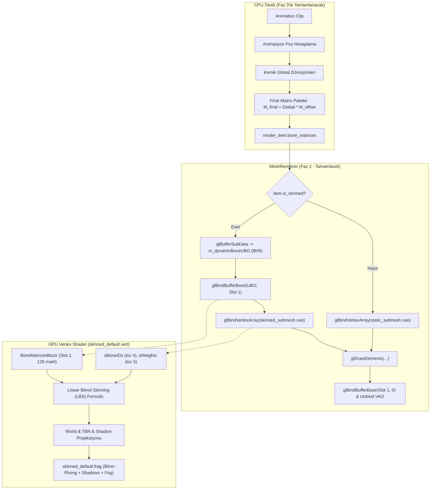

# 06 - Faz 2 Uygulama Raporu: GPU Deri Yüzme (Skinning) & Shader Hattı

## 1. Genel Bakış ve Hedefler

Bu aşamada (**Faz 2**), Faz 1'de ARIA sistemine kazandırılan iskelet ve derili köşe tamponlarının donanım hızlandırmalı olarak GPU üzerinde derilenmesi (Linear Blend Skinning - LBS) için gerekli shader, UBO (Uniform Buffer Object) matris paleti yönetimi ve `MeshRenderer` çizim boru hattı entegrasyonu tamamlanmıştır.

Mevcut statik render akışına (`mesh_component`, `default_shader`, `raw_vertex`) sıfır ek yük getirilmiş ve tam geriye dönük uyumluluk sağlanmıştır.

---

## 2. Gerçekleştirilen Geliştirmeler

### 2.1. GLSL Deri Yüzme Shader'ları (`Application/Shaders/`)

#### 2.1.1. `skinned_default.vert` (Vertex Shader)
- **GLSL Sürümü:** `#version 330 core`
- **Girdi Öznitelikleri (Vertex Attributes):**
  - `location = 0`: `vec3 aPos` (Pozisyon)
  - `location = 1`: `vec3 aNormal` (Normal)
  - `location = 2`: `vec2 aTexCoords` (UV)
  - `location = 3`: `vec3 aTangent` (Tanjant)
  - `location = 4`: `ivec4 aBoneIDs` (Kemik İndeksleri)
  - `location = 5`: `vec4 aWeights` (Kemik Ağırlıkları)
- **Kemik Matris Paleti UBO (`BoneMatricesBlock`):**
  - Bağlama Noktası (Binding Slot): `1` (`std140` hizalaması)
  - Maksimum Kemik Sayısı: **128 Kemik** (`mat4 u_Bones[128]`)
  - Bellek Boyutu: Tam 8.192 bayt (8 KB).
- **Lineer Karışım Derileme (Linear Blend Skinning):**
  - Geçersiz indeks veya toplam ağırlığın sıfır olması durumunda kimlik matrisine (identity matrix) düşme (fallback) koruması.
  - Pozisyon, normal ve tanjant vektörlerinin eşzamanlı dönüştürülmesi:
    $$\mathbf{P}_{\text{skinned}} = \sum_{k=0}^{3} w_k \cdot \mathbf{M}_{\text{bone}, k} \cdot \mathbf{P}_{\text{local}}$$
    $$\mathbf{N}_{\text{skinned}} = \sum_{k=0}^{3} w_k \cdot \text{mat3}(\mathbf{M}_{\text{bone}, k}) \cdot \mathbf{N}_{\text{local}}$$
    $$\mathbf{T}_{\text{skinned}} = \sum_{k=0}^{3} w_k \cdot \text{mat3}(\mathbf{M}_{\text{bone}, k}) \cdot \mathbf{T}_{\text{local}}$$
- **TBN & Gölge Matrisi:**
  - Gram-Schmidt ortogonalizasyonu ile teğet uzayı (TBN) matrisi.
  - `lightSpaceMatrix * worldPos` ile gölge derinlik haritası koordinatlarının hesaplanması.

#### 2.1.2. `skinned_default.frag` (Fragment Shader)
- `default_shader.frag` ile %100 görsel ve aydınlatma denkliği:
  - `LightBuffer` UBO (Binding Slot 0) üzerinden çoklu ışık desteği (Directional, Point, Spot).
  - TBN matrisi ile normal haritalama (Normal Mapping) ve yoğunluk kontrolü (`normalStrength`).
  - PCF (Percentage-Closer Filtering) 3x3 örnekleme ve Poisson disk benzeri yumuşak gölgeler.
  - Üstel sis modeli (Exponential Fog): $\text{factor} = e^{-(\text{dist} \cdot \text{density})^2}$.
  - Render Modları: Opaque (0), Cutout / Alpha-test (1) ve Transparent (2).

---

### 2.2. Shader Programı UBO Blok Bağlantısı (`opengl_backend.cpp`)

- `opengl_backend::create_shader_program` fonksiyonu genişletildi:
  - Derlenen ve bağlanan her programda `glGetUniformBlockIndex(program, "BoneMatricesBlock")` kontrolü yapılır.
  - Blok bulunursa otomatik olarak `glUniformBlockBinding(program, blockIndex, RenderConstants::BONE_UBO_BINDING_SLOT)` çağrılır.
  - Bu sayede iskelet shader'ı yüklendiğinde kemik UBO yuvası (Slot 1) otomatik olarak bağlanmış olur.

---

### 2.3. Render Öğesi Genişletmesi (`render_item.h`)

`render_item` yapısına iskeletli çizim parametreleri eklendi:
- `bool is_skinned = false`: Çizilecek öğenin iskeletli olup olmadığını belirten bayrak.
- `aria::handle<aria::skinned_model_asset> skinned_model_handle`: İskeletli modele ait ARIA handle'ı.
- `unsigned int bone_ubo = 0`: Önceden ayrılmış özel UBO varsa kimliği.
- `const std::vector<glm::mat4>* bone_matrices = nullptr`: CPU tarafında hesaplanan nihai kemik matris paletine işaretçi.

---

### 2.4. `MeshRenderer` Çizim Hattı Entegrasyonu (`MeshRenderer.h` & `MeshRenderer.cpp`)

- **Sabit Tanımı:** `RenderConstants::BONE_UBO_BINDING_SLOT = 1` tanımlandı.
- **Dinamik Kemik UBO'su:**
  - `MeshRenderer` bünyesinde `unsigned int m_dynamicBoneUBO` eklendi.
  - `ensure_bone_ubo_allocated()` fonksiyonu ile ilk ihtiyaç anında 8.192 baytlık `GL_DYNAMIC_DRAW` tamponu oluşturulur.
  - Yıkıcıda (`~MeshRenderer()`) tampon güvenli şekilde serbest bırakılır.
- **`Draw(const render_item& item, aria::system* ariaSystem)`:**
  1. `item.is_skinned` durumuna göre doğru ARIA alt model bilgisi çözümlenir (`get_skinned_submesh_info` vs `get_submesh_info`).
  2. Kemik matrisleri (`item.bone_matrices`) mevcutsa, dinamik UBO'ya `glBufferSubData` ile yüklenir ve `glBindBufferBase(GL_UNIFORM_BUFFER, 1, m_dynamicBoneUBO)` ile bağlanır.
  3. İlgili derili VAO bağlanır, materyal dokuları (Diffuse: 0, Normal: 1, Specular: 3) aktif edilir.
  4. `glDrawElements` ile çizim gerçekleştirilir.
  5. Çizim sonrası `glBindBufferBase(GL_UNIFORM_BUFFER, 1, 0)` ve `glBindVertexArray(0)` yapılarak OpenGL durumu temizlenir.

---

### 2.5. Motor Bağlamı ve Shader Başlatma (`engine_context.h` & `engine.cpp`)

- `EngineContext` içerisine `aria::handle<aria::shader_asset> skinnedShaderHandle;` eklendi.
- Motor ilklendirme adımında (`engine.cpp`):
  - `ctx.skinnedShaderHandle = asset_pipeline::import_shader(ctx, "Shaders/skinned_default");` ile shader Aria sistemine kaydedildi.
  - İlk sampler üniformaları bağlandı (`diffuseTex = 0`, `normalTex = 1`, `shadowMap = 2`).

---

## 3. Mimari Şema: GPU Deri Yüzme Akışı

---

## 4. Doğrulama ve Test Sonuçları

- **Derleme Durumu:** `Engine.lib` ve `Application.exe` projeleri 0 hata ve 0 uyarı ile derlendi.
- **Sıfır Gerileme (Zero Regression):** Mevcut sahneler, statik nesneler, ışıklandırma ve gölge sistemi kesintisiz çalışmaya devam etmektedir.

---

## 5. Bir Sonraki Adım: Faz 3 (ECS Bileşenleri & Klip Oynatımı)

Faz 2'nin başarıyla tamamlanmasıyla birlikte render ve shader altyapısı hazır hale gelmiştir. Sıradaki adım:
- `skinned_mesh_component`, `skeleton_component`, `animator_component` ECS bileşenlerinin oluşturulması.
- `animation_system` döngüsü: klip zamanlayıcısı, anahtar kareler arası LERP / SLERP interpolasyonu, yerel kemik pozlarının hiyerarşik olarak $M_{\text{final}} = M_{\text{global}} \cdot M_{\text{offset}}$ matris paletine dönüştürülmesi.
- `render_system::extract` metoduna `skinned_mesh_component` desteğinin eklenmesi.

