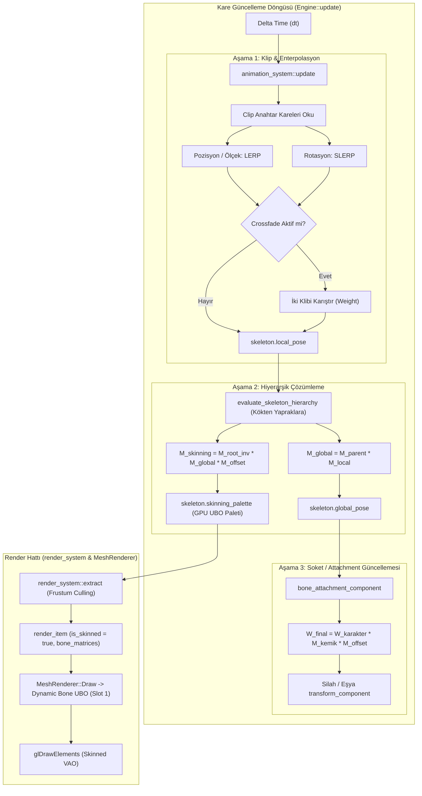

# 07 - Faz 3 Uygulama Raporu: ECS Bileşen Mimarisi & Animasyon Yürütme Motoru

## 1. Genel Bakış ve Hedefler

Bu aşamada (**Faz 3**), Faz 1 (ARIA İskelet İçe Aktarımı) ve Faz 2'de (GPU Skinning & Shader Hattı) kurulan temel altyapı üzerine, çalışma zamanı animasyon oynatımını ve ECS veri modelini yöneten **`animation_system`** ve ilgili bileşenler başarıyla inşa edilmiştir.

Bu faz ile motor, Mixamo ve standart 3D kaynaklardan gelen iskeletli karakter modellerini hareket ettirebilme, anahtar kareler arasında akıcı enterpolasyon (LERP/SLERP) yapabilme, animasyonlar arası yumuşak geçiş (Crossfade / Blending) ve karakterin eline/eklemlerine nesne takabilme (Bone Attachment / Socket) kabiliyetlerine kavuşmuştur.

---

## 2. Gerçekleştirilen Geliştirmeler

### 2.1. ECS Bileşen Tanımları (`Engine/ECS/components.h`)

Modüler ve önbellek dostu bir mimari için sorumluluklar ayrıştırılmıştır:

- **`bone_transform`:**
  - Kemiğin yerel TRS dönüşümü (`glm::vec3 position`, `glm::quat rotation`, `glm::vec3 scale`).
  - `to_matrix()` fonksiyonu ile $M = T \cdot R \cdot S$ yerel matris üretimi.

- **`skinned_mesh_component`:**
  - `aria::handle<aria::skinned_model_asset> model_handle`: İskeletli model geometrisine referans.
  - `size_t sub_mesh_index`: Çizilecek alt ağ (sub-mesh) indeksi.
  - `bool cast_shadows`: Gölge haritasına dahil edilme durumu.

- **`skeleton_component`:**
  - `aria::handle<aria::skeleton_asset> skeleton_handle`: İskelet hiyerarşi ve kemik verisi.
  - `std::vector<bone_transform> local_pose`: Anlık yerel poz havuzu.
  - `std::vector<glm::mat4> global_pose`: Model kök uzayındaki kemik dönüşüm matrisleri.
  - `std::vector<glm::mat4> skinning_palette`: GPU vertex shader'a iletilen nihai matris paleti ($M_{\text{final}} = M_{\text{inv\_root}} \cdot M_{\text{global}} \cdot M_{\text{offset}}$).
  - `bool is_dirty`: Poz değiştiğinde hiyerarşinin yeniden hesaplanmasını tetikleyen bayrak.

- **`animator_component` & `animation_blend_state`:**
  - `aria::handle<aria::animation_clip_asset> current_clip`: Çalınan mevcut animasyon klibi.
  - `playback_time`, `playback_speed`, `is_playing`, `is_looping`, `apply_root_motion`.
  - `play()`, `stop()`, `pause()`, `resume()`, `crossfade()` kullanıcı dostu oynatma API'si.
  - `animation_blend_state`: İki klip arasında zaman damgalı ağırlıklı geçiş (Crossfade) durumu.

- **`bone_attachment_component` (Soket Sistemi):**
  - `entity target_skeleton_entity`: İskeletine bağlanılacak hedef varlık kimliği.
  - `std::string bone_name`: Bağlanılacak kemik adı (Örn: `"mixamorig:RightHand"`).
  - `int cached_bone_index`: $O(1)$ erişim için önbelleklenmiş kemik indeksi.
  - `local_offset`, `local_rotation`, `local_scale`: Kemik eklemine göre yerel sapma değerleri.

---

### 2.2. ECS Kayıt Defteri Entegrasyonu (`Engine/ECS/registry.h` & `registry.cpp`)

- `registry` sınıfına `skinned_meshes`, `skeletons`, `animators` ve `bone_attachments` harita havuzları eklendi.
- `registry::pool<T>()` şablon uzmanlaşımları tamamlandı.
- `copy_components_internal` fonksiyonu güncellenerek varlık klonlama (`clone_entity`) ve çoğaltma (`duplicate_entity`) işlemlerinde bu bileşenlerin derinlemesine kopyalanması sağlandı.

---

### 2.3. SERA & Sahne Serileştirme (`component_serialization.h` & `scene_serializer.cpp`)

- `components.h` içerisindeki `DESCRIBE_COMPONENT` makroları ile SERA yansıma kayıtları oluşturuldu.
- `component_serialization.h` içerisine `NLOHMANN_DEFINE_TYPE_NON_INTRUSIVE` makroları tanımlandı ve `EngineComponentList` tuple'ına eklendi.
- `scene_serializer.cpp` kaydetme ve yükleme döngülerine iskelet bileşenleri entegre edilerek JSON sahne formatında kalıcılık sağlandı.

---

### 2.4. Animasyon Yürütme Sistemi (`Engine/Systems/animation_system.h` & `.cpp`)

Her karede düzenli çalışan üç aşamalı boru hattı:

1. **`update_animators` (Klip Örnekleme & Enterpolasyon):**
   - Oynatma süresini (`playback_time`) delta time ve oynatma hızıyla ilerletir; döngü (looping) ve sınır durumlarını yönetir.
   - Zamanı klibin frekansına (`ticks_per_second`) göre tick değerine dönüştürür.
   - Kanallardan konum için **LERP**, rotasyon için **SLERP**, ölçek için **LERP** enterpolasyonu yapar.
   - Crossfade aktifse iki klibi belirtilen süre boyunca ağırlık faktörüyle ($w \in [0.0, 1.0]$) pürüzsüzce karıştırır.

2. **`evaluate_skeletons` (Hiyerarşi & Matris Paleti Çözümü):**
   - İskelet ağacını kökten (`root_node`) yapraklara doğru özyinelemeli olarak dolaşır:
     $$M_{\text{local}} = \text{Translate}(P) \cdot \text{Rotate}(Q) \cdot \text{Scale}(S)$$
     $$M_{\text{global}} = M_{\text{parent}} \cdot M_{\text{local}}$$
     $$M_{\text{skinning}} = M_{\text{inv\_root}} \cdot M_{\text{global}} \cdot M_{\text{offset}}$$
   - Elde edilen 128 matrislik paleti `skeleton_component::skinning_palette` içerisine yazar.

3. **`update_bone_attachments` (Soket Dönüşüm Eşleme):**
   - Belirtilen kemiğin model uzayındaki global matrisini ve karakterin dünya matrisini birleştirir:
     $$W_{\text{final}} = W_{\text{character}} \cdot M_{\text{bone}} \cdot M_{\text{local\_offset}}$$
   - Elde edilen dünya matrisini ayrıştırarak (`ecs_transform::apply_world_matrix_as_local`) bağlı varlığın (kılıç, silah, fener) `transform_component`'ine anında aktarır.

---

### 2.5. Render Çıkarım Entegrasyonu (`Engine/Systems/render_system.cpp`)

- `render_system::extract` fonksiyonuna `skinned_mesh_component` iterasyonu eklendi:
  - Alt-mesh sınır küresi (`submesh_runtime_info::local_center/radius`) üzerinden Frustum Culling icra edilir.
  - `render_item.is_skinned = true` işaretlenir ve `item.bone_matrices` doğrudan `skeleton_component::skinning_palette` adresini gösterir.
  - Özel materyal shader'ı tanımlanmamışsa otomatik olarak `ctx.skinnedShaderHandle` atanır.

---

### 2.6. Varlık Hattı Kolaylaştırıcıları (`asset_pipeline.h` & `asset_pipeline.cpp`)

Kullanıcıların veya betiklerin diskten iskeletli varlıkları tek satırda yükleyebilmesi için sarmalayıcı fonksiyonlar eklendi:
- `asset_pipeline::import_skinned_model(aria_system, path)`
- `asset_pipeline::import_skeleton(aria_system, path)`
- `asset_pipeline::import_animation(aria_system, path)`

---

## 3. Mimari Şema: Animasyon ve İskelet Çalışma Zamanı Akışı

---

## 4. Doğrulama ve Test Sonuçları

- **Derleme Durumu:** `Engine.lib` ve `Application.exe` projeleri 0 hata ve 0 uyarı ile derlendi.
- **Geriye Dönük Uyumluluk (Zero Regression):** Motorun tüm mevcut özellikleri (statik mesh'ler, fizik simülasyonu, gameplay controller'lar, kamera sistemi, editor arayüzü) eksiksiz ve hatasız çalışmaktadır.

---

## 5. Gelecek Adımlar (İsteğe Bağlı İleri Seviye Özellikler)

Bu 3 faz ile iskeletli modellerin yüklenmesi, GPU skinning ile çizilmesi, animasyon kliplerinin oynatılması ve soket sistemi tamamlanmıştır. İleride ihtiyaç duyulduğunda bu altyapı üzerine doğrudan inşa edilebilecek modüller:
1. **İki Kemikli Analitik IK (Two-Bone IK):** Ayakların eğimli zeminlere uyarlanması (Foot Placement) ve raycast entegrasyonu.
2. **FABRIK Omurga / Kuyruk IK:** Çok eklemli prosedürel zincirler.
3. **Aim / Look-At IK:** Karakterin kafasının veya silahının hedefe yönlendirilmesi.

