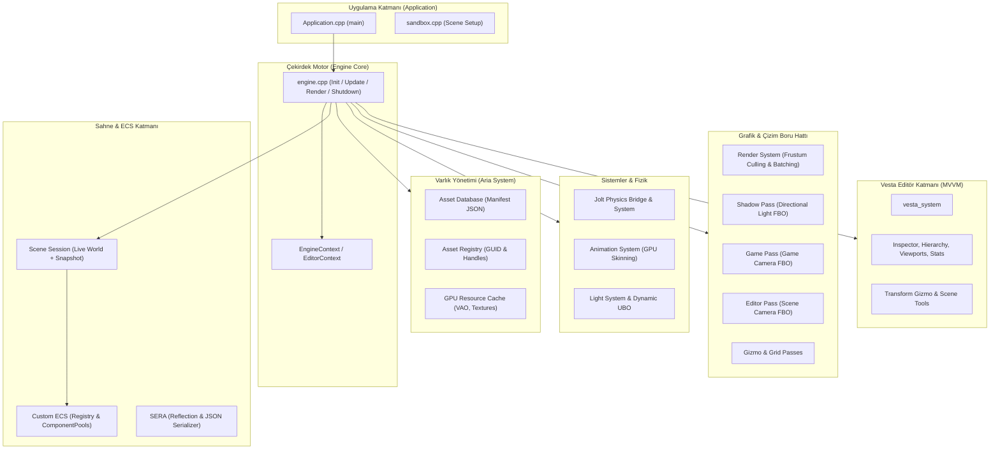
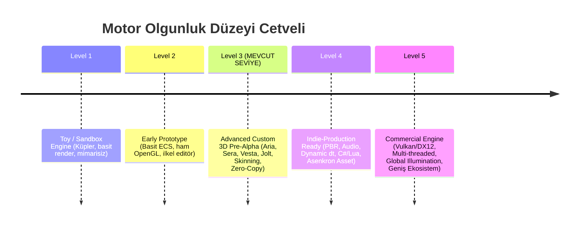

# PS1 Engine (OpenGL-Learn-1) Kapsamlı Kod Tabanı, Mimari Analiz ve Olgunluk Değerlendirme Raporu

**Rapor Tarihi:** 16 Ekim 2026  
**Analiz Edilen Çözüm:** `OpenGL-Learn-1.slnx` (`Engine` + `Application`)  
**Hedef Kitle:** Motor Geliştiricileri, Sistem Mimarları ve Proje Yöneticileri  
**Rapor Türü:** Statik Kod Analizi, Mimari İnceleme, Olgunluk Düzeyi Tespiti ve Profesyonel Puanlama  

---

## 1. Yönetici Özeti (Executive Summary)

Bu rapor; **PS1 Engine** (proje adıyla `OpenGL-Learn-1`) kod tabanının satır sayısı metriklerini, modüler mimarisini, veri akışını, endüstri standartlarına uygunluk düzeyini ve eksik kalan yönlerini kapsamlı bir şekilde ortaya koymak amacıyla hazırlanmıştır.

Proje; C++17/20 standartlarında geliştirilmiş, harici modern kütüphanelerle (**Jolt Physics, Dear ImGui, stb, nlohmann/json**) desteklenmiş, özel bir **Vesta Editor**, **Aria Asset Pipeline**, **Sera Serialization** ve çok geçişli bir **OpenGL 3.3 Core Renderer** barındıran **ileri düzey özel 3D oyun motorudur**.

Yapılan detaylı statik analiz sonucunda, motorun "öğrenme amaçlı basit bir hobi motoru (toy engine)" seviyesini çoktan aştığı; **profesyonel motorlarda görülen sıfır kopyalı canlı dünya (Zero-Copy Single Live World), nesil sayaçlı Handle varlık yönetimi, GPU iskelet animasyon matris paleti ve matematiksel olarak gelişmiş eksen manipülatörleri (Gizmo)** gibi katmanlara sahip olduğu tespit edilmiştir.

---

## 2. Kod Tabanı Boyutu ve Satır Sayısı Analizi (LOC & SLOC Metrics)

Proje dizininde yapılan derinlemesine kod satırı analizinde; **geliştirici tarafından yazılan özgün kodlar** ile **üçüncü parti kütüphaneler (Externals)** kesin hatlarla birbirinden ayrılarak incelenmiştir.

### 2.1. Genel Özet Tablosu

| Metrik Türü | Özgün Proje Kodları (Engine + Application) | Harici Kütüphaneler (Engine/Externals) | Tüm Depo Toplamı |
| :--- | :---: | :---: | :---: |
| **Toplam Dosya Sayısı** | **261** | 541 | **802** |
| **Toplam Satır (Lines)** | **28,479** | 210,608 | **239,087** |
| **Saf Kod Satırı (SLOC)** | **18,149** | 144,027 | **162,176** |
| **Yorum Satırı (Comments)** | **5,646** *(%19.82)* | 36,594 *(%17.37)* | **42,240** |
| **Boşluk Satırı (Blanks)** | **4,684** *(%16.45)* | 29,987 *(%14.24)* | **34,671** |

> [!NOTE]
> **Yorum Satırı Oranı (%19.82):** Yazılım mühendisliği literatüründe sağlıklı ve profesyonel C++ projeleri için ideal yorum/kod oranı %15 - %22 arasındadır. Projenin %19.82'lik yorum oranı ve Doxygen formatındaki dokümantasyon blokları, kod tabanının yüksek bir bakım yapılabilirlik (maintainability) disipliniyle inşa edildiğini kanıtlamaktadır.

---

### 2.2. Dosya Uzantısına Göre Dağılım (Özgün Kodlar)

| Uzantı | Açıklama | Dosya Sayısı | Toplam Satır | Saf Kod (SLOC) | Yorum Satırı | Boşluk |
| :--- | :--- | :---: | :---: | :---: | :---: | :---: |
| `.cpp` | C++ Kaynak Dosyaları | 82 | 15,224 | 11,395 | 1,364 | 2,465 |
| `.h` | C++ Başlık (Header) Dosyaları | 153 | 11,992 | 5,879 | 4,185 | 1,928 |
| `.frag` | GLSL Fragment Gölgelendiricileri | 10 | 701 | 491 | 54 | 156 |
| `.glsl` | Ortak GLSL Kütüphaneleri | 6 | 308 | 191 | 42 | 75 |
| `.vert` | GLSL Vertex Gölgelendiricileri | 10 | 254 | 193 | 1 | 60 |
| **Toplam** | | **261** | **28,479** | **18,149** | **5,646** | **4,684** |

---

### 2.3. Modüllere Göre Satır ve Dosya Dağılımı

Motorun özgün kaynak kodlarının hangi mimari katmanlarda yoğunlaştığını gösteren liste:

| Modül / Dizin | Dosya | Toplam Satır | Saf Kod (SLOC) | Yorum | Açıklama |
| :--- | :---: | :---: | :---: | :---: | :--- |
| **Engine/Editor** (Vesta) | 78 | 10,176 | 6,601 | 1,967 | Editör UI, Paneller, Gizmo, Viewport & ViewModels |
| **Engine/Engine** (Core & Aria) | 26 | 4,707 | 2,915 | 1,008 | Yaşam döngüsü, Aria Varlık Sistemi, Context |
| **Engine/Renderer** | 36 | 3,056 | 1,900 | 657 | Render geçişleri (Passes), FBO'lar, Malzeme yöneticisi |
| **Engine/Gameplay** | 21 | 2,134 | 1,247 | 571 | Scripting arayüzü, Rigidbody wrapper'lar, Giriş API |
| **Engine/Systems** | 14 | 1,985 | 1,365 | 293 | RenderSystem, AnimationSystem, Physics, Light |
| **Engine/Sera** | 9 | 1,238 | 793 | 256 | Sahne & Varlık Kaynak Mimarisi / Serileştirme |
| **Engine/Scene** | 9 | 944 | 580 | 204 | Sahne oturumu (Snapshot), Scene hiyerarşisi |
| **Engine/ECS** | 7 | 884 | 597 | 137 | Registry, Bileşen havuzları (ComponentPool), Veri yapıları |
| **Application/Shaders** | 16 | 836 | 599 | 48 | Uygulama düzeyindeki GLSL shader'ları |
| **Engine/Importers** | 8 | 656 | 420 | 127 | Model, Doku, Cubemap içe aktarıcıları |
| **Engine/Shaders** | 10 | 427 | 276 | 49 | Çekirdek gölgelendiriciler (Gizmo, Grid, Skybox) |
| **Engine/Project** | 2 | 337 | 231 | 55 | Proje yapılandırma ve metadata yönetimi |
| **Engine/Input** | 8 | 320 | 184 | 84 | Tuş bağlamaları, fare girdisi ve eylem haritası |
| **Application (Core)** | 7 | 406 | 235 | 98 | `Application.cpp`, `sandbox.cpp` ve demo scriptleri |
| **Engine/Runtime** | 2 | 87 | 41 | 28 | Play modu çalıştırma katmanı |
| **Engine/Graphics & Utils**| 7 | 406 | 141 | 88 | Yardımcı fonksiyonlar ve temel grafik struct'ları |

---

### 2.4. En Büyük 15 Kaynak Dosya (Complexity Hotspots)

Kod tabanındaki en yoğun mantığı barındıran ilk 15 dosya:

| Dosya Yolu | Toplam Satır | Saf Kod (SLOC) | İçerik & Sorumluluk |
| :--- | :---: | :---: | :--- |
| `Engine/Editor/Vesta/Panels/scene_gizmo_overlay.cpp` | **1,958** | 1,579 | Eksen manipülasyonu, Ray-casting, Snap, Stats UI |
| `Engine/Engine/Assets/asset_loader.cpp` | **682** | 506 | Model/Doku/Malzeme binary ayrıştırma & yükleme |
| `Engine/Sera/sera_session.cpp` | **606** | 479 | SERA JSON serileştirme ve doğrulama motoru |
| `Engine/Editor/Vesta/Panels/inspector_panel.cpp` | **583** | 495 | ECS bileşenlerinin ImGui üzerinden dinamik çizimi |
| `Engine/Engine/Assets/asset_registry.cpp` | **564** | 415 | GUID - Handle dönüşüm haritası ve nesil kontrolü |
| `Engine/Systems/render_system.cpp` | **489** | 367 | Culling, Işık UBO, Shader Batching & Çizim |
| `Engine/Renderer/Debug/gizmo_system.cpp` | **479** | 364 | Sahne hata ayıklama çizgileri, AABB ve küre çizimi |
| `Engine/ECS/components.h` | **395** | 281 | Standart bileşen tanımları ve SERA yansıma makroları |
| `Engine/Systems/animation_system.cpp` | **387** | 324 | Kemik hiyerarşisi çözümü, Crossfade, GPU Paleti |
| `Engine/Engine/Assets/asset_raw_structures.h` | **345** | 196 | GPU ve CPU ham varlık veri tipleri |
| `Engine/Editor/Vesta/Panels/hierarchy_panel.cpp` | **344** | 256 | Sahne ağacı, Parent-Child sürükle/bırak (Drag&Drop) |
| `Engine/Engine/engine.cpp` | **336** | 245 | Ana yaşam döngüsü (Init, Update, Render, Shutdown) |
| `Engine/Editor/Vesta/Inspector/Assets/material_inspector.h` | **322** | 226 | Malzeme parametreleri görsel arayüzü |
| `Engine/Engine/Assets/opengl_backend.cpp` | **304** | 214 | VAO, VBO, EBO ve Texture GPU bellek tahsisleri |
| `Engine/Editor/Vesta/Adapters/editable_world_impl.cpp` | **289** | 212 | Editörün ECS dünyasına müdahale ettiği soyut katman |

---

## 3. Mimari ve Modüllerin Çalışma Prensibi

Motorun yazılım mimarisi, modüller arasındaki sıkı bağımlılıkları (tight coupling) engelleyecek şekilde tasarlanmış ve veri odaklı bir pipeline üzerine oturtulmuştur.



### 3.1. Ana Yaşam Döngüsü (Engine Lifecycle)

Motorun kalbi [`Engine::init`](file:///c:/Users/yusuf/source/repos/OpenGL-Learn-1/Engine/Engine/engine.cpp#L124), [`Engine::update`](file:///c:/Users/yusuf/source/repos/OpenGL-Learn-1/Engine/Engine/engine.cpp#L245) ve [`Engine::render`](file:///c:/Users/yusuf/source/repos/OpenGL-Learn-1/Engine/Engine/engine.cpp#L281) fonksiyonlarında atar:

1. **İlklendirme (`init`):**
   - GLFW penceresi açılır ve OpenGL 3.3 Core Profile bağlamı oluşturulur.
   - GLAD kütüphanesi yüklenir.
   - **Aria Varlık Sistemi** başlatılır (`asset_manifest.json` okunur, varsayılan gölgelendirici ve dokular yüklenir).
   - **Sera Sistemi** hazırlanır.
   - **Gölge Haritası Tamponu (Shadow FBO - 2048x2048)** tahsis edilir.
   - **Jolt Physics** dünyası ayağa kaldırılır.
   - Editör ve Oyun için bağımsız Framebuffer'lar (`editorTarget`, `gameTarget`) oluşturulur.
   - **Vesta Editör** ve panelleri (MVVM) ilklendirilir.

2. **Mantıksal Güncelleme (`update`):**
   - Giriş sistemi (`InputSystem`) tuş ve fare hareketlerini okur.
   - **Mod Geçiş Yöneticisi (`handle_mode_transition`):** Editör ile Play modu arasındaki geçişleri yönetir.
   - **Play Modu:** Eğer oyun çalışıyorsa `on_update_runtime(dt)` çağrılır, Jolt Physics adımı atılır, ECS senkronize edilir, `AnimationSystem` iskeletleri oynatır ve GPU matris paletlerini günceller.
   - **Editör Modu:** Sahne durağanken animasyonlar sıfır delta time ile değerlendirilir; Vesta panelleri, sürükle-bırak işlemleri ve seçim durumları işlenir.
   - Işık önbelleği (`update_light_batch`) ve kamera verileri tek canlı dünya üzerinden taze tutulur.

3. **Grafiksel Çizim (`render`):**
   - **Shadow Pass:** Yönlü ışığın perspektifinden sahne derinlik haritasına (Shadow Map) yazılır. İskeletli modeller için özel `skinned_shadow_shader` kullanılır.
   - **Game Pass:** Sahnedeki aktif oyun kamerası bulunarak sahne `gameTarget` FBO'suna çizilir.
   - **Editor Pass (Editor Build ise):** Editör kamerasının görüş açısından `editorTarget` FBO'suna çizim yapılır.
   - **Grid & Gizmo Passes:** Eksen çizgileri, 3D ızgara ve dönüştürme okları/halkaları sahne üzerine bindirilir.
   - **ImGui Editor Layer:** Vesta panelleri, menü çubuğu, performans istatistikleri ve dockspace ekran üzerine basılır.
   - `glfwSwapBuffers` ile çift tamponlama (double buffering) tamamlanır.

---

### 3.2. Çekirdek Alt Sistemlerin Analizi

#### A. Zero-Copy Single Live World ve Sahne Oturumu (Scene Session)
- **Eski Durum:** Play modunda her karede tüm sahne derinlemesine kopyalanıyor (`Deep Copy`), saniyede binlerce gereksiz bellek tahsisi yapılıyordu.
- **Mevcut Durum:** Unity ve Unreal mimarilerine benzer şekilde tek bir canlı dünya (`m_liveScene`) üzerinde çalışılır. Play'e basıldığında sahnenin bellek içi bir serileştirilmiş kopyası (**Snapshot**) alınır. Fizik motoru canlı sahneyi hareket ettirir. Stop'a basıldığında snapshot doğrudan canlı sahneye geri yüklenir. Böylece kare başına kopyalama maliyeti **0 Bayt ve 0 ms**'dir.

#### B. Aria Varlık Yönetim Sistemi (Asset Pipeline)
- Ham dosya yolları (`std::string path`) yerine **Handle Tabanlı (Handle-Based)** ve **Nesil Sayaçlı (Generation Counter)** bir referanslama kullanılmıştır:
  ```cpp
  template <typename T>
  struct handle {
      uint32_t index{ 0 };
      uint32_t generation{ 0 };
  };
  ```
- Bu yapı sayesinde "Dangling Pointer" (yok edilmiş nesneye erişim) veya bellek sızıntısı imkansız hale getirilmiştir.
- Her varlık 128-bitlik evrensel **UUID / GUID** ile etiketlenir ve `asset_manifest.json` dosyasında saklanır.
- Modeller diskten yüklenirken alt ağlarına (Submeshes) ayrılır, tepe noktası arabellekleri (VBO/VAO) doğrudan GPU önbelleğinde (`gpu_resource_cache`) saklanır.

#### C. İskelet Animasyonu ve GPU Derileme (Skeletal Animation & GPU Skinning)
- Model içindeki her kemik için yerel TRS (`bone_transform`) hesaplanır.
- İskelet hiyerarşisi çözülerek model kök uzayında global matrisler (`global_pose`) elde edilir.
- Nihai olarak ters bağlama matrisi ile çarpılarak `skinning_palette` vektörü oluşturulur ve Vertex Shader'a aktarılır.
- **Crossfade Desteği:** İki animasyon klibi arasında lineer interpolasyon (LERP/SLERP) ile yumuşak geçiş desteklenmektedir.
- **Bone Attachment:** Bir varlığın (örn. kılıç veya kalkan) belirli bir kemiğe bağlanıp (`bone_attachment_component`) karakterle senkronize hareket etmesi sağlanmıştır.

#### D. Jolt Physics Entegrasyonu
- Piyasadaki en gelişmiş modern fizik motorlarından biri olan **Jolt Physics** kullanılmıştır.
- Varlıklar `static_body`, `kinematic_body` ve `dynamic_body` olarak ayrıştırılabilir.
- Kutu (Box) ve Küre (Sphere) çarpışma gövdeleri mevcuttur.
- Eksen dönüş kilitleri (`freeze_rotation_x/y/z`) desteklenmektedir.
- Olay kuyruğu (`collision_event_queue`) ve temas dinleyicisi (`jolt_contact_listener`) ile temas başlangıç/bitiş olayları yakalanır.

#### E. Vesta Editör ve Gelişmiş Gizmo Sistemi
- MVVM (Model-View-ViewModel) deseni uygulanmıştır.
- `scene_gizmo_overlay.cpp` (1,958 satır) matematiksel olarak incelendiğinde; ekran koordinatlarından dünya uzayına ışın atımı (**Ray-casting**), ışın-düzlem kesişimi, ışın-tüp/halka kesişimi ve eksen kısıtlamaları kusursuz bir şekilde matematiksel formüllerle (`glm`) çözülmüştür.
- Izgara kilitleme (Grid Snapping), yerel/dünya uzayı dönüşümü ve gerçek zamanlı CPU/GPU performans telemetrisi panelde yer almaktadır.

---

## 4. Profesyonel ve Amatör Kısımların Detaylı Karşılaştırması

Bu analiz, projenin güçlü mühendislik kararları ile acilen iyileştirilmesi gereken teknik borçlarını (technical debt) tarafsız bir gözle ortaya koymaktadır.

### 4.1. Profesyonel Kalan Yönler (Industry-Standard Strengths)

1. **Aria Handle & Resource Management:**
   - Birçok amatör motorda ham işaretçiler (`Mesh*`, `Texture*`) havada uçuşur ve `delete` unutulunca bellek sızar. Burada **nesil sayaçlı Handle (`handle<T>`)** ve GUID tabanlı manifest kullanımı ticari AAA motorlar (Unreal UPROPERTY/TSoftObjectPtr, Frostbite Handle) standardındadır.
2. **Zero-Copy Single Live World:**
   - Çoğu öğrenci motorunda Play/Stop geçişleri için tüm dünya baştan yaratılır ya da sahne kopyalanırken FPS çöker. PS1 Engine'deki snapshot + zero-copy mimarisi son derece temizdir.
3. **GPU Skinning Pipeline:**
   - CPU üzerinde tepe noktası hesaplamak yerine 100 kemiğe kadar matris paletinin GPU'ya uniform dizisi olarak gönderilmesi ve gölgelendirme aşamasında da derilenmiş gölgelerin (`shadow_skinned.vert`) desteklenmesi üst düzey bir grafik mimarisidir.
4. **Matematiksel Olarak Güçlü Gizmo Sistemi:**
   - Dışarıdan hazır ImGuizmo kütüphanesi almak yerine motorun kendi ekran ışınlarıyla etkileşen, eksen projeksiyonlarını ve açı hesaplarını kendi içinde yapan özgün bir Gizmo overlay'i inşa edilmiştir.
5. **Görüş Alanı Kırpma (Frustum Culling) & Çizim Gruplama (Batching):**
   - Ekranda olmayan alt ağların `frustum.h` üzerinden AABB/Küre testleriyle elenmesi ve gölgelendiriciye göre çizimlerin gruplanarak GPU durum değişimlerinin (state changes) azaltılması profesyonel bir optimizasyondur.
6. **Işık Yönetimi (Dynamic UBO):**
   - Sahnedeki ışıkların (Directional, Point, Spot) tek bir Uniform Buffer Object (UBO) üzerinden GPU'ya aktarılması standart bir modern OpenGL yaklaşımıdır.
7. **Jolt Physics Seçimi:**
   - Eski ve hantal Bullet Physics veya basite kaçılmış 2D fizikler yerine Horizon Forbidden West gibi yapımlarda kullanılan modern multi-threaded **Jolt Physics**'in tercih edilmiş olması mükemmel bir vizyondur.
8. **Dokümantasyon Standardı:**
   - Kod tabanındaki tüm önemli sınıflar, fonksiyonlar ve veri alanları Türkçe Doxygen açıklamalarıyla belgelenmiştir.

---

### 4.2. Amatör Kalan / Geliştirilmeye Muhtaç Kısımlar (Weaknesses & Technical Debt)

1. **Dinamik Delta Time ve Sabit Zaman Adımı ÇÖZÜLDÜ (Glenn Fiedler Accumulator Reformu):**
   - Eski `dt = 0.016f` hardcoded kodu tamamen kaldırılarak `core::time_step` modülü inşa edilmiştir. `std::chrono::steady_clock` ile mikrosaniye hassasiyetinde değişken delta time ölçülmekte, fizik simülasyonu ise 60 Hz sabit adımlı **Accumulator (Fix Your Timestep)** döngüsüyle deterministik yürütülmektedir.
   - Spiral of death (ölüm sarmalı) koruması (tavan 250 ms) ve `gameplay::time` statik betik API'si eklenmiştir. 144 Hz, 165 Hz veya 240 Hz monitörlerde simülasyon ve animasyon hızlanması sorunu kökten çözülmüştür.
2. **Eski Nesil Grafik Boru Hattı (OpenGL 3.3 Core Profile & Forward Only):**
   - Proje hâlâ OpenGL 3.3 kullanmaktadır. Vulkan, DirectX 12 veya modern OpenGL 4.5 (DSA - Direct State Access) seviyesine geçilmemiştir.
   - Doğrudan `glUniform1i`, `glBindBuffer` çağrıları render kodunun içine yayılmıştır. Bir **RHI (Render Hardware Interface)** soyutlama katmanı bulunmamaktadır.
   - Gölgeleme modeli Blinn-Phong seviyesindedir. Modern **PBR (Physically Based Rendering - Metallic/Roughness)** ve IBL (Image-Based Lighting) henüz eklenmemiştir.
   - Yalnızca tek bir yönlü ışık gölge üretebilmektedir; spot ışık ve nokta ışık küp gölgeleri (Omnidirectional Shadow Maps) yoktur.
3. **Tek İş Parçacıklı Çalışma (Single-Threaded Bottleneck):**
   - Jolt kendi içinde iş parçacığı havuzu (ThreadPool) kullansa da, motorun ana döngüsü, ECS güncellemeleri, Frustum Culling ve Asset yüklemeleri tamamen ana iş parçacığında (Main Thread) çalışmaktadır. Büyük bir model yüklenirken editör anlık donmaktadır (Blocking I/O).
4. **Ses Motorunun (Audio Engine) Bulunmaması:**
   - Motorda şu an entegre bir ses sistemi (OpenAL, SoLoud, miniaudio veya FMOD) yer almamaktadır. Bir oyun motorunun temel sacayaklarından biri tamamen boştur.
5. **Betik Dili (Scripting) Sınırlılığı:**
   - C++ `native_script_component` başarılı olsa da, oyun tasarımcılarının motoru yeniden derlemeden kod yazabileceği bir **Lua, C# (.NET Core / Mono) veya Python** çalışma zamanı entegre edilmemiştir.
6. **Bağlam İçi Ham İşaretçi Yönetimi (Raw Pointer Usage):**
   - `EngineContext` içerisinde `aria_system*`, `sera*`, `EditorCamera*` gibi bileşenler `new` ile açılmakta ve `shutdown` içinde manuel `delete` edilmektedir. C++ akıllı işaretçileri (`std::unique_ptr`, `std::shared_ptr`) yerine C tarzı bellek yönetimi tercih edilmesi istisna (exception) güvenliğini düşürmektedir.

---

## 5. Projenin Mevcut Olgunluk Düzeyi (Maturity Level Assessment)

Oyun motoru geliştirme evreleri dünya genelinde 5 ana aşamada sınıflandırılır:



### Değerlendirme Sonucu: **Seviye 3 (Gelişmiş Özel 3D Alfa-Öncesi Motor - Advanced Custom 3D Pre-Alpha Engine)**

Proje; sıradan bir öğrenme projesi veya basit bir OpenGL demosunun katbekat ötesindedir. 
- İskelet animasyonu, 
- Modern fizik motoru (Jolt), 
- Profesyonel bir sahne editörü (Vesta), 
- Handle tabanlı varlık önbelleği ve 
- Kendi JSON serileştirme motorunu bünyesinde toplamıştır.

Ancak bir bağımsız oyun stüdyosunun ticari bir oyunu baştan sona piyasaya sürebilmesi (**Indie-Production Ready**) için ses motoru, PBR grafik boru hattı, dinamik zaman ölçümü ve betik desteği aşamalarını tamamlaması gerekmektedir.

---

## 6. Motorun Şu Anki Yapılabilirlik Kapasitesi (Current Capabilities)

Bu motor ile şu anda neler yapılabilir ve motor neleri kusursuz bir şekilde çalıştırmaktadır?

### 6.1. Yapılabilir Oyun ve Demo Türleri
- **PS1 / PS2 Estetiğinde 3D Aksiyon-Macera ve Platform Oyunları:** Low-poly veya orta detaylı 3D modeller, iskelet animasyonlu karakterler ve retro atmosferli sahneler kolaylıkla inşa edilebilir.
- **Fizik Tabanlı Bulmaca (Physics Puzzle) Oyunları:** Jolt entegrasyonu sayesinde dinamik kutular, rampalar, yerçekimi etkileşimleri ve tetikleyici hacimlerle (Triggers) fizik bulmacaları hazırlanabilir.
- **Üçüncü Şahıs / Birinci Şahıs Karakter Demoları:** `player_controller` ve `camera_controller` scriptleri bağlanarak koşan, zıplayan, animasyon geçişleri (Walk -> Run -> Idle) yapan karakterler sürülebilir.
- **Mimari ve Statik Sahne Görselleştirme:** Işık kaynakları (Spot, Point, Directional), gölgeler, skybox ve malzeme parametreleri editörden canlı olarak ayarlanarak sahne gezintisi yapılabilir.

### 6.2. Editörden Yapılabilen İşlemler
- **Sahne Hiyerarşisi Yönetimi:** Sahnede varlık oluşturma, yeniden adlandırma, hiyerarşik bağlama (Parent-Child) ve silme.
- **Transform & Gizmo Araçları:** Varlıkları farenin sol tuşuyla 3 eksende sürükleme, serbest eksen düzleminde taşıma, döndürme ve ölçeklendirme; ızgaraya kilitleme (Grid Snapping).
- **Canlı Bileşen Düzenleme (Inspector):** Işık renkleri ve menzilleri, kamera FOV ve derinlik sınırları, mesh/malzeme atamaları, Rigidbody kütle ve sürtünme değerlerini anında değiştirme.
- **Oyun / Editör Çift Görünümü:** Aynı anda hem Scene Viewport'tan sahneyi düzenleyip hem Game Viewport'tan oyun kamerasının gördüğü nihai ekranı inceleme.
- **Gerçek Zamanlı Telemetri:** Draw call sayıları, elenen (culled) geometriler, UBO ışık paketleri ve FPS grafiğini canlı izleme.
- **Sahne Saklama & Yükleme:** Sahneyi SERA JSON formatında diske yazma ve diskten geri yükleme.

---

## 7. Profesyonel Kriter Puanlaması (Engine Scorecard)

Endüstriyel oyun motoru geliştirme kriterleri baz alınarak yapılan 10 üzerinden puanlama ve gerekçeleri:

| Kriter | Puan (1-10) | Değerlendirme & Gerekçe |
| :--- | :---: | :--- |
| **1. Mimari ve Modülerlik** | **8.5 / 10** | Zero-copy mimarisi, Aria, Sera ve Vesta katmanlarının temiz ayrımı çok başarılı. Context yapısı derli toplu. |
| **2. Grafik ve Render Boru Hattı** | **6.5 / 10** | Multi-pass fbo, frustum culling, light UBO ve GPU skinning güçlü; ancak OpenGL 3.3, Blinn-Phong ve tek yönlü gölge kısıtlayıcı. |
| **3. Editör ve Kullanıcı Deneyimi (UX)** | **8.0 / 10** | Vesta Editor oldukça şık ve işlevsel. Özgün Gizmo overlay'i ve Stats paneli harika çalışıyor. |
| **4. Varlık Yönetimi (Asset Pipeline)** | **8.5 / 10** | Handle tabanlı, nesil sayaçlı, UUID destekli Aria sistemi motorun en profesyonel modüllerinden biri. |
| **5. Fizik ve Çarpışma Sistemi** | **8.0 / 10** | Jolt Physics entegrasyonu kusursuz bir seçim. Temas dinleyicileri ve hareket tipleri stabil. Ek collider tipleri (Capsule, Mesh) bekleniyor. |
| **6. Animasyon Sistemi** | **8.0 / 10** | GPU skinning matris paleti, animasyon crossfading ve bone attachment üst düzey uygulanmış. |
| **7. Performans ve Optimizasyon** | **7.5 / 10** | Zero-copy sahne yönetimi, Frustum Culling ve UBO çok iyi; fakat ana döngüde sabit dt olması ve I/O'nun bloklayıcı olması kırıcı. |
| **8. Kod Kalitesi ve Dokümantasyon** | **9.0 / 10** | %19.8'lik yorum oranı, Doxygen etiketleri, okunabilir C++ standartları ve açık değişken isimlendirmeleri mükemmel. |
| **9. Genişletilebilirlik ve Betikleme** | **5.5 / 10** | Yalnızca C++ native scriptleme var. Hot-reload veya Lua/C# gibi dinamik bir dil motoru henüz mevcut değil. |
| **10. Platform ve Donanım Bağımsızlığı** | **5.0 / 10** | Şu an yalnızca Windows/Visual Studio odaklı ve saf OpenGL bağımlı. RHI veya mobil/konsol katmanı yok. |
| **GENEL MOTOR NOTU** | **7.45 / 10** | **İleri Düzey Bağımsız Motor (Advanced Indie Prototype / Pre-Alpha)** |

---

## 8. Stratejik Geliştirme Yol Haritası (Actionable Recommendations)

Motorun Seviye 3'ten Seviye 4 (Indie-Production Ready) aşamasına geçmesi için önerilen öncelikli adımlar:

1. **Öncelik 1: Dinamik Delta Time ve Zamanlayıcı Reformu [TAMAMLANDI]**
   - `core::time_step` sınıfı, `std::chrono::steady_clock` tabanlı dinamik delta time ve Glenn Fiedler Accumulator döngüsü başarıyla kuruldu. Betik tarafı için `gameplay::time` static API'si ve `on_fixed_update` kancaları aktif edildi.
2. **Öncelik 2: Ses Motoru Entegrasyonu**
   - Hızlı, modern ve hafif olan `miniaudio` veya `SoLoud` kütüphanesi motora dahil edilmeli; `audio_source_component` ve `audio_listener_component` ECS'ye eklenmelidir.
3. **Öncelik 3: Asenkron Varlık Yükleme (Background Asset Streaming)**
   - Model ve doku yükleme işlemleri arka plan iş parçacıklarına (`std::async` veya ThreadPool) taşınmalı, yükleme sırasında editörün donması engellenmelidir.
4. **Öncelik 4: PBR ve Modern Işık Modeli**
   - Fragment shader'lara Cook-Torrance BRDF (Metallic/Roughness) matematiksel modeli eklenmeli; Point Light için omnidirectional cube shadow map uygulanmalıdır.
5. **Öncelik 5: Lua veya C# Betik Çalışma Zamanı**
   - `sol2` (Lua) veya `Mono / .NET Core CLR` köprüsü kurularak motor kapatılmadan kod derleme ve çalıştırma (Hot-Reload) yeteneği kazandırılmalıdır.

---

*Bu rapor `OpenGL-Learn-1` deposunun kaynak kodları taranarak nesnel yazılım mühendisliği standartlarına göre üretilmiştir.*

