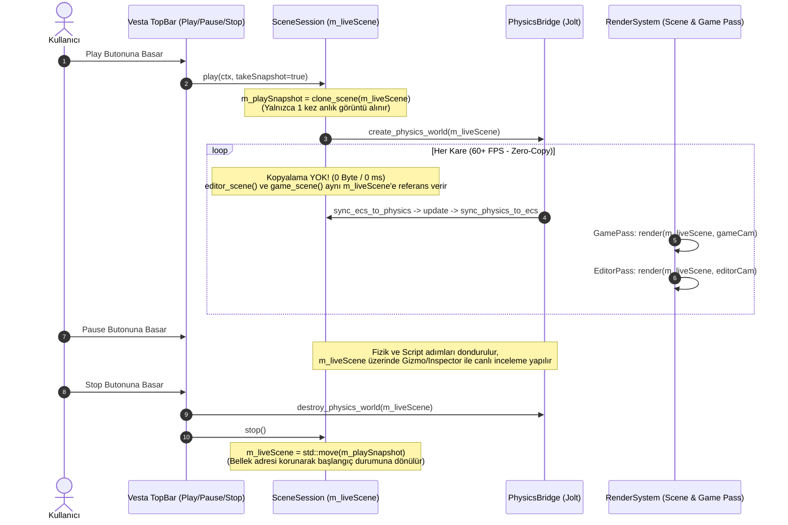

# Game ve Scene Senkronizasyonu Mimari Analiz ve Uygulama Raporu

**Tarih:** 16 Ekim 2026  
**Motor:** OpenGL-Learn-1 (Vesta Editor + Aria Engine)  
**Doküman Tipi:** Mimari Araştırma, Performans Analizi ve Uygulanan Çözüm Dokümantasyonu  

---

## 1. Yönetici Özeti (Executive Summary)

Motorumuzda editör modu ile oyun çalıştırma modu (**Play Mode**) arasındaki veri akışı incelenmiş; **Game View** ile **Scene View** arasındaki eski senkronizasyon mekanizmasının her kare (per-frame at 60Hz) tüm sahneyi ve ECS kayıt defterini sıfırdan tahsis ederek klonladığı (**Deep Cloning**) tespit edilmiştir. 

Bu eski yöntem:
1. Saniyede 60 kez yüzlerce bellek tahsisi (`malloc` / `new`) ve `delete` yaratarak aşırı CPU döngüsü harcamakta,
2. CPU önbelleklerini (L1/L2/L3 Cache) kirletmekte,
3. Bellek parçalanmasına (Memory Fragmentation) yol açmakta,
4. Sahne karmaşıklığı arttıkça (meshler, iskeletler, animasyon paletleri, malzemeler) kabul edilemez bir kare düşüşü (Frame-drop) yaratmakta ve
5. Play modunda Scene Viewport üzerinden yapılan gizmo/inspector değişikliklerini bir sonraki karede ezmekteydi.

Bu güncelleme kapsamında:
1. **Unity Tarzı Zero-Copy Single Live World + Snapshot Mimarisi** ([`scene_session.h`](file:///c:/Users/yusuf/source/repos/OpenGL-Learn-1/Engine/Scene/scene_session.h), [`scene_session.cpp`](file:///c:/Users/yusuf/source/repos/OpenGL-Learn-1/Engine/Scene/scene_session.cpp), [`runtime_layer.cpp`](file:///c:/Users/yusuf/source/repos/OpenGL-Learn-1/Engine/Runtime/runtime_layer.cpp), [`engine.cpp`](file:///c:/Users/yusuf/source/repos/OpenGL-Learn-1/Engine/Engine/engine.cpp)) başarıyla uygulanmış ve kare başına kopyalama maliyeti **0 Bayt / 0 ms** seviyesine indirilmiştir.
2. Üst kontrol çubuğuna (**Top Bar**) bağımsız **Play / Resume**, **Pause (Duraklat)** ve **Stop (Durdur)** butonları ile Play modunda sahne dosyasını koruyan güvenlik kilitleri ([`top_bar_view_model.h`](file:///c:/Users/yusuf/source/repos/OpenGL-Learn-1/Engine/Editor/Vesta/ViewModels/top_bar_view_model.h), [`top_bar_panel.cpp`](file:///c:/Users/yusuf/source/repos/OpenGL-Learn-1/Engine/Editor/Vesta/Panels/top_bar_panel.cpp)) eklenmiştir.
3. Sahne görünümü (**Scene Viewport**) üst araç çubuğuna **`Stats`** butonu ve tıklandığında açılan gerçek zamanlı **Performans & Render İstatistikleri (FPS, Frame Time Grafiği, Draw Calls, Üçgen Sayısı, Frustum Culling, Shader Batch ve ECS Telemetrisi)** penceresi ([`render_system.h`](file:///c:/Users/yusuf/source/repos/OpenGL-Learn-1/Engine/Systems/render_system.h), [`render_system.cpp`](file:///c:/Users/yusuf/source/repos/OpenGL-Learn-1/Engine/Systems/render_system.cpp), [`scene_gizmo_overlay.cpp`](file:///c:/Users/yusuf/source/repos/OpenGL-Learn-1/Engine/Editor/Vesta/Panels/scene_gizmo_overlay.cpp)) entegre edilmiştir.

---

## 2. Eski Mimari ve Sorunun Tespiti (Before Refactor)

### 2.1. Eski Kod Akışı
Motorun ana döngüsü (`Engine::update`) ve `runtime_layer::update` her kare çalıştığında şu çağrı gerçekleşmekteydi:

```cpp
// Eski Engine/Runtime/runtime_layer.cpp:
void runtime_layer::update(EngineContext& ctx, EditorContext& editorCtx)
{
    if (editorCtx.mode != EngineMode::PLAY) return;

    update_runtime_camera(ctx);
    physics_bridge::sync_ecs_to_physics(ctx, ctx.session.game_scene());
    ctx.physicsSystem.update(FIXED_DELTA_TIME);
    physics_bridge::sync_physics_to_ecs(ctx, ctx.session.game_scene());

    // KRİTİK DARBOĞAZ: Her kare tüm sahne editöre klonlanıyordu!
    ctx.session.sync_editor_from_runtime();
}
```

### 2.2. Neden Aşırı Maliyetliydi?
1. **Per-Frame Deep Copy:** Sahnedeki her bir nesne (`entity`), bileşenleri (`transform`, `mesh`, `light`, `collider`, `rigidbody`, `skeleton`, `animator` vb.) ile birlikte her karede derinlemesine kopyalanıyordu.
2. **Dinamik Bellek Tahsisleri:** İskelet sistemindeki `bone_transform` vektörleri, `global_pose` matris dizileri ve `skinning_palette` dizileri saniyede 60 kez `realloc`/`malloc` ediliyordu.
3. **Tek Yönlü Ezme (No Bidirectional Sync):** Kullanıcı Play modundayken Scene Viewport üzerinden bir nesneyi Transform Gizmosu ile taşırsa, yapılan değişiklik bir sonraki karede `sync_editor_from_runtime()` tarafından eziliyordu.

---

## 3. Uygulanan Yeni Mimari: Zero-Copy Single Live World + Snapshot



### 3.1. Mimari Tasarım Kararları ve Bellek Güvenliği
1. **Tek Canlı Dünya (`m_liveScene`):**
   - [`scene_session`](file:///c:/Users/yusuf/source/repos/OpenGL-Learn-1/Engine/Scene/scene_session.h) içerisinde `editor_scene()` ve `game_scene()` metotları artık her zaman aynı canlı `m_liveScene` referansını döndürür.
   - Bu sayede Play modunda hem **Game Viewport** hem **Scene Viewport** hem **Hierarchy** hem de **Inspector** sıfır kopyalama ile doğrudan canlı simülasyon verisini okur ve düzenleyebilir.
2. **Referans Kararlılığı (`&m_liveScene.get_registry()`):**
   - Vesta editör panelleri (`hierarchy_panel`, `inspector_view_model`, `editable_world_impl`) başlangıçta `registry&` referansı alır.
   - `m_liveScene` doğrudan `scene_session` üyesi olarak tutulduğundan ve `stop()` esnasında `m_liveScene = std::move(m_playSnapshot)` ile yerinde (in-place move assignment) geri yüklendiğinden, `m_liveScene.get_registry()` bellek adresi uygulama ömrü boyunca **asla değişmez** (dangling reference oluşmaz).
3. **Jolt Physics Yıkım Sırası ve Seçim Temizliği:**
   - [`engine.cpp`](file:///c:/Users/yusuf/source/repos/OpenGL-Learn-1/Engine/Engine/engine.cpp) içerisindeki `handle_mode_transition` fonksiyonunda, Stop'a basıldığında önce `physics_bridge::destroy_physics_world(ctx, ctx.session.game_scene())` çağrılarak canlı sahnedeki Jolt `BodyID`'leri temizlenir; hemen ardından `ctx.session.stop()` ile sahne Play öncesi durumuna geri döndürülür.
   - Oyun esnasında dinamik olarak oluşturulmuş (`spawn`) ve Stop sonrasında artık var olmayan varlıklar `editor_selection_manager` içerisinden otomatik olarak temizlenir.
4. **Tekil Işık Önbelleği Güncellemesi:**
   - Eski yapıda her kare hem `game_scene().update_light_batch()` hem de `editor_scene().update_light_batch()` çağrılıyordu. Yeni mimaride iki sahne aynı olduğundan bu işlem kare başına yalnızca **1 kez** çalıştırılır.

---

## 4. Play / Pause / Stop Kontrol Sistemi

[`top_bar_view_model.h`](file:///c:/Users/yusuf/source/repos/OpenGL-Learn-1/Engine/Editor/Vesta/ViewModels/top_bar_view_model.h) ve [`top_bar_panel.cpp`](file:///c:/Users/yusuf/source/repos/OpenGL-Learn-1/Engine/Editor/Vesta/Panels/top_bar_panel.cpp) güncellenerek profesyonel oyun motoru simülasyon kontrolleri eklenmiştir:

| Buton | Durum & İşlev | Görsel Geri Bildirim |
| :--- | :--- | :--- |
| **`Play` / `Resume`** | Editör modundayken simülasyonu başlatır; `Paused` durumundayken simülasyonu kaldığı yerden devam ettirir. | Aktif oynatma sırasında yeşil vurgu (`Mode: PLAYING`). |
| **`Pause`** | Simülasyon çalışırken fizik adımlarını, scriptleri ve animasyon zamanlayıcısını dondurur. Kullanıcı sahneyi inceleyebilir veya nesneleri taşıyabilir. | Duraklatıldığında kehribar/turuncu vurgu (`Mode: PAUSED`). |
| **`Stop`** | Simülasyonu sonlandırır, fizik dünyasını temizler ve sahneyi Play öncesi alınan `m_playSnapshot` yedeğine geri döndürür. | Simülasyon aktifken kırmızı vurgu (`Mode: EDITOR`). |
| **`Save / Load Scene`** | Play veya Pause modundayken sahne dosyasının üzerine yanlışlıkla çalışma zamanı durumunun yazılmasını önlemek için otomatik devre dışı (`Disabled`) bırakılır. | Üzerine gelindiğinde bilgilendirici İngilizce ipucu (`Tooltip`). |

---

## 5. Scene Viewport Performans ve Render İstatistikleri (`Stats` Overlay)

Sahne görünümü üst araç çubuğuna eklenen **`Stats`** butonu ([`scene_gizmo_overlay.cpp`](file:///c:/Users/yusuf/source/repos/OpenGL-Learn-1/Engine/Editor/Vesta/Panels/scene_gizmo_overlay.cpp)) ve [`render_system`](file:///c:/Users/yusuf/source/repos/OpenGL-Learn-1/Engine/Systems/render_system.h) telemetri altyapısı ile sahnenin sağ üst köşesinde açılıp kapanabilen şık bir optimizasyon paneli sunulmuştur:

- **Zamanlama ve Kararlılık:**
  - Yumuşatılmış (EMA) **FPS** ve **Kare Süresi (`ms`)** (Performansa göre Yeşil / Sarı / Kırmızı renk kodlu).
  - Son 90 karenin süresini gösteren canlı **Frame Time Sparkline Grafiği** (`Min` ve `Max` ms değerleriyle).
- **GPU Render Boru Hattı (Scene Pass):**
  - **Draw Calls:** Toplam `glDrawElements` çağrısı (`Main Pass` ve `Shadow Pass` kırılımıyla).
  - **Triangles:** Çizilen gerçek üçgen sayısı ([`MeshRenderer::Draw`](file:///c:/Users/yusuf/source/repos/OpenGL-Learn-1/Engine/Renderer/MeshRenderer.cpp) üzerinden indeks sayısından hesaplanır).
  - **Shader Batches:** Durum değişimini minimize eden aktif GPU shader grubu sayısı.
  - **Frustum Culling:** Görüş alanında kalan (`vis`) ve kırpılarak GPU'ya gönderilmeyen (`culled`) alt ağ (submesh) sayıları.
- **Dünya ve ECS Telemetrisi:**
  - Aktif `Entity` sayısı, `Static Mesh` ve `Skinned Mesh` bileşen sayıları.
  - Aktif GPU Işık sayısı (`Active Lights / 64`) ve Gölge Haritası (`Shadows ON / No Shadows`) durumu.
  - Fizik gövdesi (`Rigidbody`) sayısı, simülasyon modu (`Editor` / `Playing (Zero-Copy)` / `Paused (Zero-Copy)`) ve anlık Viewport çözünürlüğü.

- **Zamanlama ve Kararlılık:**
  - Yumuşatılmış (EMA) **FPS** ve **Kare Süresi (`ms`)** (Performansa göre Yeşil / Sarı / Kırmızı renk kodlu).
  - Son 90 karenin süresini gösteren canlı **Frame Time Sparkline Grafiği** (`Min` ve `Max` ms değerleriyle).
- **GPU Render Boru Hattı (Scene Pass):**
  - **Draw Calls:** Toplam `glDrawElements` çağrısı (`Main Pass` ve `Shadow Pass` kırılımıyla).
  - **Triangles:** Çizilen gerçek üçgen sayısı ([`MeshRenderer::Draw`](file:///c:/Users/yusuf/source/repos/OpenGL-Learn-1/Engine/Renderer/MeshRenderer.cpp) üzerinden indeks sayısından hesaplanır).
  - **Shader Batches:** Durum değişimini minimize eden aktif GPU shader grubu sayısı.
  - **Frustum Culling:** Görüş alanında kalan (`vis`) ve kırpılarak GPU'ya gönderilmeyen (`culled`) alt ağ (submesh) sayıları.
- **Dünya ve ECS Telemetrisi:**
  - Aktif `Entity` sayısı, `Static Mesh` ve `Skinned Mesh` bileşen sayıları.
  - Aktif GPU Işık sayısı (`Active Lights / 64`) ve Gölge Haritası (`Shadows ON / No Shadows`) durumu.
  - Fizik gövdesi (`Rigidbody`) sayısı, simülasyon modu (`Editor` / `Playing (Zero-Copy)` / `Paused (Zero-Copy)`) ve anlık Viewport çözünürlüğü.

