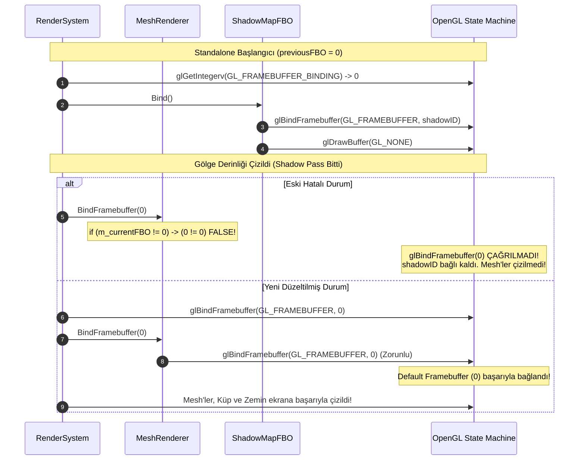

# Standalone Build Rendering ve Input Post-Mortem Raporu

**Tarih:** 17 Ekim 2026  
**Kapsam:** Standalone Build (`GameRuntime.exe` / `Test-3.exe`), OpenGL Framebuffer State Yönetimi, GLFW Pencere Modları ve Input Kilitleme Mimarisi  
**Hedef Kitle:** Motor Geliştiricileri, Grafik Programcıları, Oyun Mimarları

---

## 1. Yönetici Özeti (Executive Summary)

Motorun editörden bağımsız, standalone çalıştırılabilir paket çıktısı (`Export / Standalone Build`) alma sürecinde üç kritik semptom ortaya çıkmıştır:
1. **Görünmeyen Mesh'ler (Silent Rendering Drop):** Sahneye yerleştirilen tüm mesh'ler (plane, oyuncu küpü, içe aktarılan 3D modeller) Editör Viewport'unda sorunsuz çizilirken, standalone build'de (`Test-3.exe`) ekran tamamen boş kalıyor ve hiçbir mesh çizilmiyordu.
2. **Kilitlenen Fare ve Odak Kaybı (Input Trap):** Oyunda `ESC` tuşuna basıldığında fare imleci serbest kalıyor, ancak sahneye veya pencereye tekrar tıklansa dahi fare asla yeniden kilitlenemiyor ve kamera kontrolleri tamamen devre dışı kalıyordu.
3. **Pencere Modu Uyumsuzluğu (Window Mode Bug):** `boot.config` üzerinde `fullscreen=1` olarak ayarlanmış olmasına rağmen oyun tam ekran başlamıyordu.

Bu rapor; hataların kök nedenlerini, grafik sürücüsü ve OpenGL durum makinesi (State Machine) seviyesindeki davranışlarını, uygulanan kesin çözümleri ve gelecekte benzer mimari hataların önlenmesi için gereken en iyi pratikleri (Best Practices) açıklamaktadır.

---

## 2. Derinlemesine Hata Analizi ve Kök Nedenler (Root Causes)

### Hata 1: OpenGL Framebuffer State Caching Tuzağı (Mesh'lerin Çizilmemesi)

#### Arka Plan
Oyun motorumuzda gölge haritalama (Shadow Mapping) iki adımlı (two-pass) bir süreçtir:
1. **Shadow Pass (Gölge Geçişi):** Işık perspektifinden sahne derinliği hesaplanır. Bu aşamada `shadow_map_fbo` (özel bir FBO) bağlanır ve renk tamponu kapatılır (`glDrawBuffer(GL_NONE)`).
2. **Main Pass (Ana Çizim Geçişi):** Sahne kamerası perspektifinden asıl renk ve gölgelendirme çizilir. Çizim hedefi, önceki aktif Framebuffer'a geri alınmalıdır.

#### Kök Neden
[`render_system.cpp`](../Engine/Systems/render_system.cpp) içinde kod şu akışa sahipti:

```cpp
// 1. Gölge haritası çizilmeden önce o anki aktif FBO kaydedilir
GLint previousFBO = 0;
glGetIntegerv(GL_FRAMEBUFFER_BINDING, &previousFBO);

// 2. Gölge FBO'su bağlanır ve derinlik çizilir
ctx.shadowFBO.Bind();
// ... shadow rendering ...

// 3. Gölge geçişi bittiğinde önceki FBO'ya geri dönülür
ctx.renderer.BindFramebuffer(previousFBO);
```

[`MeshRenderer.cpp`](../Engine/Renderer/MeshRenderer.cpp) içindeki `BindFramebuffer` fonksiyonunda ise gereksiz bir "State Caching" (durum önbellekleme) optimizasyonu mevcuttu:

```cpp
void MeshRenderer::BindFramebuffer(unsigned int fboID) {
    if (m_currentFBO != fboID) {
        glBindFramebuffer(GL_FRAMEBUFFER, fboID);
        m_currentFBO = fboID;
    }
}
```

#### Neden Editörde Çalıştı da Standalone'da Patladı?
Bu durum, grafik programlamada **"Editor vs. Standalone Framebuffer Discrepancy"** olarak bilinen tipik bir durum uyumsuzluğudur:

* **Editör Modunda:**
  Editör kendi Dear ImGui / Vesta arayüzü içine sahneyi gömmek için bir `render_target` (örneğin ID'si `3` olan bir off-screen FBO) kullanır. Gölge pass başlamadan önce `glGetIntegerv(GL_FRAMEBUFFER_BINDING, &previousFBO)` çağrıldığında `previousFBO = 3` döner. Gölge bittiğinde `BindFramebuffer(3)` çağrılır. `m_currentFBO` değeri `0` olduğundan `0 != 3` koşulu **doğru** (`true`) çıkar ve `glBindFramebuffer(GL_FRAMEBUFFER, 3)` başarıyla çalıştırılır. Mesh'ler çizilir!

* **Standalone (Runtime) Modunda:**
  Standalone oyunda ImGui veya ara bir FBO yoktur; doğrudan işletim sistemi penceresinin varsayılan ekran tamponuna (`Default Backbuffer`, ID = `0`) çizim yapılır.
  1. Başlangıçta `m_currentFBO = 0` dır.
  2. Gölge öncesi `previousFBO = 0` olarak okunur.
  3. `ctx.shadowFBO.Bind()` doğrudan OpenGL API'sini çağırarak `glBindFramebuffer(GL_FRAMEBUFFER, shadowFboId)` yapar. Ancak bu çağrı `MeshRenderer` üzerinden geçmediği için `m_currentFBO` hâlâ `0` kalır!
  4. Gölge geçişi biter ve `ctx.renderer.BindFramebuffer(previousFBO)` (`previousFBO = 0`) çağrılır.
  5. `MeshRenderer::BindFramebuffer` fonksiyonu şu kontrolü yapar:
     $$\text{if } (m\_currentFBO \neq fboID) \implies \text{if } (0 \neq 0) \implies \mathbf{FALSE}!$$
  6. **Sonuç:** `glBindFramebuffer(GL_FRAMEBUFFER, 0)` **asla çağrılmaz!**
  7. OpenGL durum makinesinde `shadowFBO` bağlı kalmaya devam eder. Üstelik gölge FBO'sunda `glDrawBuffer(GL_NONE)` açık olduğundan, motorun sonraki tüm `glDrawElements` çağrıları (zemin, oyuncu küpü, ev modelleri) boşluğa çizilip çöpe atılır. Ekrana tek bir piksel bile düşmez!

---

### Hata 2: ESC Tuşu ve Input Trap Mantığı (Fare Kontrolünün Kaybolması)

#### Kök Neden
[`camera_controller.cpp`](../Test-3/Assets/Scripts/camera_controller.cpp) içerisinde şu kod yer alıyordu:

```cpp
if (gameplay::input::is_key_just_pressed(256)) { // 256 = GLFW_KEY_ESCAPE
    m_isLocked = !m_isLocked;
    gameplay::input::set_cursor_mode(m_isLocked);
}
```

* **Editörde:** Editör sahnesinde `ESC` basıp fareyi serbest bıraktığınızda, Vesta viewport paneline farenin sol tuşuyla tekrar tıkladığınızda editör viewport'u `set_cursor_mode(true)` yaparak odağı geri alabiliyordu.
* **Standalone'da:** Standalone oyunda editör GUI'si yoktur. Kullanıcı `ESC` tuşuna bastığında `m_isLocked = false` oluyor ve fare imleci serbest kalıyordu. Ancak standalone motorda pencereye tıklandığında imleci tekrar `GLFW_CURSOR_DISABLED` yapacak hiçbir küresel dinleyici (listener/callback) bulunmuyordu. Kullanıcı pencereye defalarca tıklasa dahi fare serbest kalıyor, `mouse_delta` sıfırlanıyor ve kamera bir daha döndürülemiyordu.

---

### Hata 3: Boot Konfigürasyonunun Pencere Sistemine Yansıtılmaması

#### Kök Neden
Standalone çalıştırıcı [`game_runtime.cpp`](../Engine/Runtime/game_runtime.cpp), başlatılırken `boot.config` dosyasını `boot_config::load()` ile okuyordu. `cfg.fullscreen` değeri belleğe alınıyordu; ancak GLFW penceresi oluşturulurken veya oluşturulduktan sonra `cfg.fullscreen` bayrağı kontrol edilip `glfwSetWindowMonitor` fonksiyonuna iletilmiyordu. Bu nedenle motor sürekli pencere modunda (`windowed`) açılıyordu.

---

## 3. Uygulanan Mimari Çözümler (Solutions Implemented)

### Çözüm 1: Güvenilir Framebuffer Durum Yönetimi (State Statelessness)

OpenGL sürücüsü zaten dahili olarak `glBindFramebuffer` çağrısının gereksiz olup olmadığını donanım seviyesinde filtreler (driver-level caching). Birden fazla alt sistemin (`shadow_map_fbo`, `render_target`, `MeshRenderer`) bağımsız GL çağrısı yaptığı bir motorda sınıf seviyesinde FBO önbelleklemek tehlikelidir.

1. [`MeshRenderer.cpp`](file:///c:/Users/yusuf/source/repos/OpenGL-Learn-1/Engine/Renderer/MeshRenderer.cpp#L151-L157) içindeki yanıltıcı `m_currentFBO != fboID` kontrolü kaldırılarak doğrudan OpenGL bağlama çağrısı yapıldı:
   ```cpp
   void MeshRenderer::BindFramebuffer(unsigned int fboID) {
       glBindFramebuffer(GL_FRAMEBUFFER, fboID);
       m_currentFBO = fboID;
   }
   ```
2. [`render_system.cpp`](file:///c:/Users/yusuf/source/repos/OpenGL-Learn-1/Engine/Systems/render_system.cpp#L170-L178) içinde gölge geçişi bitiminde açıkça ve doğrudan donanım bağlamı geri yüklendi:
   ```cpp
   // Shadow pass tamamlandı, ana hedefi garanti olarak bağla
   glBindFramebuffer(GL_FRAMEBUFFER, previousFBO);
   ctx.renderer.BindFramebuffer(previousFBO);
   ```

### Çözüm 2: Editör/Oyun Ayrımı ve Standalone Auto-Focus Sistemi

Kamera kontrolü ve imleç yönetimi iki katmanlı olarak yeniden yapılandırıldı:

1. **Çalışma Zamanı Tespiti (Runtime Awareness):**
   [`gameplay_context.h`](file:///c:/Users/yusuf/source/repos/OpenGL-Learn-1/Engine/Gameplay/gameplay_context.h) ve `gameplay_context.cpp` içerisine `is_editor_build()` API'si eklendi.
   ```cpp
   bool context::is_editor_build() {
   #if defined(STANDALONE_BUILD) || defined(GAME_RUNTIME)
       return false;
   #else
       return true;
   #endif
   }
   ```
2. **Kamera Script Koruması:**
   `camera_controller.cpp` içerisinde `ESC` tuşuyla serbest kalma davranışı yalnızca editör moduna bağlandı:
   ```cpp
   if (gameplay::context::is_editor_build() && gameplay::input::is_key_just_pressed(256)) {
       m_isLocked = !m_isLocked;
       gameplay::input::set_cursor_mode(m_isLocked);
   }
   ```
3. **Pencere İçi Tıklama ile Otomatik Yeniden Kilitleme:**
   [`input_system.cpp`](file:///c:/Users/yusuf/source/repos/OpenGL-Learn-1/Engine/Input/input_system.cpp#L23-L33) içerisine standalone mod için küresel bir odak kurtarma mekanizması yerleştirildi. Kullanıcı oyundan çıksa (Alt+Tab) veya imleç serbest kalsa bile pencereye sol veya sağ tıklandığı an imleç tekrar kilitlenir:
   ```cpp
   #if defined(STANDALONE_BUILD) || defined(GAME_RUNTIME)
   if (action == GLFW_PRESS && (button == GLFW_MOUSE_BUTTON_LEFT || button == GLFW_MOUSE_BUTTON_RIGHT)) {
       if (glfwGetInputMode(window, GLFW_CURSOR) != GLFW_CURSOR_DISABLED) {
           glfwSetInputMode(window, GLFW_CURSOR, GLFW_CURSOR_DISABLED);
       }
   }
   #endif
   ```

### Çözüm 3: Doğal Çözünürlüklü Tam Ekran (Exclusive/Borderless Fullscreen)

[`game_runtime.cpp`](file:///c:/Users/yusuf/source/repos/OpenGL-Learn-1/Engine/Runtime/game_runtime.cpp#L85-L101) içerisine `boot.config` parametrelerine göre GLFW monitör ayarlama desteği getirildi:

```cpp
if (cfg.fullscreen) {
    GLFWmonitor* primaryMonitor = glfwGetPrimaryMonitor();
    if (primaryMonitor) {
        const GLFWvidmode* mode = glfwGetVideoMode(primaryMonitor);
        if (mode) {
            glfwSetWindowMonitor(ctx.window, primaryMonitor, 0, 0, mode->width, mode->height, mode->refreshRate);
        }
    }
}
glfwSwapInterval(cfg.vsync ? 1 : 0);
```

---

## 4. Akış Şeması: Gölge Geçişi ve Framebuffer Yaşam Döngüsü



---

## 5. Öğretici Notlar ve Best Practices (Gelecek İçin Çıkarımlar)

1. **OpenGL Durum Değişkenlerini (State Variables) Elle Önbelleğe Almayın (Avoid Redundant State Caching):**
   * OpenGL sürücüleri (Nvidia, AMD, Intel) `glBindFramebuffer`, `glUseProgram` ve `glBindTexture` gibi çağrılarda gereksiz durum değişimlerini zaten optimize eder.
   * C++ seviyesinde tutulan `m_currentFBO` gibi değişkenler; harici FBO'lar (ImGui, ShadowMap, Post-Processing) doğrudan OpenGL çağırdığında kolayca senkronizasyonunu yitirir ve "hayalet bug"lara (ghost bugs) yol açar.
2. **Kritik Geçiş Noktalarında (Pass Boundaries) Durumu Eksiksiz Temizleyin:**
   * Bir render pass'ten çıkarken sadece FBO değil, değiştirilen `glViewport`, `glCullFace`, `glDepthMask`, `glDrawBuffer` durumlarının da orijinal veya beklenen varsayılan haline geri döndürüldüğünden emin olunmalıdır.
3. **Editör ve Standalone Arasındaki Framebuffer 0 Farkını Unutmayın:**
   * Editör daima bir Custom FBO'ya (`> 0`) çizer.
   * Standalone doğrudan varsayılan Framebuffer'a (`0`) çizer.
   * Bu sebeple `0` değerini hiçbir zaman "geçersiz" veya "boş" bir ID olarak şartlara bağlamayın (`0` OpenGL için en önemli Framebuffer'dır: ekranın kendisidir).
4. **Input Odak Tasarımında Editör ve Oyun Ayrımı:**
   * Oyun motoru geliştirirken `ESC` tuşu gibi global tuşların davranışı editör çalışma zamanı ile son kullanıcı oyunu arasında daima izole edilmelidir (`is_editor_build()`).
   * Standalone oyunlarda fare imleci serbest kalsa bile kullanıcı pencereye tıkladığı anda odağı geri kazandıran emniyet ağları (fallback autofocus) bulunmalıdır.

